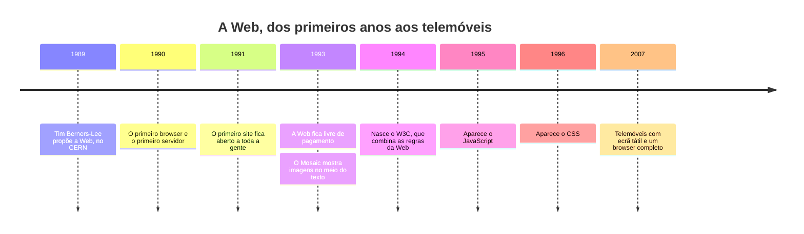
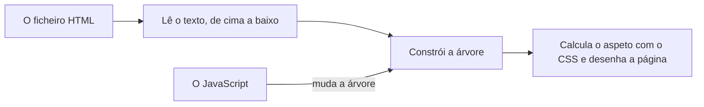
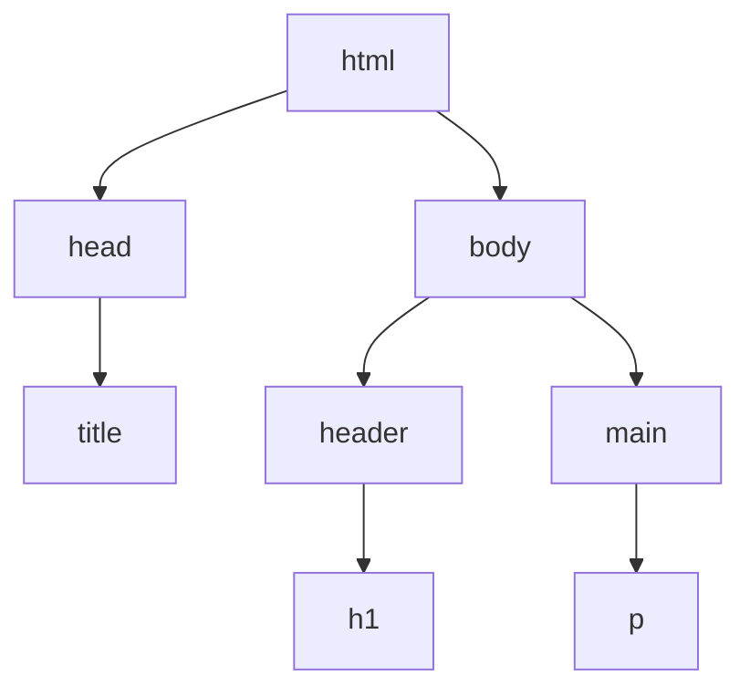
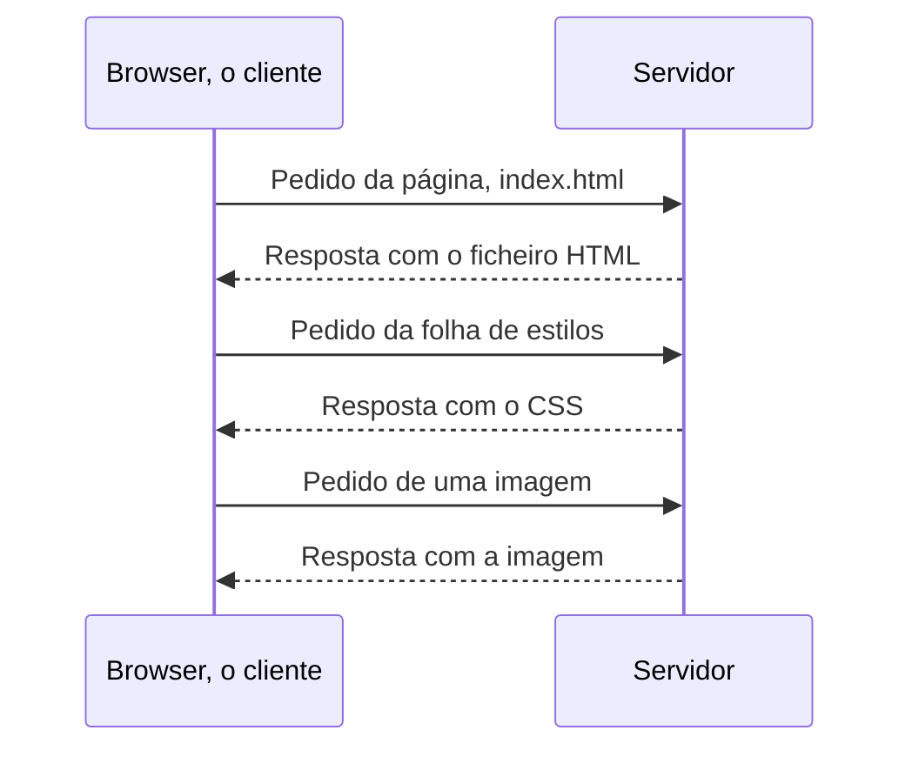
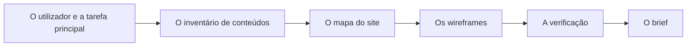
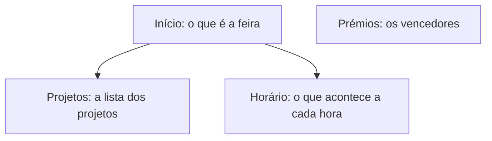
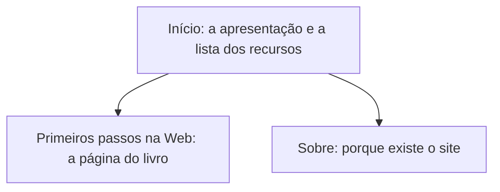

# A Web, os utilizadores e o planeamento

Neste guia vês o que acontece entre escreveres um endereço e veres uma página. Vês o trabalho do HTML, do CSS e do JavaScript, o que o browser faz com eles e como conversa com o servidor. Depois aprendes a planear um site antes de o escrever, com o mapa do site e os wireframes. O exemplo é a Estante Digital, o site de recursos de estudo das aulas.

É o primeiro guia da disciplina, e não precisas de rever nada. Para praticar: [laboratório](laboratorios/01-web-e-planeamento-laboratorio.md) e [ficha de exercícios](exercicios/01-web-e-planeamento-exercicios.md).

## Neste guia

1. [Parte 1: Como uma página chega ao teu ecrã](#parte-1-como-uma-página-chega-ao-teu-ecrã)
2. [Parte 2: Planear um site antes de o escrever](#parte-2-planear-um-site-antes-de-o-escrever)
3. [Exemplo guiado: o plano da Estante Digital](#exemplo-guiado-o-plano-da-estante-digital)

## Parte 1: Como uma página chega ao teu ecrã

### A Internet e a Web não são a mesma coisa

Há quem diga que o correio eletrónico ou uma videochamada "são a Web". Não são: usam a Internet, mas não são a Web.

A **Internet** é a rede que liga computadores do mundo inteiro. É feita de coisas físicas: cabos, antenas, routers, satélites, cabos no fundo do mar. Só transporta dados de um computador para outro, sem saber se são páginas, mensagens ou vídeos.

A **Web** (de *World Wide Web*, teia do tamanho do mundo) é um dos serviços que usam a Internet. É o conjunto de páginas ligadas umas às outras, que se abrem num browser, como o Chrome. O correio eletrónico, as videochamadas e os jogos em rede são outros serviços, que usam a mesma Internet sem serem a Web.

A Internet é como a rede de estradas de um país: liga todas as terras, mas não transporta nada sozinha. A Web é uma empresa de autocarros que usa essas estradas, e o correio é outra empresa, que as usa para outro fim. Se as estradas fecharem, nenhuma das empresas funciona. Mas as estradas não são nenhuma delas.

### Uma história curta da Web

Em 1989, Tim Berners-Lee era investigador no CERN, um laboratório europeu de física. Propôs uma forma de partilhar documentos entre computadores, com ligações de uns para os outros. Para a pôr a funcionar, inventou três coisas que ainda hoje se usam. O HTML é a linguagem em que se escrevem os documentos. O HTTP são as regras para um computador pedir um documento a outro. E o URL é o endereço de cada documento.



A linha do tempo mostra o que veio a seguir. Em 1991, o primeiro site ficou aberto a toda a gente, e em 1993 a Web ficou livre de pagamento. Nesse ano, o Mosaic, um dos primeiros browsers fáceis de usar, mostrava imagens no meio do texto. Em 1994 nasceu o W3C, em 1995 o JavaScript e em 1996 o CSS. Desde 2007, com os telemóveis de ecrã tátil, as páginas têm de funcionar em ecrãs pequenos e grandes.

Uma cópia do primeiro site, de 1992, ainda se visita em `info.cern.ch`. Com o W3C, os browsers passaram a seguir as mesmas regras, e por isso uma página bem escrita funciona em todos. Os browsers de hoje continuam a mostrar páginas de há trinta anos, e por isso aceitam muita coisa escrita com regras antigas.

<details>
<summary>Para ires mais longe: o HTML5</summary>

Hoje o HTML já não tem versões numeradas. É um padrão vivo, que vai sendo atualizado aos poucos. HTML5 é o nome que ficou para o HTML moderno, e vais encontrá-lo em muitos sítios.

</details>

### Três linguagens, três trabalhos

Pensa num botão "Gostar", com um contador ao lado, que sobe cada vez que carregas. Há três coisas a decidir: o que existe na página, como se apresenta e o que acontece quando carregas. Numa página web, cada decisão é de uma linguagem.

O **HTML** diz o que cada pedaço do conteúdo é: um título, um parágrafo, uma lista, uma imagem, uma ligação para outra página. É a estrutura.

O **CSS** diz como cada pedaço se apresenta: a cor, a letra, os espaços e o lugar de cada coisa no ecrã. É o aspeto.

O **JavaScript** diz como a página se comporta quando carregas num botão, escreves num campo ou escolhes uma opção. É o comportamento.

Os três trabalhos separam-se porque cada um muda por razões diferentes. Um site pode mudar de cores sem tocar no conteúdo. E uma pessoa cega, que ouve a página lida por um programa, recebe o conteúdo e a estrutura do HTML sem precisar do aspeto.

Vê o botão "Gostar" feito com as três. Não precisas de perceber o código: olha só para o que cada parte faz. Antes de leres o resultado, prevê: depois de três cliques, o que aparece, e qual das três partes faz o número mudar?

```html
<!-- HTML: diz que isto é um botão, com o texto "Gostar", e um parágrafo com o contador. -->
<button id="gostar">Gostar</button>
<p id="contador">Gostos: 0</p>
```

```css
/* CSS: diz que o botão tem fundo azul, letra branca e cantos redondos. */
#gostar {
  background: #1f4e8c;
  color: white;
  border-radius: 8px;
}
```

```js
// JavaScript: diz que, quando se carrega no botão, o contador aumenta um.
let total = 0;
// O que está entre chavetas corre uma vez por cada clique no botão.
document.querySelector("#gostar").addEventListener("click", function () {
  total = total + 1;
  document.querySelector("#contador").textContent = "Gostos: " + total;
});
```

O resultado é um botão azul, com "Gostar" a branco e os cantos redondos, e por baixo `Gostos: 0`. Depois de três cliques, aparece `Gostos: 3`. Quem faz o número mudar é o JavaScript. O HTML só disse que havia um botão e um parágrafo, e o CSS só disse como o botão se apresenta.

### O browser é o ambiente de execução da Web

Para correr um programa escrito em muitas linguagens, é preciso instalar primeiro, no computador, um programa próprio para essa linguagem. Uma página web também precisa de um programa para funcionar, mas esse programa já vem em qualquer computador e em qualquer telemóvel: é o browser.

O **browser** (em português também se diz navegador) é o programa que pede as páginas, lê os ficheiros e desenha a página no ecrã. O Chrome, o Edge, o Firefox e o Safari são browsers. Como é no browser que as páginas funcionam, diz-se que ele é o **ambiente de execução** da Web. Para começar a fazer páginas, chegam um editor de texto e um browser.

<details>
<summary>Para ires mais longe: browsers diferentes</summary>

O Chrome e o Edge usam o mesmo motor para desenhar as páginas, e o Firefox e o Safari usam motores diferentes. Mesmo com as regras combinadas, há sempre pequenas diferenças entre eles. Por isso, quem faz páginas testa-as em mais do que um browser.

</details>

### O browser constrói uma árvore, o DOM

Um ficheiro HTML é só texto. Para desenhar a página, o browser tem de saber o que está dentro de quê. Tem de saber, por exemplo, que o título está no cabeçalho. Por isso, faz isto com o ficheiro:



O browser lê o ficheiro de cima a baixo e constrói uma árvore, com um ramo para cada parte da página. A árvore só existe enquanto a página está aberta, e não fica guardada no disco. Depois, o browser calcula o aspeto de cada ramo, a partir do CSS, e desenha a página. O JavaScript pode mudar a árvore, e o browser volta a desenhar o que mudou.

A essa árvore chama-se **DOM**. Cada ramo é um **elemento**: o título, cada parágrafo, cada ligação.

Vê o ficheiro de uma página pequena e a árvore que o browser constrói a partir dele:

```html
<!doctype html>
<html lang="pt-PT">
  <head>
    <title>Estante Digital</title>
  </head>
  <body>
    <header>
      <h1>Estante Digital</h1>
    </header>
    <main>
      <p>Recursos de estudo recomendados pela turma.</p>
    </main>
  </body>
</html>
```



Cada caixa do diagrama é um elemento do DOM, e cada linha liga um elemento ao que ele tem lá dentro. O `title` está dentro do `head`, e o `p` está dentro do `main`, que está dentro do `body`.

### O esqueleto de uma página

As páginas de hoje começam todas pelo mesmo esqueleto, que é o da página pequena de cima. Vais encontrar os nomes das suas partes no topo da árvore de qualquer página.

A primeira linha, o `<!doctype html>`, diz ao browser que a página segue as regras modernas do HTML. Não é um elemento da página, e por isso não está no diagrama.

O `html` embrulha tudo, e o `lang="pt-PT"` diz que a página está em português de Portugal. Lá dentro há duas partes. O `head` é a cabeça da página: não aparece no meio dela e guarda o `title`, o título que se vê no separador. O `body` é o corpo, com tudo o que se vê.

Dentro do `body`, o `header` é o cabeçalho do topo e o `main` é o conteúdo principal. O `h1` é o título principal, e o `p` é um parágrafo.

Repara que o `head` e o `header` são coisas diferentes, apesar do nome parecido. O `head` não aparece na página, e o `header` aparece no topo dela.

### As ferramentas do programador

Para veres a árvore do DOM, o browser tem umas ferramentas escondidas, para quem faz páginas. São as **ferramentas do programador** (em inglês, *developer tools*). Abrem-se com a tecla F12, ou com Ctrl+Shift+I no Windows e Cmd+Option+I no Mac. Também se abrem com o botão direito do rato num ponto da página, escolhendo Inspecionar.

As ferramentas estão arrumadas em separadores. O separador Elements (em português, Elementos) mostra o DOM. Quando passas o rato por um ramo da árvore, a parte da página que ele desenha fica pintada.

### Mudar o DOM não muda o ficheiro

Depois de três cliques no botão "Gostar", a página diz `Gostos: 3`. O ficheiro, no disco, continua a dizer `Gostos: 0`.

O ficheiro é o texto guardado no disco, que se escreveu no editor. O DOM é a árvore que o browser construiu a partir desse texto, e é a partir dele que a página se desenha. Quando o JavaScript muda o DOM, a página muda, mas o ficheiro fica igual. Tu também podes mudar o DOM, no separador Elements, e o ficheiro também não muda.

Pensa numa receita e num bolo. A receita é o ficheiro: fica escrita no livro. O bolo é o DOM: faz-se a partir da receita e, depois de feito, pode ser decorado sem que a receita mude.

Quando recarregas a página, o browser deita fora a árvore e constrói outra a partir do ficheiro. O que tinha mudado no DOM desaparece. Por isso, depois de recarregares, o contador volta a `Gostos: 0`, e um título que mudaste no separador Elements volta ao que estava. Não estragas nada: o que mudas no DOM fica só na tua cópia da página.

### O browser acrescenta o que falta no ficheiro

A cópia de 1992 do primeiro site da Web não tem o `html` nem o `head` que as páginas de hoje têm. Mesmo assim, o browser de hoje mostra-a.

Quando um ficheiro não segue as regras de hoje, o browser não desiste: constrói a árvore pelas regras de hoje e acrescenta o que falta. Se o ficheiro não tem `html` nem `head`, o DOM tem-nos na mesma. O browser também corrige, à sua maneira e sem avisar, o que encontra mal escrito.

Assim, o DOM pode ser diferente do ficheiro mesmo sem JavaScript. Para ver a página como o browser a entendeu, olha-se para a árvore, no separador Elements, e não para o ficheiro.

### Cliente e servidor

Quando abres uma página na Internet, há dois computadores a conversar. O teu browser é o **cliente**: é quem pede. Do outro lado está um **servidor**: um computador sempre ligado, que guarda os ficheiros do site e os envia a quem os pede.

A conversa é parecida com a de um restaurante. O cliente faz um pedido à cozinha, e a cozinha manda a resposta: o prato, ou a notícia de que esse prato não existe. O cliente não entra na cozinha nem sabe como o prato foi feito. Só faz pedidos e recebe respostas.

### Uma página de hoje faz muitos pedidos

Uma página raramente chega com um só pedido. O browser pede primeiro o ficheiro HTML. Ao lê-lo, descobre que a página precisa também de imagens, de JavaScript e de uma **folha de estilos**, o ficheiro com o CSS. Faz um pedido novo para cada um.



O browser pede o HTML e, à medida que o lê, pede a folha de estilos e a imagem. Cada ficheiro é um pedido e uma resposta. Uma página de um site grande pode fazer dezenas de pedidos.

### O endereço de uma página

Para chegares a uma casa, precisas da morada. Para chegares a uma página, precisas do endereço dela, a que se chama **URL**. O URL diz onde está uma página, uma imagem ou outro ficheiro que se peça a um servidor. Vê este endereço, partido nas suas partes:

```text
https://www.example.com/cursos/informatica.html
```

| Parte | Neste endereço | O que quer dizer |
| --- | --- | --- |
| Protocolo | `https` | As regras da conversa entre o browser e o servidor. O `s` quer dizer segura: a conversa vai cifrada, e quem estiver pelo meio não a consegue ler |
| Domínio | `www.example.com` | O nome do servidor, como o nome da rua e da terra numa morada |
| Caminho | `/cursos/informatica.html` | A pasta e o ficheiro dentro do servidor, como o número da porta e o andar |

O protocolo acaba em `://`. O domínio vai daí até à barra seguinte, e o caminho é o resto.

<details>
<summary>Para ires mais longe: mais partes de um endereço, e o que o https não garante</summary>

Depois de um ponto de interrogação vêm parâmetros, como em `?pesquisa=html`, que passam informação ao servidor, por exemplo o que escreveste numa caixa de pesquisa. Depois de um cardinal vem um fragmento, como em `#horario`, que indica uma parte da própria página. O browser salta para essa parte.

Um endereço só com `http`, sem o `s`, não vai cifrado, e o browser avisa com "Não seguro" na barra de endereço. Nunca escrevas uma palavra-passe numa página com esse aviso. Mas o `s` só garante que a conversa vai cifrada: um site falso também pode usar `https`.

O domínio `example.com` está reservado para exemplos, e ninguém o pode registar para um site verdadeiro.

</details>

### Uma página do teu disco não vem de um servidor

Nos primeiros temas, abres as tuas páginas a partir do disco do teu computador. Aí não há servidor nenhum: o browser lê o ficheiro diretamente, sem pedir nada a ninguém.

Percebes a diferença pelo protocolo. Uma página que veio de um servidor começa por `https://` (ou `http://`), e um ficheiro do teu disco começa por `file://`. Depois vem o caminho do ficheiro no disco, sem domínio:

```text
file:///C:/Users/aluno/Documents/o-meu-site/index.html
```

O Chrome esconde o início do endereço até carregares na barra de endereço. Carrega uma vez nela para o veres completo.

Um endereço `file://` só funciona no teu computador, porque é lá que o ficheiro está. Se o enviares a um colega, o browser dele não encontra nada. Para outras pessoas verem o teu site, ele tem de estar num servidor.

### O pedido diz o que o browser quer

O protocolo da Web chama-se **HTTP**: são as regras da conversa entre o browser e o servidor. O `https` é o mesmo HTTP, com a conversa cifrada. Não precisas de saber as regras todas: basta-te ler uma coisa no pedido e outra na resposta.

No pedido, o **método** diz o que o browser quer. O mais comum é o `GET`, que quer dizer "dá-me este ficheiro". É o que o browser usa quando escreves um endereço ou carregas numa ligação.

No separador Network das ferramentas do programador (em português, Rede), cada pedido aparece numa linha, com o nome do ficheiro pedido. Quando carregas numa linha, vês o endereço completo e o método.

### A resposta diz como correu o pedido

Na resposta, o servidor envia, antes do conteúdo, um **código de resposta**: um número de três algarismos que diz como correu o pedido. O primeiro algarismo diz a família:

| Família | Quer dizer | Exemplo que vais encontrar |
| --- | --- | --- |
| 2xx | Correu bem | 200: aqui está o que pediste |
| 3xx | Vai a outro endereço, ou usa a cópia que já tens | 301: a página mudou de endereço para sempre. 304: a página não mudou desde a última visita, e o browser usa a cópia que guardou |
| 4xx | O pedido tem um problema | 404: o que pediste não existe neste servidor |
| 5xx | O servidor teve um problema | 500: o servidor avariou ao preparar a resposta |

No separador Network, o código de cada pedido aparece na coluna Status.

## Parte 2: Planear um site antes de o escrever

### Um site planeia-se antes de se escrever

Imagina um site a que alguém foi acrescentando páginas à medida que se lembrava delas. Cada página tem um menu diferente, há informação repetida e informação que falta, e há páginas a que só se chega por acaso. Quem o visita perde-se e desiste.

Mudar a organização de um site no papel demora segundos. Num site já escrito, demora horas, porque obriga a mexer em todas as páginas e em todas as ligações. Por isso, um site planeia-se antes de se escrever, como uma casa tem planta antes de se construir.



O plano faz-se por esta ordem. Primeiro, para quem é o site e o que essa pessoa lá quer fazer. Depois, o conteúdo, o mapa das páginas e os wireframes. No fim, confirma-se que tudo concorda e junta-se o plano no brief. Faz-se em papel, que é rápido, se deita fora sem pena e não te distrai com cores e tipos de letra.

### O utilizador e a tarefa principal

O plano começa por saber para quem é o site. "Para toda a gente" não serve, porque um site para toda a gente não ajuda a decidir o que aparece primeiro. Uma boa resposta é concreta. No site da feira de ciência de uma escola, pode ser "as famílias dos alunos, que querem saber quando é a apresentação de um projeto".

Depois, o que essa pessoa quer fazer no site: a **tarefa principal**. Na feira, é encontrar a hora de uma apresentação. A tarefa principal decide o que aparece primeiro, o que fica no menu e o que pode ficar mais escondido. A essa ordem, do que a pessoa precisa primeiro para o que precisa depois, chama-se **hierarquia de informação**.

Ajuda imaginar uma pessoa concreta e contar a história da visita dela. Por exemplo: "O Rui quer ver a apresentação do projeto da irmã. Abre o site da feira, carrega em Horário, no menu, e encontra a hora." Se a história não se conta com o teu plano, o plano tem um problema.

### O inventário de conteúdos

Para decidir as páginas, é preciso saber primeiro o que se vai pôr nelas. Faz-se a lista de tudo o que o site vai ter: os textos, as imagens, as listas, as tabelas, os contactos. É o **inventário de conteúdos**. Para cada coisa, diz-se de onde vem: escrita por ti, de uma fonte que tens de citar, ou inventada para o exemplo.

Depois agrupam-se as coisas parecidas. Os grupos são, muitas vezes, as páginas do site ou as partes de uma página.

O conteúdo pode ser inventado, desde que seja realista. Mas nunca leva dados pessoais verdadeiros: moradas, telefones, datas de nascimento, fotografias de outras pessoas sem autorização. Um site na Web pode ser visto, copiado e guardado por qualquer pessoa.

### O mapa do site

Com o conteúdo agrupado, decidem-se as páginas e as ligações entre elas. Desenham-se no **mapa do site** (em inglês, *sitemap*). Cada página é uma caixa, com o nome e uma frase a dizer para que serve, e as ligações são linhas. A página inicial fica no topo, e as que se abrem a partir dela ficam por baixo, como numa árvore genealógica.



Este é o mapa do site da feira de ciência, com quatro páginas. O Início liga aos Projetos e ao Horário. A página Prémios não tem nenhuma linha a chegar-lhe: existe, mas ninguém a encontra. É uma **página perdida**.

Um bom mapa cumpre estas regras:

- todas as páginas se alcançam a partir da página inicial, seguindo ligações;
- de todas as páginas se volta à página inicial, pelo menos pelo menu;
- o menu, a lista de ligações que se repete em todas as páginas, leva às páginas principais;
- uma página de que há muitas, como a de cada projeto, alcança-se por uma lista, e não pelo menu;
- num site pequeno, chega-se a qualquer página com duas ou três ligações, e se forem precisas mais, a árvore está funda de mais;
- cada página tem um nome claro, que diz o que lá se encontra e é o que aparece no menu.

O mapa desenha uma só linha até cada página: a do caminho principal, a partir da página inicial. O menu repete as mesmas ligações em todas as páginas, e as ligações de regresso também se repetem. Essas não se desenham, para o mapa não ficar cheio de linhas.

### O wireframe

O mapa diz que páginas existem, mas não como cada uma está arrumada. Isso diz o **wireframe**: um esboço da página só com caixas e com o tipo de conteúdo de cada uma. Não tem cores, tipos de letra nem imagens verdadeiras. O nome vem do inglês e quer dizer estrutura de arame, porque mostra só o esqueleto da página.

Há umas convenções simples, para qualquer pessoa ler um wireframe sem explicação:

- uma caixa com um X lá dentro, ou `[X]`, é uma imagem;
- linhas onduladas ou riscos são texto corrido, e um texto em maiúsculas é um título;
- uma palavra sublinhada é uma ligação;
- cada zona grande, como o cabeçalho, o menu, o conteúdo e o rodapé, é uma caixa.

Ao lado de cada zona escreve-se uma **anotação** a dizer o que é, como "cabeçalho com o nome do site" ou "lista dos projetos". Este é o wireframe da página inicial da feira de ciência, com as anotações à direita:

```text
┌─────────────────────────────┐
│ [X] Feira de Ciência        │   cabeçalho: logótipo e nome
│ Início  Projetos  Horário   │   menu
├─────────────────────────────┤
│ TÍTULO DA PÁGINA            │   título da página
│ ~~~~~~~~~~~~~~~~~~~~        │   texto de apresentação
│ ~~~~~~~~~~~~~~              │
├─────────────────────────────┤
│ Escola e data da feira      │   rodapé
└─────────────────────────────┘
```

### O wireframe estreito e o largo têm a mesma ordem de leitura

A mesma página vai ser vista num telemóvel e num computador, e por isso desenham-se duas versões. O wireframe estreito, para o telemóvel, tem uma só coluna, com tudo empilhado de cima para baixo. O wireframe largo, para o computador, pode pôr algumas coisas lado a lado.

A **ordem de leitura** é a ordem em que se encontra o conteúdo, e é a mesma nas duas versões. No largo, as coisas podem ficar lado a lado. Mas o que vem primeiro no estreito continua a vir primeiro, lido caixa a caixa, da esquerda para a direita e de cima para baixo. No wireframe largo da feira, o menu sobe para a linha do nome, e a ordem não muda:

```text
┌────────────────────────────────────────────────────────────┐
│ [X] Feira de Ciência              Início  Projetos  Horário│
├────────────────────────────────────────────────────────────┤
│ TÍTULO DA PÁGINA                                           │
│ ~~~~~~~~~~~~~~~~~~~~~~~~~~~~~~~~~~~~~~~~~~                 │
├────────────────────────────────────────────────────────────┤
│ Escola e data da feira                                     │
└────────────────────────────────────────────────────────────┘
```

O estreito é o mais útil dos dois. A ordem das suas caixas, de cima para baixo, é a ordem do conteúdo no ficheiro HTML. É também a ordem em que a lê um **leitor de ecrã**, o programa que lê a página a quem não a vê.

### O mapa e os wireframes têm de concordar

O mapa e os wireframes descrevem o mesmo site por dois lados, e por isso têm de dizer o mesmo. Imagina que o wireframe da página inicial tem uma ligação "Contactos", e o mapa não tem essa página. A ligação leva a uma página que não existe. É uma **ligação sem destino**, que num site publicado costuma dar o código 404.

Antes de dares o plano por acabado, confirma quatro coisas:

- cada ligação desenhada num wireframe leva a uma página que existe no mapa;
- cada linha do mapa aparece em algum wireframe, como uma ligação desenhada;
- os nomes das páginas são os mesmos no mapa e nos menus, porque "Sobre" num e "Quem somos" noutro parecem páginas diferentes;
- o menu é igual em todos os wireframes, com as mesmas opções pela mesma ordem.

Estas verificações apanham no papel os erros que, no site, só se descobrem quando alguém carrega numa ligação e vê uma página de erro.

### O brief junta o plano num só documento

No fim, o plano fica num só documento, o **brief**. É o resumo de um trabalho antes de começar: o que é, para quem é e o que tem de ter. A palavra é inglesa, e usa-se assim em Portugal. O teu fica no [modelo do brief e wireframe](../projeto/modelos/brief-e-wireframe.md), na pasta do projeto.

O brief acaba com os **critérios de aceitação**, as condições que o site tem de cumprir para se dar por pronto nesta etapa. Um critério pode ser "a partir do Início chega-se a qualquer página com uma só ligação".

Neste tema preenches estes campos do modelo, cada um com uma ideia deste guia. Os outros campos preenchem-se noutros temas.

| Campo do modelo | O que lá escreves |
| --- | --- |
| O título, no topo | O nome provisório do teu site |
| Utilizador e necessidade | Para quem é o site e o que essa pessoa precisa |
| Resultado útil para essa pessoa | O que a pessoa consegue fazer com o site, a tarefa principal |
| Conteúdo necessário e respetiva origem | O inventário de conteúdos |
| Limites do trabalho | O que o site não vai ter nesta etapa, para caber no tempo, como "tem só três páginas" |
| Páginas e ligações entre páginas (sitemap) | O mapa do site |
| Hierarquia de informação | O que é mais importante em cada página, por ordem |
| Wireframe de largura pequena e larga | O wireframe estreito e o largo, desenhados em papel e fotografados |
| Critérios de aceitação | Duas ou três condições que o site tem de cumprir nesta etapa |
| Verificação com um colega antes de implementar | O que um colega encontrou, ou não, no teu plano, sem explicações tuas |

## Exemplo guiado: o plano da Estante Digital

Neste exemplo faz-se, passo a passo, o plano da Estante Digital, um site onde uma turma reúne os recursos de estudo que recomenda. O conteúdo é todo inventado.

### Passo 1: A necessidade

Os alunos que começam a fazer páginas web encontram centenas de vídeos, livros e sítios. Não sabem por onde começar nem quais valem a pena. A turma já experimentou vários e sabe quais ajudaram. A necessidade é esta: ter num só lugar uma pequena lista de recursos de confiança, escolhidos por quem já os usou.

### Passo 2: O utilizador e a tarefa principal

Para quem é? Para alunos de Desenvolvimento de Aplicações, sobretudo os que estão a começar, que querem estudar sozinhos, muitas vezes no telemóvel.

Qual é a tarefa principal? Encontrar um recurso para estudar um assunto e saber onde o arranjar.

A história de uma visita, que o plano tem de permitir: "A Marta tem teste de HTML na sexta-feira. Abre a Estante Digital no telemóvel e vê logo que há livros, vídeos e sítios. Escolhe o livro Primeiros passos na Web e lê para quem é. Fica a saber que está na biblioteca e a que horas a biblioteca abre."

### Passo 3: O inventário de conteúdos

A lista de tudo o que o site vai ter, com a origem de cada coisa:

| Conteúdo | Tipo | Origem |
| --- | --- | --- |
| Apresentação do site: o que é e para quem | Texto curto | Escrito pela turma |
| Seis recursos, cada um com nome, tipo e descrição curta: dois livros, dois vídeos, dois sítios ou aplicações | Lista | Inventado para o exemplo |
| Para cada recurso com página própria: para quem é, o que se aprende, como usar, onde encontrar | Texto e listas | Inventado para o exemplo |
| Capa de cada livro | Imagem | Desenhada para o exemplo |
| Horário da biblioteca | Tabela | Inventado para o exemplo |
| Porque existe o site e como se escolhem os recursos | Texto | Escrito pela turma |

Agrupando as coisas parecidas, aparecem três grupos. São a apresentação com a lista dos recursos, a informação completa de cada recurso e a explicação sobre o site.

### Passo 4: As páginas

Dos três grupos saem três páginas:

- **Início**: a apresentação do site e a lista dos seis recursos, arrumada por tipo. É aqui que a Marta começa.
- **Página de cada recurso**: uma por recurso, todas com a mesma forma. Nesta fase, só o livro Primeiros passos na Web tem página, e os outros têm só a descrição curta na lista.
- **Sobre**: porque existe o site e como se escolhem os recursos.

Pôs-se de lado uma alternativa: uma página para cada tipo, com os livros, os vídeos e os sítios em páginas separadas. Com só seis recursos, a Marta tinha de carregar numa ligação a mais só para ver a lista, e as três páginas ficavam quase vazias. Se um dia houver cinquenta recursos, a decisão muda.

### Passo 5: O mapa do site



O Início liga à página do livro, pela lista de recursos, e ao Sobre, pelo menu. Verificam-se as regras do mapa, uma a uma:

- todas as páginas se alcançam a partir do Início;
- de todas as páginas se volta ao Início, pelo menu;
- o menu leva às duas páginas principais, Início e Sobre;
- as páginas dos recursos não estão no menu, porque vão ser muitas, e alcançam-se pela lista;
- qualquer página fica a uma ligação de distância do Início;
- os nomes dizem o que lá se encontra.

### Passo 6: O wireframe estreito da página inicial

Este é o wireframe da página inicial num telemóvel, com as anotações à direita:

```text
┌──────────────────────────────┐
│ [X] Estante Digital          │   cabeçalho: logótipo e nome
│ Início   Sobre               │   menu
├──────────────────────────────┤
│ TÍTULO DA PÁGINA             │   título da página
│ ~~~~~~~~~~~~~~~~~~~~~~~~~~   │   texto de apresentação
│ ~~~~~~~~~~~~~~~~~~           │
│                              │
│ Livros                       │   grupo 1, com ligação
│ - Primeiros passos na Web    │
│ - Pequeno dicionário         │
│                              │
│ Vídeos                       │   grupo 2
│ - ~~~~~~~~~~~~~~~            │
│ - ~~~~~~~~~~~~~~~            │
│                              │
│ Sítios e aplicações          │   grupo 3
│ - ~~~~~~~~~~~~~~~            │
│ - ~~~~~~~~~~~~~~~            │
├──────────────────────────────┤
│ Nota sobre o site            │   rodapé
└──────────────────────────────┘
```

A ordem, de cima para baixo, é a ordem pela qual a Marta precisa das coisas. Primeiro, o nome do site e o menu, que dizem onde ela está e para onde pode ir. Depois, o assunto da página e a apresentação, e a seguir os três grupos de recursos. No fim, a nota sobre o site. Esta ordem é a hierarquia de informação da página inicial, e é ela que se escreve nesse campo do brief.

Só o primeiro livro é uma ligação, porque é o único que já tem página. No papel, essa ligação desenhava-se sublinhada. Aqui, a anotação diz "com ligação".

### Passo 7: O wireframe largo da página inicial

No ecrã de um computador há espaço para pôr os três grupos lado a lado. O menu passa para a mesma linha do nome do site:

```text
┌──────────────────────────────────────────────────────────────┐
│ [X] Estante Digital                          Início   Sobre  │
├──────────────────────────────────────────────────────────────┤
│ TÍTULO DA PÁGINA                                             │
│ ~~~~~~~~~~~~~~~~~~~~~~~~~~~~~~~~~~~~~~~~~~~~~~~~~~~~~~~~     │
│ ~~~~~~~~~~~~~~~~~~~~~~~~~~~~~~~~~~                           │
│                                                              │
│ ┌──────────────┐  ┌──────────────┐  ┌──────────────┐         │
│ │Livros        │  │Vídeos        │  │Sítios e      │         │
│ │- Primeiros   │  │- ~~~~~~~~~   │  │aplicações    │         │
│ │- Pequeno     │  │- ~~~~~~~~~   │  │- ~~~~~~~~~   │         │
│ │              │  │              │  │- ~~~~~~~~~   │         │
│ └──────────────┘  └──────────────┘  └──────────────┘         │
├──────────────────────────────────────────────────────────────┤
│ Nota sobre o site                                            │
└──────────────────────────────────────────────────────────────┘
```

A arrumação mudou, mas a ordem de leitura é a mesma. Lendo caixa a caixa, da esquerda para a direita e de cima para baixo, encontra-se tudo pela ordem do wireframe estreito.

### Passo 8: O wireframe da página de um recurso

A página do livro, no telemóvel:

```text
┌──────────────────────────────┐
│ [X] Estante Digital          │   cabeçalho igual ao da página inicial
│ Início   Sobre               │
├──────────────────────────────┤
│ TÍTULO DO RECURSO            │   título: o nome do recurso
│ ~~~~~~~~~~~~~~~~~~~~~~~~~~   │
│ ┌────────────────────┐       │   capa do livro
│ │         X          │       │
│ └────────────────────┘       │
│ legenda da capa              │
│                              │
│ Para quem é                  │   secções da ficha do recurso
│ ~~~~~~~~~~~~~~~~~~~~~~       │
│ O que vais aprender          │
│ - ~~~~~~~~~~~~~~~            │
│ - ~~~~~~~~~~~~~~~            │
│ Como o usar                  │
│ 1. ~~~~~~~~~~~~~~            │
│ 2. ~~~~~~~~~~~~~~            │
│ Onde o encontrar             │
│ ~~~~~~~~~~~~~~~~~~~~~~       │
│ ┌────────────────────┐       │   horário da biblioteca
│ │  TABELA: horário   │       │
│ └────────────────────┘       │
│                              │
│ ┌──────────────────────┐     │   caixa secundária
│ │Dica de quem já o leu │     │
│ └──────────────────────┘     │
│ Voltar à lista               │   ligação de regresso
├──────────────────────────────┤
│ Nota sobre o site            │   rodapé igual ao da página inicial
└──────────────────────────────┘
```

O cabeçalho e o rodapé são iguais aos da página inicial, para a Marta reconhecer que continua no mesmo site. A seguir ao nome do livro vem a capa, que ajuda a reconhecê-lo na estante. Depois vêm as partes da ficha, pela ordem das perguntas da Marta: é para mim, o que aprendo, como o uso, onde o encontro. A dica fica numa caixa à parte, porque é um comentário e não informação essencial. No fim, uma ligação leva de volta à lista.

### Passo 9: Verificar a coerência

Faz-se a verificação de "O mapa e os wireframes têm de concordar", ligação a ligação:

| Ligação desenhada | Onde está | Destino no mapa | Resultado |
| --- | --- | --- | --- |
| Início, no menu | Todas as páginas | Início | Existe |
| Sobre, no menu | Todas as páginas | Sobre | Existe |
| Primeiros passos na Web, na lista | Página inicial | Página do livro | Existe |
| Voltar à lista | Página do livro | Início | Existe |

Numa primeira versão do wireframe da página do livro havia uma caixa "Recursos parecidos", com ligações para o outro livro e para os dois vídeos. A verificação apanhou o problema: essas páginas não estão no mapa, porque ainda não existem, e seriam ligações sem destino. A caixa foi trocada pela "Dica de quem já o leu", que não tem ligações. Quando as páginas desses recursos existirem, a caixa pode voltar, e nesse dia o mapa e os wireframes mudam os dois.

Os nomes batem certo: "Início" e "Sobre" são iguais no mapa e nos menus, e o menu é o mesmo nos dois wireframes.

Com a verificação feita, escrevem-se no brief os critérios de aceitação desta etapa:

- a partir do Início chega-se a qualquer página com uma só ligação;
- o menu é igual em todas as páginas, com Início e Sobre por esta ordem;
- nenhuma ligação fica sem destino.

### Passo 10: O percurso de um utilizador

Por fim, conta-se a história do passo 2 com o plano na mão, apontando para cada caixa. A Marta abre o site e está no Início. Vê o título e os três grupos. No grupo Livros vê o nome sublinhado do Primeiros passos na Web, carrega nele e chega à página do livro. Lê "Para quem é" e confirma que é para ela. Desce até "Onde o encontrar" e vê a estante e o horário. Carrega em "Voltar à lista" e volta ao Início.

A história conta-se sem nenhum salto que o plano não mostre, e por isso o plano está pronto.

## Erros frequentes

### Um tema grande demais

O que se vê: o mapa não para de crescer, e nenhuma página fica feita. "Um site sobre futebol" dá para mil páginas. "O site de uma equipa inventada, com os jogos da época e os jogadores" dá para três páginas bem feitas. Corrige-se começando pequeno e acrescentando depois.

### Páginas soltas no mapa

O que se vê: uma caixa no mapa sem nenhuma linha a chegar-lhe, uma página perdida. Acontece quando se acrescenta uma página e se esquece de a ligar. Corrige-se ligando-a, direta ou indiretamente, à página inicial.

### Um menu diferente em cada página

O que se vê: os wireframes de duas páginas têm menus com opções diferentes, ou por outra ordem. A pessoa tem de reaprender o site em cada página. Corrige-se com o mesmo menu em todos os wireframes, com as mesmas opções pela mesma ordem.

### Um wireframe com cores, tipos de letra e desenhos bonitos

O que se vê: o tempo acaba, e o wireframe tem cores mas falta-lhe metade das zonas. O wireframe serve para decidir a arrumação, e não o aspeto. Cada minuto a colorir é um minuto a menos a pensar na ordem e nas ligações. Corrige-se com caixas, riscos e um X para as imagens. O aspeto decide-se nos temas de CSS.

### A ordem muda entre o wireframe estreito e o largo

O que se vê: no largo, a lista aparece antes do título, e no estreito aparece depois. A página ia ser lida numa ordem num ecrã e noutra ordem noutro. Corrige-se mantendo uma só ordem de leitura: arruma-se lado a lado no largo, sem trocar a ordem.

## Palavras novas deste guia

- Internet: a rede física que liga computadores do mundo inteiro e transporta dados entre eles.
- Web: o serviço de páginas ligadas umas às outras, que se abrem num browser e usam a Internet para chegar até ti.
- HTML: a linguagem que diz o que cada pedaço do conteúdo é; dá a estrutura.
- CSS: a linguagem que diz como cada pedaço se apresenta; dá o aspeto.
- JavaScript: a linguagem que diz como a página se comporta quando alguém faz alguma coisa.
- Browser (navegador): o programa que pede as páginas, lê os ficheiros e desenha a página no ecrã.
- Ambiente de execução: o sítio onde um programa funciona; o da Web é o browser.
- DOM: a árvore que o browser constrói a partir do ficheiro HTML, enquanto a página está aberta, e a partir da qual desenha a página.
- Elemento: cada ramo da árvore, que é uma parte da página, como um título, um parágrafo ou uma ligação.
- Ferramentas do programador: as ferramentas do browser para ver e experimentar uma página por dentro.
- Cliente: quem pede; na Web, o browser.
- Servidor: um computador sempre ligado, que guarda os ficheiros de um site e os envia a quem os pede.
- Folha de estilos: o ficheiro com o CSS de uma página.
- URL: o endereço de uma página, de uma imagem ou de outro ficheiro que se peça a um servidor.
- Protocolo: as regras de uma conversa entre computadores, como o `https`; é a primeira parte do URL.
- Domínio: o nome do servidor, como `www.example.com`.
- Caminho: a pasta e o ficheiro dentro do servidor, como `/cursos/informatica.html`.
- HTTP: o protocolo da Web, com as regras da conversa entre o browser e o servidor; o `https` é o HTTP cifrado.
- Método: a parte do pedido que diz o que o browser quer; o mais comum é o GET, "dá-me este ficheiro".
- Código de resposta: o número de três algarismos que diz como correu o pedido, como 200 ou 404.
- Tarefa principal: o que o utilizador quer fazer no site.
- Hierarquia de informação: a ordem do que é mais importante numa página, do que o utilizador precisa primeiro para o que precisa depois.
- Inventário de conteúdos: a lista de todo o conteúdo de um site, com a origem de cada coisa.
- Mapa do site: o desenho das páginas de um site e das ligações que levam a cada uma.
- Página perdida: uma página a que não se chega por nenhuma ligação.
- Wireframe: o esboço de uma página só com caixas e com o tipo de conteúdo de cada uma. O estreito é para o telemóvel, e o largo para o computador.
- Anotação: o texto ao lado de uma zona do wireframe, a dizer o que ela é.
- Ordem de leitura: a ordem em que se encontra o conteúdo de uma página, a mesma no wireframe estreito e no largo.
- Leitor de ecrã: um programa que lê a página em voz alta a quem não a vê.
- Ligação sem destino: uma ligação para uma página que não existe; num site publicado, costuma dar o código 404.
- Brief: o resumo de um trabalho antes de começar: o que é, para quem e o que tem de ter.
- Critérios de aceitação: as condições que o site tem de cumprir para se dar por pronto numa etapa do trabalho.

## O que vem a seguir

No tema seguinte, o primeiro do Git, guardas as versões da pasta do teu site, a começar pelo plano.

## Para saber mais

- CERN, [o primeiro site da história](https://info.cern.ch/): a página de entrada da cópia do primeiro site, em inglês.
- MDN Web Docs, [como a Web funciona](https://developer.mozilla.org/pt-BR/docs/Learn_web_development/Getting_started/Web_standards/How_the_web_works): o caminho de um pedido, do browser ao servidor, em português do Brasil.
- MDN Web Docs, [o que são as ferramentas do programador](https://developer.mozilla.org/pt-BR/docs/Learn_web_development/Howto/Tools_and_setup/What_are_browser_developer_tools): os separadores das ferramentas, em português do Brasil.
- MDN Web Docs, [a lista dos códigos de resposta do HTTP](https://developer.mozilla.org/pt-BR/docs/Web/HTTP/Reference/Status): todos os códigos, com o que quer dizer cada um, em português do Brasil.


