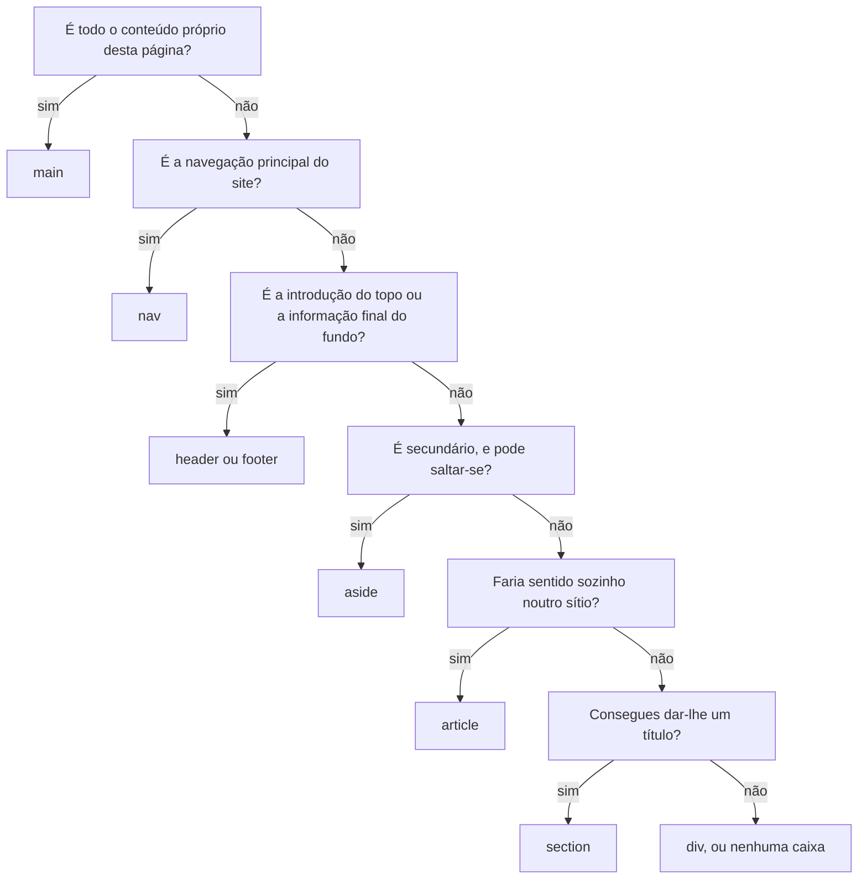

# HTML e semântica

Neste guia aprendes a escrever páginas com HTML, escolhendo cada elemento pelo que o conteúdo é, e não pelo aspeto que tem. Vês o esqueleto completo, os títulos, as listas, as ligações, as imagens, as zonas de uma página e as tabelas. No fim, aprendes a verificar uma página. O exemplo é a Estante Digital, com as páginas construídas passo a passo.

Usa o que viste no guia 01. Rever: [O browser constrói uma árvore, o DOM](01-web-e-planeamento.md#o-browser-constrói-uma-árvore-o-dom), [O esqueleto de uma página](01-web-e-planeamento.md#o-esqueleto-de-uma-página) e [O wireframe](01-web-e-planeamento.md#o-wireframe). Para praticar: [laboratório](laboratorios/02-html-e-semantica-laboratorio.md) e [ficha de exercícios](exercicios/02-html-e-semantica-exercicios.md).

## Neste guia

1. [Parte 1: Escrever HTML](#parte-1-escrever-html)
2. [Parte 2: A página e o texto](#parte-2-a-página-e-o-texto)
3. [Parte 3: Ligações e imagens](#parte-3-ligações-e-imagens)
4. [Parte 4: As zonas da página](#parte-4-as-zonas-da-página)
5. [Parte 5: Tabelas](#parte-5-tabelas)
6. [Parte 6: Erros e verificação](#parte-6-erros-e-verificação)
7. [Exemplo guiado: as páginas da Estante Digital](#exemplo-guiado-as-páginas-da-estante-digital)

## Parte 1: Escrever HTML

### O que é o HTML

Olha para estas quatro linhas. Percebes logo que a primeira é o título de uma página e que "Livros" é o título de uma parte. E percebes que as duas últimas linhas são uma lista:

```text
Recursos de estudo recomendados pela turma
Livros
Primeiros passos na Web
Pequeno dicionário de HTML
```

Percebes porque és uma pessoa e adivinhas pela experiência. O browser não adivinha. Antes de continuares, prevê: se pusesses este texto, tal como está, num ficheiro `.html` e o abrisses no browser, aparecia em quatro linhas?

Não aparece. O browser junta tudo seguido, como se fosse uma só frase, com um espaço no sítio de cada mudança de linha:

```text
Recursos de estudo recomendados pela turma Livros Primeiros passos na Web Pequeno dicionário de HTML
```

Ninguém lhe disse que eram coisas diferentes. Para isso serve o HTML, a *HyperText Markup Language*, linguagem de marcação de hipertexto. As duas palavras difíceis dizem o que ele faz.

**Hipertexto** é texto com ligações para outros textos. Um livro lê-se de uma ponta à outra, e um hipertexto lê-se saltando: carregas numa palavra sublinhada e passas para outra página. A Web inteira é um enorme hipertexto.

**Marcação** é pôr marcas num texto para dizer o que cada pedaço é. É como pintar com marcadores os títulos e as listas de um texto impresso. As palavras não mudam, mas fica-se a saber o papel de cada pedaço. O HTML faz o mesmo com marcas escritas no próprio texto:

```html
<h1>Recursos de estudo recomendados pela turma</h1>
<h2>Livros</h2>
<ul>
  <li>Primeiros passos na Web</li>
  <li>Pequeno dicionário de HTML</li>
</ul>
```

Agora o browser mostra um título grande (`h1`) e um título um pouco mais pequeno (`h2`). Por baixo, mostra uma lista (`ul`) com dois itens (`li`), cada um com uma bolinha à frente. As palavras são as mesmas. O que mudou foi que cada pedaço passou a dizer o que é.

O HTML não é uma linguagem de programação. Não dá ordens ao computador nem toma decisões: descreve o conteúdo, e o browser mostra-o.

### Etiquetas e elementos

Cada marca do HTML é uma **etiqueta** (em inglês, *tag*): uma palavra entre os sinais `<` e `>`. Há etiquetas de abertura, como `<h1>`, e etiquetas de fecho, iguais mas com uma barra antes do nome, como `</h1>`. A de abertura diz "começa aqui um título", e a de fecho diz "acaba aqui o título".

Já sabes que cada ramo do DOM é um elemento. No ficheiro, um elemento escreve-se com a etiqueta de abertura, o conteúdo e a etiqueta de fecho, juntos:

```html
<h1>Recursos de estudo recomendados pela turma</h1>
```

| Parte | Neste exemplo | O que é |
| --- | --- | --- |
| Etiqueta de abertura | `<h1>` | Marca o início do elemento |
| Conteúdo | `Recursos de estudo recomendados pela turma` | O texto que o elemento marca |
| Etiqueta de fecho | `</h1>` | Marca o fim do elemento, com a barra antes do nome |
| Elemento | Tudo junto, do `<h1>` ao `</h1>` | Um título de primeiro nível |

A etiqueta é a marca que escreves, e o elemento é a coisa marcada. Quando dizes "esta página tem três parágrafos", contas elementos. Quando dizes "esqueci-me de fechar a etiqueta", falas da marca que falta escrever.

<details>
<summary>Para ires mais longe: outras formas de escrever etiquetas</summary>

O HTML não distingue maiúsculas de minúsculas nos nomes das etiquetas: `<H1>` e `<h1>` são a mesma coisa. Nos anos 90 escrevia-se em maiúsculas, e hoje a convenção é escrever tudo em minúsculas.

Em código de outras pessoas vais encontrar às vezes ``, com uma barra antes do `>`. O HTML aceita essa barra, mas ela não faz nada, e nos materiais da disciplina não a usamos.

</details>

### Atributos

Numa ligação, o texto em que se carrega é o conteúdo, mas o destino não aparece na página. O destino é um **atributo**: uma informação extra sobre um elemento, escrita dentro da etiqueta de abertura, com a forma `nome="valor"`.

```html
<a href="sobre.html">Sobre</a>
```

Aqui, `a` é o nome do elemento, uma ligação, e `href` é o nome do atributo, o destino. `"sobre.html"` é o valor do atributo, e `Sobre` é o conteúdo, o texto que aparece na página.

Uma imagem, o elemento `img`, também se escreve com atributos: o `src` diz qual é o ficheiro da imagem, e o `alt` descreve-a.

```html

```

Os atributos seguem quatro regras:

- escrevem-se na etiqueta de abertura, e nunca na de fecho;
- se houver mais do que um, separam-se com espaços, como os quatro desta imagem;
- o valor escreve-se entre aspas duplas, porque basta um espaço dentro do valor para deixar de funcionar sem elas;
- cada elemento aceita os seus atributos: `href` faz sentido numa ligação, e não num título.

A imagem não tem texto lá dentro: toda a informação de que precisa está nos atributos. Por isso não tem conteúdo nem etiqueta de fecho, e não existe `</img>`. Um elemento assim chama-se **elemento vazio**, e a imagem é o mais comum.

### Comentários

Às vezes queres deixar no ficheiro uma nota para quem lê o código, sem que ela apareça na página. Escreves um **comentário**, entre `<!--` e `-->`, que o browser ignora:

```html
<!-- Este parágrafo apresenta o site a quem chega pela primeira vez. -->
<p>A Estante Digital reúne livros, vídeos e sítios.</p>
```

Os comentários explicam decisões que o código sozinho não explica. Os ficheiros da Estante Digital têm muitos, para os poderes ler e perceber. Os comentários não aparecem na página, mas qualquer pessoa os lê, abrindo o código da página no browser. Nunca escrevas num comentário o que não escreverias na própria página.

### Elementos dentro de elementos

Para pôr uma palavra importante a meio de um parágrafo, escreves um elemento dentro do outro. A isto chama-se **aninhar** elementos:

```html
<p>Entrega o trabalho <strong>até sexta-feira</strong>, na sala 12.</p>
```

O elemento `strong`, que marca o que é importante, está dentro do elemento `p`, o parágrafo. Diz-se que o `p` é o **pai** do `strong`, e que o `strong` é **filho** do `p`.

A regra do aninhamento é esta: fecha-se primeiro o que se abriu por último. Pensa em caixas dentro de caixas, ou nos parênteses em Matemática: em `[ ( 2 + 3 ) × 4 ]`, o parêntese curvo abre depois do reto e fecha antes dele.

```html
<!-- Certo: o strong abriu dentro do p e fecha dentro do p. -->
<p>Isto é <strong>muito</strong> importante.</p>

<!-- Errado: o p fecha antes do strong, que abriu depois dele. -->
<p>Isto é <strong>muito importante.</p></strong>
```

Uma página inteira é uma grande estrutura de elementos dentro de elementos, que o browser transforma na árvore do DOM. Rever: [O browser constrói uma árvore, o DOM](01-web-e-planeamento.md#o-browser-constrói-uma-árvore-o-dom).

### A indentação mostra o que está dentro de quê

Nos exemplos deste guia, cada elemento que está dentro de outro começa um pouco mais à direita. Esses espaços no início das linhas chamam-se **indentação**. O browser ignora-os, e a página fica igual com ou sem eles. Servem para as pessoas verem de relance quem está dentro de quem. Nos materiais usamos dois espaços por nível.

Sem indentação, um ficheiro de cinquenta linhas fica quase impossível de ler, e um erro de aninhamento fica escondido. Com indentação, uma etiqueta de fecho fora do sítio salta à vista, porque fica desalinhada da sua etiqueta de abertura. O VS Code, o editor das aulas, indenta o ficheiro inteiro com o comando Format Document: Shift+Alt+F no Windows e Shift+Option+F no Mac.

### Espaços e mudanças de linha

O browser trata todos os espaços seguidos, tabulações e mudanças de linha como um só espaço, também dentro de um elemento. Estas duas versões dão o mesmo resultado no ecrã:

```html
<p>A Estante Digital reúne livros, vídeos e sítios.</p>

<p>
  A Estante Digital
  reúne livros,      vídeos e sítios.
</p>
```

As duas mostram "A Estante Digital reúne livros, vídeos e sítios.", com um só espaço entre cada palavra. O browser troca cada grupo de espaços e de mudanças de linha por um só espaço, e tira os do início e do fim.

Por isso, podes partir um parágrafo comprido por várias linhas no ficheiro, para se ler melhor. Mas carregar em Enter no ficheiro não muda de linha na página, e carregar várias vezes na barra de espaços não afasta palavras. Para um parágrafo novo, precisas de um elemento `p` novo.

Para mudar de linha dentro do mesmo parágrafo há o `br`, outro elemento vazio. Usa-se quando a mudança de linha faz parte do conteúdo, como nas linhas de uma morada:

```html
<p>
  Biblioteca da escola<br>
  Piso 1, junto ao pavilhão B
</p>
```

O browser mostra o parágrafo em duas linhas, e a mudança vem do `br`, e não do Enter que está no ficheiro.

O `br` nunca se usa para afastar blocos de texto, nem se empilham vários para criar espaço. Afastar coisas é aspeto, e o aspeto é trabalho do CSS.

## Parte 2: A página e o texto

### O esqueleto completo de uma página

O esqueleto que viste no guia 01 tinha só as partes principais. Rever: [O esqueleto de uma página](01-web-e-planeamento.md#o-esqueleto-de-uma-página). O esqueleto completo, com que começam todas as páginas das aulas, é este:

```html
<!doctype html>
<html lang="pt-PT">
  <head>
    <meta charset="utf-8">
    <meta name="viewport" content="width=device-width, initial-scale=1">
    <title>Início | Estante Digital</title>
  </head>
  <body>
    <!-- Aqui vai tudo o que aparece na página. -->
  </body>
</html>
```

O `<!doctype html>` vai sempre na primeira linha, sem nada antes. Sem ele, o browser imita os browsers antigos e desenha algumas coisas de maneira estranha.

O atributo `lang` do `html` diz em que língua está o conteúdo. O `pt-PT` é português de Portugal, o `pt-BR` é português do Brasil e o `en` é inglês. Um leitor de ecrã, o programa que lê a página a quem não a vê, usa-o para escolher a voz e a pronúncia. Numa página em português marcada como inglesa, lê as palavras com pronúncia inglesa, e o texto fica impossível de perceber.

<details>
<summary>Para ires mais longe: porque existe o doctype</summary>

Nos anos 90, cada browser desenhava as páginas à sua maneira, e os sites foram feitos a contar com esses defeitos. Quando os browsers passaram a seguir as regras oficiais, os sites antigos ficariam desarrumados. A solução foi esta: se a página começa com o doctype, o browser segue as regras modernas. Se não começa, entra num modo de compatibilidade, que imita os browsers antigos.

</details>

### O que vai no head

Neste tema, o `head` leva sempre três elementos, por esta ordem.

O `<meta charset="utf-8">` diz ao browser como transformar em letras os números guardados no ficheiro. Um computador só guarda números, e usa uma tabela para saber que número corresponde a que letra. A **UTF-8** é a tabela usada em quase toda a Web. Tem as letras de todas as línguas, incluindo o ç, o ã e o é. Se o browser ler o ficheiro com outra tabela, as letras acentuadas aparecem trocadas, como `ç` no lugar de `ç`. Esta linha vai em primeiro lugar no `head`, porque o browser precisa da tabela antes de ler o resto. O ficheiro tem de estar guardado em UTF-8, que é o que o VS Code faz e mostra na barra de baixo.

O `<meta name="viewport" content="width=device-width, initial-scale=1">` é para os telemóveis. Diz ao telemóvel que use a largura verdadeira do ecrã e que não encolha a página. Sem ela, a página aparece encolhida num telemóvel, e é preciso fazer zoom para ler. No computador não se nota diferença. Por isso pomo-la desde a primeira página.

O `<title>` é o título da página. Não aparece dentro dela: aparece no separador do browser, nos favoritos, no histórico e nos resultados de um motor de pesquisa. É também a primeira coisa que um leitor de ecrã diz quando a página abre. Por isso cada página tem um título diferente, que diz o que ela é.

Nos materiais, o título tem a forma `Página | Site`, como `Início | Estante Digital` ou `Sobre | Estante Digital`. A parte que muda vem primeiro, porque, com muitos separadores abertos, o browser corta os títulos e só se vê o princípio.

<details>
<summary>Para ires mais longe: porque os telemóveis encolhem as páginas</summary>

Quando apareceram os telemóveis com um browser completo, quase todos os sites tinham sido feitos para ecrãs de computador. Para não os estragar, os telemóveis passaram a fingir que tinham um ecrã de cerca de 980 píxeis, e encolhiam a página até caber. A linha do `viewport` diz ao telemóvel que deixe de fingir.

</details>

### Títulos: de h1 a h6

Num trabalho escolar, o título geral, os capítulos e as secções mostram logo como o trabalho está organizado. Numa página, isso faz-se com os títulos. O HTML tem seis níveis, do `h1`, o mais importante, ao `h6`, o menos importante. O `h` vem de *heading*, título em inglês.

Os títulos de uma página formam o seu **índice**:

- o `h1` é o título da página inteira, o assunto do conteúdo principal, e nas nossas páginas há um só;
- cada `h2` é o título de uma grande parte da página;
- cada `h3` é o título de uma parte dentro de um `h2`, e assim por diante.

A regra que mais importa é esta: a descer, não se saltam níveis. Depois de um `h2`, o título seguinte pode ser outro `h2`, uma parte nova ao mesmo nível, ou um `h3`, uma parte desta. Não pode ser um `h4`, que seria a parte de uma parte que não existe. A subir pode saltar-se: depois de um `h4`, podes voltar a um `h2`, porque começa uma parte nova.

Este é o índice da página de um recurso da Estante Digital, com a indentação a mostrar os níveis:

```text
h1  Primeiros passos na Web
    h2  Para quem é
    h2  O que vais aprender
    h2  Como o usar
    h2  Onde o encontrar
    h2  Dica de quem já o leu
```

E este é um índice com dois problemas:

```text
h1  Estante Digital
h1  Primeiros passos na Web
    h3  Para quem é
    h3  O que vais aprender
```

Há dois `h1`, e a página parece ter dois assuntos, quando o assunto é o livro e não o nome do site. E há um salto de `h1` para `h3`, que deixa um nível vazio pelo meio.

Isto importa porque quem usa um leitor de ecrã não passa os olhos pela página. Pede a lista dos títulos, ou salta de título em título com uma tecla. Para essa pessoa, os títulos são o mapa da página, e se a hierarquia estiver errada, o mapa está errado.

O erro típico é escolher o título pelo tamanho da letra, como um `h4` "porque fica do tamanho certo". O tamanho é só o aspeto que o browser dá por omissão, e o CSS muda-o. O nível escolhe-se pelo lugar do título na estrutura. Para apanhar os erros, faz o índice da página, com a indentação a mostrar os níveis: tem de fazer sentido sozinho.

### Parágrafos e texto com significado

Num aviso da biblioteca, há uma frase que ninguém pode deixar escapar: o prazo de entrega. O texto corrido vai em parágrafos, com o elemento `p`, e dentro de um parágrafo há dois elementos que dão significado a palavras soltas:

- o `strong` marca texto de importância forte, como um prazo ou um aviso, e o browser mostra-o a negrito;
- o `em` marca ênfase, a palavra que tem a força da frase, e o browser mostra-o em itálico.

```html
<p>A requisição é por uma semana. <strong>Livros entregues com atraso bloqueiam novas requisições.</strong></p>
<p>Não disse que o livro era difícil. Disse que era <em>comprido</em>.</p>
```

No browser, a segunda frase do primeiro parágrafo aparece a negrito, e a palavra "comprido" aparece em itálico. O `em` diz que a frase fala do tamanho do livro, e não da dificuldade.

<details>
<summary>Para ires mais longe: os elementos b e i</summary>

Existem também os elementos `b` e `i`, que põem o texto a negrito e em itálico com um significado muito fraco. O `b` só chama a atenção para umas palavras, e o `i` marca um tom diferente, como uma palavra estrangeira. Nas aulas usamos o `strong` para a importância e o `em` para a ênfase. Para mudar só o aspeto, usa-se o CSS.

</details>

### Listas

Os passos de uma receita e a lista dos ingredientes são listas diferentes: nos passos, a ordem conta, e nos ingredientes não. Por isso o HTML tem dois tipos de lista, e cada item, nos dois, é um elemento `li` (de *list item*):

- a **lista não ordenada**, `ul` (de *unordered list*), para itens cuja ordem não importa;
- a **lista ordenada**, `ol` (de *ordered list*), para itens cuja ordem importa.

```html
<ul>
  <li>O que fazem o browser e o servidor quando abres uma página.</li>
  <li>Como se escreve a estrutura de uma página com HTML.</li>
</ul>

<ol>
  <li>Lê os capítulos pela ordem.</li>
  <li>No fim de cada capítulo, faz o exercício no computador.</li>
</ol>
```

Na `ul`, o browser põe uma bolinha antes de cada item. Na `ol`, numera os itens, 1. e 2., e os números não estão no ficheiro: é o browser que os põe, pela ordem dos `li`.

Para escolher, faz o teste da troca: se trocares dois itens de lugar, a informação fica errada? Nos passos de uma receita, trocar "bater os ovos" com "pôr no forno" estraga o bolo, e é uma lista ordenada. Nos ingredientes, a ordem é indiferente, e é uma lista não ordenada.

Dentro de um `ul` ou de um `ol` só podem estar elementos `li`, e o browser não avisa se falhares. Uma lista dentro de outra vai dentro de um `li`, e não entre dois `li`:

```html
<ul>
  <li>
    Livros
    <ul>
      <li>Primeiros passos na Web</li>
      <li>Pequeno dicionário de HTML</li>
    </ul>
  </li>
  <li>Vídeos</li>
</ul>
```

Os dois livros aparecem por baixo de "Livros", mais afastados da margem e com uma bolinha vazia.

Uma lista, e não parágrafos com um hífen à frente, faz o browser saber que é uma lista. Um leitor de ecrã anuncia "lista, 2 itens" antes de a ler, e a pessoa fica a saber quanto vai ouvir.

## Parte 3: Ligações e imagens

### Uma ligação leva a outro sítio

Para ir da página inicial da Estante Digital para a página Sobre, carrega-se numa palavra sublinhada. É uma **ligação** (em inglês, *link*), que se escreve com o elemento `a` e o atributo `href`, que diz o destino:

```html
<a href="sobre.html">Sobre a Estante Digital</a>
```

No browser aparece "Sobre a Estante Digital", sublinhado e azul, e o `sobre.html` não aparece.

O conteúdo do `a` é o **texto da ligação**: o que aparece sublinhado e em que se carrega. Esse texto diz para onde a ligação leva. Evita "clica aqui", "aqui" ou "ver mais", por duas razões. Muita gente passa os olhos pela página à procura do sítio onde carregar, e um "clica aqui" obriga a ler a frase à volta. E um leitor de ecrã pode mostrar a lista das ligações da página, fora do texto: dez "clica aqui" não dizem nada.

Para corrigir, põe a ligação nas palavras que dizem o destino. Em vez de "Para ver o horário, clica aqui", escreve "Consulta o horário da biblioteca", com a ligação em "horário da biblioteca".

### Caminhos relativos

Para ligar ao `sobre.html` ou para mostrar uma imagem do teu site, não se dá a morada completa do ficheiro. Dá-se um **caminho relativo**: onde está o ficheiro a partir do ficheiro onde estás, como quem diz "segue em frente e é a segunda porta".

```text
estante-digital/
├── index.html
├── primeiros-passos-na-web.html
├── sobre.html
└── imagens/
    ├── capa-primeiros-passos-na-web.svg
    └── logotipo.svg
```

A partir do `index.html`, o `sobre.html` está na mesma pasta, e basta o nome: `href="sobre.html"`. O logótipo está dentro da pasta `imagens`, e escreve-se o nome da pasta, uma barra e o nome do ficheiro: `src="imagens/logotipo.svg"`.

Quando o ficheiro está na pasta de cima, sobe-se com dois pontos seguidos, `..`, que querem dizer "a pasta de cima". Se a página do livro estivesse numa pasta `recursos`, para voltar ao `index.html` escrevia-se `href="../index.html"`. Para o logótipo, subia-se uma pasta e descia-se para `imagens`: `src="../imagens/logotipo.svg"`. Cada `../` sobe um nível.

Três regras evitam quase todos os problemas com caminhos:

- nunca uses o caminho completo do teu disco, como `C:\Users\Ana\Desktop\site\foto.jpg` ou um endereço `file:///`, porque só funciona no teu computador;
- nos caminhos da Web usa-se a barra `/`, mesmo no Windows, onde o explorador de ficheiros mostra `\`;
- os nomes dos ficheiros e das pastas vão em minúsculas, sem espaços e sem acentos, com hífenes entre as palavras, como `primeiros-passos-na-web.html`.

A última regra tem uma razão escondida. No Windows, `Foto.JPG` e `foto.jpg` são o mesmo ficheiro, mas num servidor, que quase sempre usa Linux, são dois ficheiros diferentes. Uma página que funciona na escola pode deixar de mostrar a imagem quando é publicada.

### O destino de uma ligação

O `href` escreve-se de maneira diferente conforme o destino está no teu site ou noutro:

| Destino | Exemplo de `href` | Quando se usa |
| --- | --- | --- |
| Outra página do teu site | `sobre.html` | Para navegar entre as tuas páginas, com um caminho relativo |
| Uma página de outro site | `https://developer.mozilla.org/pt-BR/docs/Web/HTML/Reference/Elements` | Para levar a pessoa para fora do teu site |

O destino noutro site é um **endereço absoluto**: o endereço completo, que começa por `https://`. Se escreveres `href="developer.mozilla.org"`, sem ele, o browser pensa que é um ficheiro da pasta do teu site, procura-o e não o encontra. No Chrome em português aparece "Não foi possível aceder ao seu ficheiro". A barra de endereço mostra que o browser foi procurar dentro da tua pasta. Para corrigir, copia o endereço completo da barra do browser, na página de destino, e cola-o no `href`.

<details>
<summary>Para ires mais longe: outros destinos de uma ligação</summary>

Um `href` como `#horario` salta para o elemento da mesma página que tem o atributo `id="horario"`. O valor de um `id` é único na página. Nas aulas, segue as regras dos nomes de ficheiros: minúsculas, sem espaços e sem acentos.

Um `href` como `mailto:biblioteca@escola.example` abre o programa de correio com o destinatário preenchido.

O atributo `target="_blank"` abre a ligação num separador novo. Não o uses por hábito: quem lê é que decide se quer um separador novo. E um separador aberto sem aviso desorienta quem usa um leitor de ecrã.

</details>

### Ligação ou botão

Na Web, carrega-se em duas coisas diferentes, que no ecrã podem ter o mesmo aspeto. Uma ligação leva-te a outro sítio: outra página, outra parte da mesma página, um ficheiro. Um **botão** faz uma ação aqui mesmo, sem sair do sítio, como enviar um formulário ou abrir um menu. As ligações são o elemento `a`, e os botões são o elemento `button`.

Para quem usa o teclado ou um leitor de ecrã, comportam-se de maneira diferente. Uma ligação ativa-se com Enter, e um botão com Enter ou com a barra de espaços. O leitor de ecrã anuncia "ligação" ou "botão", e a pessoa espera mudar de sítio, ou que aconteça alguma coisa. Por isso, uma ação nunca se faz com uma ligação, nem a navegação com um botão. Neste tema só há navegação, e por isso tudo em que se carrega é uma ligação.

### Imagens

A página do livro, na Estante Digital, mostra a capa, para a pessoa a reconhecer na estante da biblioteca. Uma imagem põe-se na página com o elemento `img`, que é vazio:

```html

```

Quando uma etiqueta tem muitos atributos, podes parti-la por várias linhas, para se ler melhor. Os atributos são:

- `src` (de *source*, origem): o caminho para o ficheiro da imagem;
- `alt` (de *alternative*, alternativo): o texto que substitui a imagem quando ela não pode ser vista;
- `width` e `height`: a largura e a altura, em píxeis, sem a unidade. Com eles, o browser reserva o espaço da imagem antes de a descarregar, e a página não salta quando ela chega.

| Formato | Para quê |
| --- | --- |
| JPG | Fotografias |
| PNG | Desenhos, capturas de ecrã e imagens com fundo transparente |
| SVG | Desenhos feitos de formas, como logótipos e ícones, que se podem aumentar sem perder qualidade |
| WebP | O mesmo que o JPG e o PNG, com ficheiros mais pequenos |

As imagens da Estante Digital são SVG. Uma fotografia tirada com um telemóvel pode ter 4000 píxeis de largura e vários megabytes, e demora a chegar a quem tem dados móveis. Antes de a usares, reduz-lhe o tamanho para a largura de que precisas, num programa de edição de imagem.

Usa imagens feitas por ti, ou imagens cuja licença permita o uso. Uma imagem encontrada numa pesquisa não é livre só por estar na Internet. Quando uma imagem não é tua, diz de onde veio e qual é a licença. Escreve-o no README do teu site, o ficheiro que o apresenta a quem abre a pasta, na secção "Imagens e tipos de letra de outros". O modelo do README está na pasta do projeto, em [readme-do-projeto](../projeto/modelos/readme-do-projeto.md). E não publiques fotografias de outras pessoas sem autorização delas.

### O texto alternativo

Uma imagem nem sempre é vista. Uma pessoa cega usa um leitor de ecrã, que lê o `alt` no sítio da imagem. Uma imagem que não carregou, por a rede estar lenta ou o caminho errado, dá lugar ao `alt`. E um motor de pesquisa lê o `alt` para saber o que a imagem mostra. Em todos estes casos, o **texto alternativo**, o valor do `alt`, ocupa o lugar da imagem.

Para o escrever, faz esta pergunta: se estivesses ao telefone a descrever a página a alguém, o que dirias no sítio da imagem? A página tem de continuar a fazer sentido. Não é uma descrição de todos os pormenores, mas o que a imagem transmite naquele sítio. Não comeces por "Imagem de", porque o leitor de ecrã já anuncia que é uma imagem, e escreve uma frase curta.

A resposta depende do sítio da imagem:

- A imagem transmite informação: o `alt` descreve essa informação. Na página do livro, a capa ajuda a reconhecê-lo na estante, e o `alt` descreve o que se vê: `alt="Capa azul com o título Primeiros passos na Web em letras brancas e o desenho de um globo terrestre."`.
- A imagem é decorativa ou repete o que está escrito ao lado: o `alt` fica vazio, `alt=""`. É o logótipo da Estante Digital, ao lado do nome do site. Com um `alt` com texto, o leitor de ecrã diria o nome duas vezes.
- A imagem é o único conteúdo de uma ligação: o `alt` é o texto da ligação. Diz para onde ela leva, e não o que a imagem mostra.

```html
<a href="primeiros-passos-na-web.html"></a>
```

Aqui, a capa pequena é a única coisa em que se carrega. O leitor de ecrã anuncia uma ligação e lê o `alt` como o nome dela: "Página do livro Primeiros passos na Web". Se o `alt` descrevesse a capa, a pessoa ouvia as cores e o globo, e não sabia para onde ia.

Um `alt` vazio não é o mesmo que não ter `alt`. O `alt=""` diz "podes saltar esta imagem". Uma imagem sem `alt` não diz nada, e muitos leitores de ecrã leem então o nome do ficheiro, como "logotipo ponto svg". Toda a imagem tem o atributo `alt`: às vezes com texto, às vezes vazio, nunca ausente.

Para testar uma página inteira, lê-a de cima a baixo trocando cada imagem pelo seu `alt`. Se continuar a fazer sentido, sem faltar nada e sem repetições, os textos alternativos estão bem.

### Imagem com legenda: figure e figcaption

Às vezes, uma imagem é um conteúdo de que o texto fala, e tem uma legenda. Junta-se a imagem e a legenda num `figure`, e a legenda vai num `figcaption`, no princípio ou no fim do `figure`:

```html
<figure>
  
  <figcaption>
    Capa da edição que está na biblioteca da escola.
    Livro fictício, criado para este exemplo.
  </figcaption>
</figure>
```

No browser, a capa aparece com a legenda por baixo. O `figure` diz que as duas formam uma unidade: a legenda pertence àquela imagem, e não ao parágrafo seguinte.

O `alt` e a legenda não fazem o mesmo trabalho, e por isso não se repetem. A legenda é vista por toda a gente e acrescenta contexto, como de onde vem a imagem. O `alt` só é lido por quem não vê a imagem, e diz o que ela mostra. Nem todas as imagens precisam de `figure`: o logótipo do cabeçalho não tem legenda, e o texto não fala dele.

## Parte 4: As zonas da página

### As zonas da página: header, nav, main e footer

Um wireframe divide a página em zonas: o cabeçalho, a navegação, o conteúdo principal e o rodapé. O HTML tem um elemento para cada uma. **Semântica** quer dizer significado. Escrever HTML semântico é escolher cada elemento pelo que o conteúdo é, e não pelo aspeto.

| Elemento | O que marca | Na Estante Digital |
| --- | --- | --- |
| `header` | O cabeçalho: a introdução, como o nome do site, o logótipo e a navegação principal | O logótipo, o nome e o menu |
| `nav` | A navegação principal, que leva às várias partes do site | A lista com Início e Sobre |
| `main` | O conteúdo principal: o que é próprio desta página e não se repete nas outras | Tudo o que está entre o cabeçalho e o rodapé |
| `footer` | O rodapé: a informação final, como a autoria ou um aviso | A nota de que o site é um exemplo |

Cada um tem as suas regras:

- há um só `main` por página, e não fica dentro do `header` nem do `footer`;
- o `nav` é só para a navegação principal, e uma ligação solta como "Voltar à lista" não precisa dele;
- o `header` e o `footer` nunca ficam um dentro do outro.

Para saber o que é o `main`, pergunta o que muda de página para página. O cabeçalho e o rodapé repetem-se em todas, e o que muda é o conteúdo principal.

### As partes do conteúdo: section, article e aside

Dentro do conteúdo principal, há partes diferentes. Na página do livro, há a ficha do livro, as partes dessa ficha, cada uma com o seu título, e uma dica ao lado. O HTML tem um elemento para cada tipo de parte:

| Elemento | O que marca | Na Estante Digital |
| --- | --- | --- |
| `section` | Uma parte do conteúdo, com o seu próprio título | "Livros", "Vídeos", "Sítios e aplicações" |
| `article` | Um conteúdo completo, que faria sentido sozinho noutro sítio | A ficha do livro Primeiros passos na Web |
| `aside` | Um conteúdo relacionado, mas secundário, que se pode saltar | A caixa "Dica de quem já o leu" |

Uma `section` tem sempre um título, e se não lhe consegues dar um, não é uma secção. Um `article` faria sentido copiado sozinho para outro site, como uma notícia ou a ficha de um livro. Um `aside` salta-se sem perder nada do essencial, como uma dica.

Quando estiveres indeciso, faz as perguntas do diagrama, por esta ordem, e para na primeira a que respondes sim:



Pela ordem das perguntas, as respostas são `main`, `nav`, `header` ou `footer`, `aside`, `article` e `section`. As partes de dentro do `main` voltam às perguntas, a partir da segunda. A pergunta da `section` fica para o fim, porque quase tudo se pode pôr debaixo de um título.

Se nenhuma pergunta servir, há o `div`, uma caixa genérica, sem significado, que serve para agrupar coisas só para as arrumar. É o último recurso, e não o primeiro. Uma página feita só de `div` funciona para quem a vê, e não diz nada a mais ninguém. Não diz nada a quem usa um leitor de ecrã, aos motores de pesquisa nem a quem lê o código.

### A árvore de acessibilidade

Um leitor de ecrã não lê o ecrã nem o ficheiro. A partir do DOM, o browser constrói uma segunda árvore, mais simples, só com o que interessa a quem não vê a página. É a **árvore de acessibilidade**, e é essa que o leitor de ecrã recebe.

Nela, cada coisa aparece com duas informações. O **papel** diz o que a coisa é: título, ligação, lista, imagem, navegação. O nome é o texto que a identifica, como o texto de uma ligação ou o `alt` de uma imagem. Um `div` tem um papel genérico (em inglês, *generic*), que não diz nada. Uma imagem com `alt=""` nem aparece, porque foi marcada como decorativa.

É por isto que a semântica importa. O que não está no HTML não chega à árvore. E o que não chega à árvore não existe para quem usa um leitor de ecrã. No separador Elements das ferramentas do programador, a árvore abre-se no painel Accessibility.

### Os pontos de referência

Uma pessoa que usa um leitor de ecrã e visita dez páginas do teu site não quer ouvir o menu dez vezes. Quer saltar logo para o conteúdo principal.

Na árvore de acessibilidade, o `nav`, o `main` e o `aside` são **pontos de referência** (em inglês, *landmarks*). O `header` e o `footer` da página inteira também são. São as zonas para onde o leitor de ecrã salta diretamente. Os papéis deles, que vês nas ferramentas do programador, são *navigation*, *main* e *complementary*, e *banner* e *contentinfo*. Numa página feita só de `div`, não há pontos de referência, e o salto não existe.

## Parte 5: Tabelas

### Uma tabela de dados cruza linhas e colunas

Num horário, "a que horas fecha a biblioteca à quarta-feira?" responde-se cruzando a linha "Quarta-feira" com a coluna "Fecha". Quando cada valor responde a uma pergunta que junta uma linha e uma coluna, a informação é uma **tabela de dados**. São exemplos um horário, uma lista de preços por tamanho e os resultados de um campeonato.

Uma tabela usa vários elementos, uns dentro dos outros:

| Elemento | O que marca |
| --- | --- |
| `table` | A tabela inteira |
| `caption` | A legenda, o nome da tabela, logo a seguir à etiqueta de abertura do `table` |
| `thead` | O grupo das linhas de cabeçalho, no topo |
| `tbody` | O grupo das linhas de dados, o corpo da tabela |
| `tr` | Uma linha (de *table row*) |
| `th` | Uma célula de cabeçalho (de *table header*), que diz o que é uma coluna ou uma linha |
| `td` | Uma célula de dados (de *table data*), um valor |

Este é o horário da biblioteca, com as três primeiras linhas de dados:

```html
<table>
  <caption>Horário da biblioteca da escola (fictício)</caption>
  <thead>
    <tr>
      <th scope="col">Dia</th>
      <th scope="col">Abre</th>
      <th scope="col">Fecha</th>
    </tr>
  </thead>
  <tbody>
    <tr>
      <th scope="row">Segunda-feira</th>
      <td>08:30</td>
      <td>17:30</td>
    </tr>
    <tr>
      <th scope="row">Terça-feira</th>
      <td>08:30</td>
      <td>17:30</td>
    </tr>
    <tr>
      <th scope="row">Quarta-feira</th>
      <td>08:30</td>
      <td>13:00</td>
    </tr>
  </tbody>
</table>
```

Para ler o código, segue as linhas. Cada `tr` é uma linha, com as células lá dentro, da esquerda para a direita. A primeira linha, no `thead`, só tem cabeçalhos. Nas linhas do `tbody`, a primeira célula também é um cabeçalho, porque diz de que dia é a linha, e as outras são dados. No browser, sem CSS, os valores ficam arrumados em colunas, sem linhas entre as células.

Se te esqueceres do `tbody`, o browser acrescenta-o ao DOM, e ele aparece no separador Elements sem estar no teu ficheiro. Rever: [O browser acrescenta o que falta no ficheiro](01-web-e-planeamento.md#o-browser-acrescenta-o-que-falta-no-ficheiro).

### Os cabeçalhos e a legenda dizem o que é cada valor

Quem vê a tabela percebe, de relance, que `13:00` é a hora de fecho de quarta-feira. Quem a ouve num leitor de ecrã recebe as células uma a uma. Precisa que lhe digam a que linha e a que coluna pertence cada valor.

São os `th` que o dizem. O atributo `scope` diz a que se aplica cada um: `scope="col"` à coluna, e `scope="row"` à linha. Com eles, na célula `13:00`, a pessoa ouve algo como "Quarta-feira, Fecha, 13:00". Sem cabeçalhos, ouvia só "13:00", sem saber de que dia nem se é a hora de abrir ou de fechar.

O `caption` é o nome da tabela. É o que o leitor de ecrã anuncia quando chega a ela, e diz a quem vê de que trata a tabela antes dos números.

### Tabelas não servem para arrumar a página

Nos anos 90, os browsers ainda não arrumavam bem as coisas lado a lado com o CSS. Para fazer um menu à esquerda e o conteúdo à direita, os sites usavam uma tabela invisível, com a página inteira lá dentro. Ainda se encontra código assim em sites antigos:

```html
<table>
  <tr>
    <td>
      <a href="index.html">Início</a><br>
      <a href="sobre.html">Sobre</a>
    </td>
    <td>
      <h1>Recursos de estudo</h1>
      <p>A Estante Digital reúne livros, vídeos e sítios.</p>
    </td>
  </tr>
</table>
```

Para quem olha, fica um menu à esquerda e o texto à direita. Mas isto diz ao browser que há uma tabela de dados com uma linha e duas colunas. O leitor de ecrã pode anunciar uma tabela e ficar à espera de dados que não existem. Também não há navegação nem conteúdo principal na árvore de acessibilidade, porque não há `nav` nem `main`. E, num telemóvel, as duas colunas não se põem uma por baixo da outra sem desfazer a tabela.

A forma certa usa os elementos semânticos, e deixa a arrumação para o CSS. Antes de leres, prevê: sem CSS, o menu desta versão aparece à esquerda do texto ou por cima dele?

```html
<nav>
  <ul>
    <li><a href="index.html">Início</a></li>
    <li><a href="sobre.html">Sobre</a></li>
  </ul>
</nav>
<main>
  <h1>Recursos de estudo</h1>
  <p>A Estante Digital reúne livros, vídeos e sítios.</p>
</main>
```

Aparece por cima. Sem CSS, cada zona ocupa a largura toda e fica debaixo da anterior, pela ordem do ficheiro. Pôr o menu ao lado é trabalho do CSS, e o HTML não muda para isso. Uma tabela é para dados em linhas e colunas, e nunca para pôr coisas lado a lado.

## Parte 6: Erros e verificação

### Como o browser lida com os erros

Quando te enganas a escrever HTML, não aparece nenhuma mensagem de erro. O browser segue regras próprias para adivinhar o que querias dizer, corrige o DOM à sua maneira e desenha a página. Por um lado, uma página com um erro continua a aparecer. Por outro, não sabes que erraste, e o browser nem sempre adivinha bem.

Estes são quatro casos, experimentados no browser:

| O que escreveste | O que o browser faz no DOM | O que vês na página |
| --- | --- | --- |
| Um `strong` que nunca fechaste, a meio de um parágrafo que está logo dentro do `main` | Fecha-o no fim do parágrafo e abre outro em cada zona seguinte: um à volta do resto do `main` e mais um à volta do rodapé | Tudo o que vem a seguir fica a negrito, até ao fim da página. No Elements vês três `strong`, e só escreveste um |
| Uma lista `ul` dentro de um `p` | Fecha o `p` antes da lista e cria um parágrafo vazio a seguir, com o `</p>` que sobrou | A lista aparece, mas o DOM tem um parágrafo vazio a mais |
| Um `h2` fechado com `</h3>` | Aceita o `</h3>` como fecho do `h2`, porque qualquer fecho de título fecha o título aberto | Nada de estranho: o erro fica escondido |
| Uma ligação `a` dentro de outra `a` | Fecha a primeira ligação antes de abrir a segunda, e o texto que vinha depois já não pertence a nenhuma | Duas ligações seguidas, em vez de uma, e o fim do texto sem ligação |

Os dois primeiros são os mais frequentes nas primeiras páginas. Quando tudo fica a negrito a partir de certo ponto, falta o fecho de um `strong`, ou falta-lhe a barra: `<strong>` onde devia estar `</strong>`. Procura o último sítio onde o negrito estava certo. Quando aparece no Elements um parágrafo vazio a seguir a uma lista, há uma lista dentro de um `p`. Um parágrafo não pode conter listas, títulos, tabelas nem outros parágrafos. Se a frase introduz a lista, como "Os recursos são:", fica num parágrafo sozinha.

Para apanhar estes erros, compara o que escreveste com o que o browser construiu. No separador Elements, se a árvore for diferente do teu ficheiro, o browser corrigiu um erro teu. Há também o **validador** do W3C, em `validator.w3.org`, que lê um ficheiro HTML e faz a lista dos erros, com o número da linha. As mensagens estão em inglês, e as que não perceberes podes levar à aula.

### Verificar uma página

Uma página só está pronta depois de verificada. Neste tema, verificar quer dizer quatro coisas.

Primeiro, seguir todas as ligações. Carrega em cada uma: tem de levar ao sítio certo, e cada página de destino tem de ter uma forma de voltar. Uma ligação que dá "Não foi possível aceder ao seu ficheiro" é uma ligação sem destino. Rever: [O mapa e os wireframes têm de concordar](01-web-e-planeamento.md#o-mapa-e-os-wireframes-têm-de-concordar).

Segundo, ler a página pela ordem do HTML. Sem CSS, a página mostra o conteúdo pela ordem do ficheiro, e é essa a ordem em que um leitor de ecrã a percorre. Lê de cima a baixo e pergunta: a ordem faz sentido, o mais importante vem primeiro, e os títulos dizem de que trata cada parte?

Terceiro, percorrer a página só com o teclado, no Chrome ou no Edge. Carrega na tecla Tab várias vezes. O **foco**, a moldura que mostra onde estás, salta de ligação em ligação, pela ordem do HTML. Com Shift+Tab andas para trás, e com Enter segues a ligação. Se chegas a todas as ligações e percebes onde estás, a página passa este teste.

Quarto, ver a estrutura com as ferramentas do programador. No separador Elements, confirma que a árvore é igual ao teu ficheiro. Na árvore de acessibilidade, confirma três coisas:

- aparecem o cabeçalho, a navegação, o conteúdo principal e o rodapé;
- os títulos estão pela ordem certa;
- cada imagem com texto alternativo tem o nome que lhe deste no `alt`, e as decorativas não aparecem.

## Exemplo guiado: as páginas da Estante Digital

Neste exemplo constroem-se, passo a passo, a página inicial e a página de um recurso da Estante Digital. No fim vem a página "Sobre". Os ficheiros completos estão na pasta [estante-digital](../exemplos/frontend/estante-digital/index.html) dos exemplos da disciplina, para os abrires no browser e no editor.

### Passo 1: Partir do plano

O HTML não se inventa ao escrever: traduz o plano. Antes de abrir o editor, olha-se para o wireframe da página inicial e dá-se nome a cada zona. Os wireframes estão no exemplo guiado do guia 01. Rever: [Exemplo guiado: o plano da Estante Digital](01-web-e-planeamento.md#exemplo-guiado-o-plano-da-estante-digital).

| Zona desenhada no wireframe | Elemento | Porquê |
| --- | --- | --- |
| Faixa de cima, com o logótipo, o nome e o menu | `header` com um `nav` lá dentro | É a introdução do site e repete-se em todas as páginas; o menu é a navegação principal |
| Título grande da página | `h1` | É o assunto desta página |
| Blocos "Livros", "Vídeos" e "Sítios e aplicações" | Três `section`, cada uma com o seu `h2` e uma lista | Cada bloco é uma parte com título próprio |
| Faixa de baixo, com a nota sobre o site | `footer` | É a informação final, e repete-se em todas as páginas |
| Tudo o que fica entre o cabeçalho e o rodapé | `main` | É o conteúdo próprio desta página |

Esta tabela é a decisão mais importante do exemplo: o resto é escrever o que ela diz.

### Passo 2: A pasta e os nomes dos ficheiros

O site vive numa pasta chamada `estante-digital`, com os ficheiros HTML lá dentro e as imagens numa subpasta `imagens`. Os nomes seguem as regras dos caminhos relativos: minúsculas, sem espaços, sem acentos e com hífenes.

A página inicial chama-se `index.html`, por uma convenção da Web. Quando alguém escreve o endereço de um site sem indicar a página, como `https://www.example.com/`, a maior parte dos servidores envia o ficheiro `index.html` dessa pasta. Assim, a página inicial aparece quando o site for publicado.

### Passo 3: O esqueleto da página inicial

Começa-se pelo esqueleto, com o título desta página. Antes de abrires o ficheiro no browser, prevê: o que aparece na janela, e o que aparece no separador?

```html
<!doctype html>
<html lang="pt-PT">
  <head>
    <meta charset="utf-8">
    <meta name="viewport" content="width=device-width, initial-scale=1">
    <title>Início | Estante Digital</title>
  </head>
  <body>
  </body>
</html>
```

A janela fica em branco, porque o `body` está vazio. Mas no separador aparece "Início | Estante Digital", que é a primeira confirmação de que o ficheiro foi lido.

### Passo 4: O cabeçalho e a navegação

Dentro do `body`, a primeira zona é o `header`:

```html
<header>
  <p>
    
    Estante Digital
  </p>
  <nav>
    <ul>
      <li><a href="index.html">Início</a></li>
      <li><a href="sobre.html">Sobre</a></li>
    </ul>
  </nav>
</header>
```

No browser, aparecem o logótipo e o nome do site na mesma linha e, por baixo, uma lista com duas ligações, "Início" e "Sobre". Há três decisões a explicar.

O nome do site está num `p`, e não num `h1`. O assunto da página inicial são os recursos de estudo recomendados pela turma, e não o nome do site. Se o nome do site fosse o `h1`, todas as páginas teriam o mesmo assunto, e a página do livro teria dois `h1`.

O logótipo tem `alt=""`, porque é uma imagem decorativa, ao lado do nome escrito. O atributo está lá, vazio: não foi esquecido.

A navegação é uma lista de ligações dentro de um `nav`. É uma lista porque são várias opções do mesmo tipo, e é um `nav` porque é a navegação principal. A ligação "Início" na própria página inicial não faz mal. O menu é igual em todas as páginas, e nas outras é a forma de voltar ao princípio.

### Passo 5: O conteúdo principal

A seguir ao `header` vem o `main`, com o `h1`, dois parágrafos de introdução e as três secções:

```html
<main>
  <h1>Recursos de estudo recomendados pela turma</h1>
  <p>
    A Estante Digital reúne livros, vídeos e sítios que ajudaram alunos
    de Desenvolvimento de Aplicações a estudar. Cada recurso tem uma
    descrição curta. Os que já têm página própria têm uma ligação para ela.
  </p>
  <p>
    Todos os recursos deste site são fictícios: foram inventados para
    servir de exemplo nos guias da disciplina.
  </p>

  <section>
    <h2>Livros</h2>
    <ul>
      <li>
        <a href="primeiros-passos-na-web.html">Primeiros passos na Web</a>:
        livro para quem nunca escreveu uma página, disponível na biblioteca da escola.
      </li>
      <li>
        Pequeno dicionário de HTML: consulta rápida das etiquetas mais usadas,
        com um exemplo curto para cada uma.
      </li>
    </ul>
  </section>

  <!-- As secções "Vídeos" e "Sítios e aplicações" seguem a mesma forma. -->
</main>
```

Cada secção começa pelo seu `h2`, e o conteúdo é uma lista não ordenada, porque trocar dois livros de lugar não torna a informação errada.

Só o primeiro livro tem ligação, porque é o único que já tem página própria. Uma ligação no segundo livro seria uma ligação sem destino. Quando a página do dicionário existir, acrescenta-se a ligação. O texto da ligação é o título do livro, e não "ver mais". Por isso, continua a dizer para onde vai numa lista de ligações lida fora do contexto.

### Passo 6: O rodapé e a página completa

Depois do `main` vem o `footer`, com a nota final:

```html
<footer>
  <p>
    Estante Digital, site de exemplo dos materiais de Desenvolvimento de
    Aplicações do 10.º ano. Conteúdo fictício.
  </p>
</footer>
```

O `body` fica com três filhos, `header`, `main` e `footer`, pela ordem do wireframe. O ficheiro completo é o [index.html](../exemplos/frontend/estante-digital/index.html) da pasta de exemplo, com comentários a explicar as mesmas decisões.

### Passo 7: Abrir e ler de cima a baixo

No browser aparecem o logótipo e o nome do site, a lista do menu com as bolinhas, o título grande e os parágrafos. A seguir vêm os três títulos de secção, com as suas listas, e no fundo o rodapé. Não há cores nem colunas: é o aspeto que o browser dá por omissão, e está certo nesta fase.

A ordem do HTML é a ordem em que uma pessoa precisa das coisas. Primeiro o nome do site e o menu, depois o assunto da página e as três partes, e no fim a nota. O índice dos títulos é este:

```text
h1  Recursos de estudo recomendados pela turma
    h2  Livros
    h2  Vídeos
    h2  Sítios e aplicações
```

Tem um `h1`, três `h2` ao mesmo nível e nenhum salto.

### Passo 8: A segunda página parte do mesmo esqueleto

A página do livro chama-se `primeiros-passos-na-web.html`, com o nome tirado do título do livro. Não se começa do zero. Copia-se o `index.html`, porque o esqueleto, o cabeçalho e o rodapé são iguais, e muda-se só o que é desta página:

- o `title`, que passa a `Primeiros passos na Web | Estante Digital`;
- todo o conteúdo do `main`.

O cabeçalho e o rodapé ficam iguais em todas as páginas. Assim, quem muda de página encontra o menu no mesmo sítio, com as mesmas opções.

### Passo 9: Um article com uma figura

O conteúdo principal desta página é a ficha de um livro. Se copiasses a ficha para o site da biblioteca, fazia sentido sozinha, porque tem título, descrição, capa e informações. Por isso fica num `article`, dentro do `main`:

```html
<main>
  <article>
    <h1>Primeiros passos na Web</h1>
    <p>
      Um livro curto, com capítulos de poucas páginas, para quem quer
      perceber como se faz uma página web sem saber nada de programação.
    </p>

    <figure>
      
      <figcaption>
        Capa da edição que está na biblioteca da escola.
        Livro fictício, criado para este exemplo.
      </figcaption>
    </figure>
    <!-- As secções do livro vêm a seguir. -->
  </article>
</main>
```

Nesta página, a capa serve para reconhecer o livro na estante. Por isso, o `alt` descreve o que se vê: a cor, o título e o desenho. A legenda acrescenta o que o `alt` não diz: de que edição é a capa e que o livro é fictício. As duas ficam juntas num `figure`. As medidas, 240 por 320, são as do desenho da capa.

### Passo 10: Duas listas, duas decisões

A ficha tem uma secção "O que vais aprender" e uma secção "Como o usar", e as duas são listas de tipos diferentes:

```html
<section>
  <h2>O que vais aprender</h2>
  <ul>
    <li>O que fazem o browser e o servidor quando abres uma página.</li>
    <li>Como se escreve a estrutura de uma página com HTML.</li>
    <li>Como se ligam várias páginas umas às outras.</li>
    <li>Como se descreve uma imagem a quem não a pode ver.</li>
  </ul>
</section>

<section>
  <h2>Como o usar</h2>
  <ol>
    <li>Lê os capítulos pela ordem, porque cada um usa o anterior.</li>
    <li>No fim de cada capítulo, faz o exercício no computador antes de avançar.</li>
    <li>Anota as dúvidas e leva-as à aula seguinte.</li>
  </ol>
</section>
```

Trocar dois assuntos de "O que vais aprender" não torna a informação errada: é um `ul`. Trocar o primeiro e o último passo de "Como o usar" torna, porque as dúvidas levam-se à aula depois de ler: é um `ol`.

### Passo 11: A tabela do horário

A secção "Onde o encontrar" diz em que estante está o livro e mostra o horário da biblioteca. Cada valor responde a uma pergunta como "a que horas fecha à quarta-feira?", e por isso é uma tabela de dados. Tem a forma do horário da secção das tabelas, com uma linha por dia, de segunda a sexta-feira. O `caption` diz "(fictício)", porque o horário foi inventado. Uma tabela com dados verdadeiros diz, sempre que pode, de onde vêm os dados.

### Passo 12: O aside e o caminho de volta

Depois do `article`, ainda dentro do `main`, há uma caixa com uma dica e uma ligação de regresso:

```html
<aside>
  <h2>Dica de quem já o leu</h2>
  <p>
    Não saltes o capítulo sobre ligações: é o que mais vais usar
    quando fizeres o teu próprio site.
  </p>
</aside>

<p><a href="index.html">Voltar à lista de recursos</a></p>
```

A dica é um `aside`: está relacionada com o livro, mas quem a saltar não perde nada da ficha. Fica fora do `article`, porque é um comentário ao lado da ficha, e não parte dela.

A ligação "Voltar à lista de recursos" dá à página um caminho de volta, além do menu. Não está num `nav`, porque não é a navegação principal: é uma ligação solta no fim do conteúdo. O índice dos títulos desta página tem um `h1`, com o nome do livro, e cinco `h2`.

### Passo 13: A página Sobre e uma ligação para fora

A terceira página, [sobre.html](../exemplos/frontend/estante-digital/sobre.html), tem o mesmo esqueleto, o mesmo cabeçalho e o mesmo rodapé. Tem um `h1`, "Sobre a Estante Digital", e três secções. A secção "Saber mais" tem a única ligação para outro site:

```html
<p>
  Para consultares o significado de cada etiqueta, usa também a
  <a href="https://developer.mozilla.org/pt-BR/docs/Web/HTML/Reference/Elements">lista de elementos HTML da MDN</a>,
  em português do Brasil.
</p>
```

O endereço é absoluto e começa por `https://`, porque o destino não está na pasta do site. O texto da ligação diz o que se vai encontrar, e a frase avisa que a página está em português do Brasil.

### Passo 14: Verificar

Com as três páginas escritas, faz-se a verificação.

As ligações: na página inicial, "Início" leva à própria página, "Sobre" à página Sobre e "Primeiros passos na Web" à página do livro. Na página do livro, "Início" e "Voltar à lista de recursos" levam à página inicial. Na página Sobre, o menu funciona e a ligação para a MDN abre a página dela. Nenhuma ligação fica sem destino.

O teclado: na página inicial, o primeiro Tab leva o foco a "Início", o segundo a "Sobre" e o terceiro a "Primeiros passos na Web". Com Enter, abre-se a página do livro. A ordem do foco é a ordem do HTML.

A árvore: no separador Elements, cada página tem os elementos do ficheiro, pela mesma ordem, sem parágrafos vazios. O browser não teve de corrigir nenhum erro. Na árvore de acessibilidade da página do livro há cinco pontos de referência: *banner*, *navigation*, *main*, *complementary*, a dica, e *contentinfo*. A capa aparece como imagem, com o nome do `alt`, e o logótipo não aparece, porque tem o `alt` vazio.

As páginas passaram as quatro verificações, e estão prontas por agora.

## Erros frequentes

### A imagem não aparece

O que se vê: no sítio da imagem aparece um ícone de imagem partida, ou só o texto do `alt`, ou nada.

Porque acontece: quase sempre, o caminho do `src` não corresponde ao sítio da imagem. A imagem pode estar noutra pasta, ainda nas Transferências. O nome pode ter uma letra trocada, como `fotogafia.jpg` no código e `fotografia.jpg` no disco. A extensão pode ser outra, como `.jpeg` no disco e `.jpg` no código. Ou pode faltar a pasta no caminho, como `capa.svg` em vez de `imagens/capa.svg`.

Como se corrige: compara letra a letra o caminho do `src` com o que vês no explorador de ficheiros, a partir da pasta da página. Uma diferença só de maiúsculas não faz falhar a imagem no teu computador, mas faz falhar no servidor, e por isso também se corrige.

### A ligação dá "Não foi possível aceder ao seu ficheiro"

O que se vê: carregas na ligação e o browser mostra uma página de erro, com o código `ERR_FILE_NOT_FOUND`.

Porque acontece: o caminho do `href` está errado, como nas imagens, ou a ligação aponta para uma página que ainda não escreveste.

Como se corrige: confirma o nome do ficheiro de destino e a pasta onde está. Se a página ainda não existe, tira a ligação até ela existir.

### Mudei o ficheiro e a página não mudou

O que se vê: alteraste o ficheiro no editor, mas o browser mostra a página como estava.

Porque acontece: não guardaste o ficheiro, não recarregaste a página, ou estás a editar uma cópia diferente da que está aberta. No VS Code, um ficheiro por guardar tem uma bolinha no separador, no lugar da cruz.

Como se corrige: guarda (Ctrl+S no Windows, Cmd+S no Mac) e recarrega a página (F5 no Windows, Cmd+R no Mac). Se continuar igual, vê na barra de endereço qual é o ficheiro aberto.

### O ficheiro abre como texto, ou chama-se `index.html.txt`

O que se vê: o browser mostra as etiquetas como texto, em vez da página, ou o ficheiro abre noutro programa.

Porque acontece: o ficheiro foi guardado num editor de texto simples, que acrescentou `.txt` ao nome. O Windows esconde muitas vezes as extensões, e o nome parece certo.

Como se corrige: cria os ficheiros no VS Code. Se já aconteceu, mostra as extensões no explorador de ficheiros e muda o nome do ficheiro.

### Aparece um título onde devia estar texto normal

O que se vê: o texto que vem depois de um título aparece também com letra de título. No separador Elements vês dois `h2`, e só escreveste um.

Porque acontece: falta a barra na etiqueta de fecho. Em `<h2>Livros<h2>`, o segundo `<h2>` é uma etiqueta de abertura, e o que vem a seguir fica dentro desse título novo.

Como se corrige: a etiqueta de fecho leva sempre a barra, `</h2>`.

### A língua da página está errada

O que se vê: no ficheiro, o `html` tem `lang="en"`. No ecrã não muda nada, mas um leitor de ecrã lê o teu português com pronúncia inglesa.

Porque acontece: o esqueleto foi escrito pelo atalho do VS Code, um `!` seguido de Tab, que põe `lang="en"`.

Como se corrige: muda para `lang="pt-PT"`. Enquanto aprendes, escreve o esqueleto à mão, que é a melhor forma de o saber de cor.

## Palavras novas deste guia

- Hipertexto: texto com ligações para outros textos, que se lê saltando de um para outro.
- Marcação: as marcas escritas num texto para dizer o que cada pedaço é.
- Etiqueta: uma palavra entre `<` e `>`, como `<h1>`. A de fecho leva uma barra, como `</h1>`.
- Atributo: uma informação extra sobre um elemento, escrita na etiqueta de abertura com a forma `nome="valor"`.
- Elemento vazio: um elemento sem conteúdo e sem etiqueta de fecho, como `img`, `meta` e `br`.
- Comentário: um texto entre `<!--` e `-->`, para quem lê o código, que o browser ignora.
- Aninhar: pôr um elemento dentro de outro. Fecha-se primeiro o que se abriu por último.
- Pai e filho: o elemento que contém outro diretamente é o pai dele, e o de dentro é o filho.
- Indentação: os espaços no início das linhas, que mostram quem está dentro de quem. O browser ignora-os.
- UTF-8: a tabela que transforma os números guardados no ficheiro em letras, com as letras de todas as línguas.
- Índice da página: a lista dos títulos, com a indentação a mostrar os níveis.
- Lista não ordenada: uma lista em que a ordem dos itens não importa, marcada com `ul`.
- Lista ordenada: uma lista em que a ordem dos itens importa, marcada com `ol`.
- Ligação: um elemento `a` que leva a outro sítio, com o destino no atributo `href`.
- Texto da ligação: o conteúdo do `a`, em que se carrega, e que diz para onde a ligação leva.
- Caminho relativo: o caminho de um ficheiro a partir do ficheiro onde estás, como `sobre.html` ou `imagens/logotipo.svg`.
- Endereço absoluto: um endereço completo, começado por `https://`, para levar a outro site.
- Botão: um elemento `button`, que faz uma ação sem sair do sítio.
- Texto alternativo: o valor do `alt`, que substitui a imagem quando ela não pode ser vista.
- Semântica: o significado. Escrever HTML semântico é escolher cada elemento pelo que o conteúdo é.
- Árvore de acessibilidade: a árvore que o browser constrói a partir do DOM, e que os leitores de ecrã recebem.
- Papel: o que uma coisa é, na árvore de acessibilidade, como título, ligação ou navegação.
- Ponto de referência: uma zona da página para onde um leitor de ecrã salta diretamente, como a navegação ou o conteúdo principal.
- Tabela de dados: uma tabela em que cada valor responde a uma pergunta que junta uma linha e uma coluna.
- Validador: o serviço do W3C que lê um ficheiro HTML e faz a lista dos erros, com o número da linha.
- Foco: a moldura que mostra em que ligação estás quando percorres a página com o teclado.

Os elementos deste guia, e o que cada um marca:

- `p`: um parágrafo. `br`: uma mudança de linha que faz parte do conteúdo.
- `h1` a `h6`: os títulos, do mais importante para o menos importante.
- `strong`: texto de importância forte. `em`: a palavra com ênfase.
- `ul`, `ol` e `li`: a lista não ordenada, a lista ordenada e cada item.
- `a`: uma ligação. `img`: uma imagem.
- `figure` e `figcaption`: uma imagem com a sua legenda, e a legenda.
- `header`: o cabeçalho. `nav`: a navegação principal. `main`: o conteúdo principal. `footer`: o rodapé.
- `section`: uma parte do conteúdo com título próprio. `article`: um conteúdo que faria sentido sozinho noutro sítio. `aside`: um conteúdo secundário, que se pode saltar.
- `div`: uma caixa genérica, sem significado.
- `table` e `caption`: a tabela e a legenda dela.
- `thead` e `tbody`: o grupo das linhas de cabeçalho e o grupo das linhas de dados.
- `tr`, `th` e `td`: uma linha, uma célula de cabeçalho e uma célula de dados.

Os atributos deste guia:

- `lang`: a língua da página. `charset`: a tabela das letras.
- `href`: o destino de uma ligação.
- `src`: o ficheiro de uma imagem. `alt`: o texto alternativo.
- `width` e `height`: a largura e a altura de uma imagem.
- `scope`: a que se aplica um cabeçalho de tabela.

## O que vem a seguir

No tema seguinte, CSS explicado e Flexbox, dás aspeto às tuas páginas sem mudar o HTML.

## Para saber mais

- MDN Web Docs, [lista de elementos HTML](https://developer.mozilla.org/pt-BR/docs/Web/HTML/Reference/Elements), em português do Brasil: cada elemento explicado, com exemplos.
- W3C, Web Accessibility Initiative, [tutorial sobre imagens](https://www.w3.org/WAI/tutorials/images/), em inglês: o texto alternativo, com muitos exemplos de cada situação.
- W3C, Web Accessibility Initiative, [tutorial sobre tabelas](https://www.w3.org/WAI/tutorials/tables/), em inglês: os cabeçalhos das tabelas e o `scope`, com exemplos.
- W3C, [serviço de validação de HTML](https://validator.w3.org/), em inglês: envias o teu ficheiro e recebes a lista dos erros, com o número da linha.


