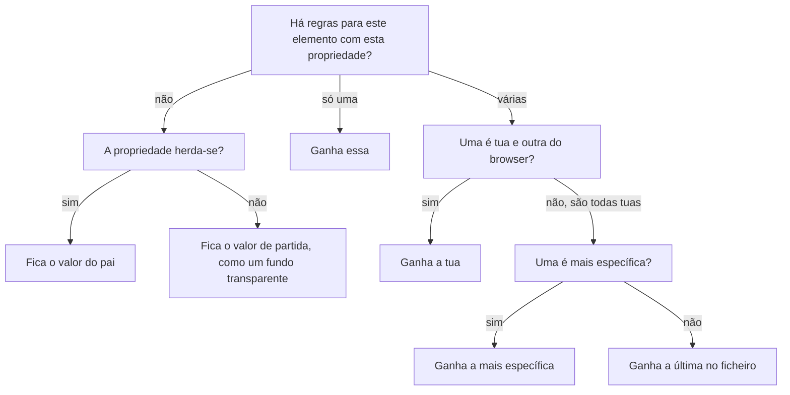

# CSS e Flexbox

Neste guia aprendes a dar aspeto às tuas páginas com CSS, sem mudar o que o HTML diz. Vês como se escreve uma regra, como se escolhem os elementos e qual ganha quando duas regras discordam. Depois arrumas caixas lado a lado com o Flexbox. O exemplo é a Estante Digital, que ganha uma folha de estilos passo a passo.

Usa o que viste nos guias anteriores. Rever: [Três linguagens, três trabalhos](01-web-e-planeamento.md#três-linguagens-três-trabalhos), [As ferramentas do programador](01-web-e-planeamento.md#as-ferramentas-do-programador) e [Atributos](02-html-e-semantica.md#atributos). Para praticar: [laboratório](laboratorios/03-css-e-flexbox-laboratorio.md) e [ficha de exercícios](exercicios/03-css-e-flexbox-exercicios.md).

## Neste guia

1. [Parte 1: Uma folha de estilos](#parte-1-uma-folha-de-estilos)
2. [Parte 2: Escolher os elementos](#parte-2-escolher-os-elementos)
3. [Parte 3: Quando duas regras discordam](#parte-3-quando-duas-regras-discordam)
4. [Parte 4: Texto, cor e unidades](#parte-4-texto-cor-e-unidades)
5. [Parte 5: Cada elemento é uma caixa](#parte-5-cada-elemento-é-uma-caixa)
6. [Parte 6: Arrumar com o Flexbox](#parte-6-arrumar-com-o-flexbox)
7. [Parte 7: Estados e acessibilidade](#parte-7-estados-e-acessibilidade)
8. [Exemplo guiado: a Estante Digital com CSS](#exemplo-guiado-a-estante-digital-com-css)

## Parte 1: Uma folha de estilos

### Uma regra de CSS: seletor, propriedade e valor

As páginas da Estante Digital têm a estrutura certa, mas o aspeto é o que o browser dá a todas. O texto é preto sobre fundo branco, os títulos são grandes e as ligações são azuis. Para pôr o título principal em azul-escuro, escreve-se uma **regra** de CSS:

```css
h1 {
  color: #1f4e8c;
}
```

A regra diz "em todos os elementos `h1`, a cor do texto é `#1f4e8c`", um azul-escuro. O **seletor**, antes das chavetas, diz a que elementos a regra se aplica: aqui, a todos os `h1`. Entre as chavetas vêm as declarações. Cada declaração tem uma propriedade, o que se muda, e um valor, como fica. Em `color: #1f4e8c;`, a propriedade é `color`, a cor do texto, e o valor é `#1f4e8c`.

Uma regra pode ter várias declarações, uma por linha:

```css
h1 {
  color: #1f4e8c;
  line-height: 1.2;
}
```

A forma tem de ser exata. Depois da propriedade vêm dois pontos, e cada declaração acaba num ponto e vírgula. As chavetas abrem-se e fecham-se sempre aos pares. Um ponto e vírgula esquecido estraga essa declaração e a seguinte, que o browser lê como uma só. A página não mostra erro nenhum: o browser ignora o que não percebe e continua.

Os comentários de CSS escrevem-se entre `/*` e `*/`, e o browser ignora-os:

```css
/* Os títulos principais na cor do site. */
h1 {
  color: #1f4e8c;
}
```

### A folha de estilos externa

As regras escrevem-se num ficheiro só delas, com a extensão `.css`, a **folha de estilos**. Nas aulas chama-se `estilos.css` e fica na pasta do site, ao lado das páginas. Cada página liga-se à folha com um elemento `link`, dentro do `head`, a seguir ao `title`:

```html
<link rel="stylesheet" href="estilos.css">
```

O `rel="stylesheet"` diz que o ficheiro é uma folha de estilos, e o `href` é o caminho para ele, como o de uma ligação. O `link` é um elemento vazio, como o `img`, sem etiqueta de fecho.

As três páginas da Estante Digital ligam-se ao mesmo `estilos.css`. Mudar a cor dos títulos no ficheiro muda-a nas três páginas de uma vez. E o HTML continua a dizer só o que cada pedaço é: o aspeto está todo noutro ficheiro.

<details>
<summary>Para ires mais longe: o CSS dentro do HTML</summary>

O CSS também se pode escrever dentro de uma página, num elemento `style` dentro do `head`, ou no atributo `style` de um elemento, como `<h1 style="color: #1f4e8c">`. Vais encontrar as duas formas em código de outras pessoas. Têm um problema: o estilo fica preso àquela página ou àquele elemento, e para mudar o site inteiro tens de procurar em todos os ficheiros. Nas aulas, o CSS vai sempre na folha de estilos externa.

</details>

### O browser já tem estilos

Sem nenhuma folha de estilos, um `h1` já aparece grande e a negrito, e uma ligação aparece azul e sublinhada. Uma lista tem bolinhas e um recuo à esquerda. Quem decide isto?

O próprio browser. Cada browser tem uma folha de estilos dele, com o aspeto por omissão de cada elemento. São os **estilos do browser**. As tuas regras juntam-se a eles e mudam só o que disserem. O que não disseres fica como o browser decidiu.

Quando uma regra tua e uma regra do browser dão valores diferentes à mesma propriedade, ganha sempre a tua. Alguns estilos do browser vão incomodar-te. O `body` tem uma margem de 8 píxeis à volta, e por isso o conteúdo nunca toca nos lados da janela. As listas `ul` têm um recuo à esquerda, onde ficam as bolinhas. Quando não os quiseres, tira-los com uma regra tua:

```css
body {
  margin: 0;
}
```

Com esta regra, o conteúdo da página encosta aos lados da janela.

## Parte 2: Escolher os elementos

### O seletor de elemento

O seletor mais simples é o nome de um elemento, como o `h1` da secção anterior. Aplica-se a todos os elementos desse tipo, em todas as páginas que usam a folha de estilos.

Para dar as mesmas declarações a vários tipos de elementos, separam-se os seletores com vírgulas:

```css
h1,
h2 {
  color: #1f4e8c;
}
```

Esta regra põe na mesma cor todos os `h1` e todos os `h2`. Escreve cada seletor do grupo na sua linha, para se lerem bem.

### O seletor de classe

Na página inicial da Estante Digital há três listas de recursos, e cada recurso vai ser um cartão. Na página do livro há outras listas, que não são de cartões. Um seletor `ul` apanhava todas. É preciso dar um nome às listas de cartões.

Esse nome é uma **classe**, que se escreve no HTML com o atributo `class`:

```html
<ul class="cartoes">
```

No CSS, o seletor de classe é o nome da classe com um ponto à frente:

```css
.cartoes {
  padding: 0;
}
```

A regra aplica-se a todos os elementos com a classe `cartoes`, e só a esses. As outras listas não mudam.

A classe não muda o que o elemento é: o `ul` continua a ser uma lista, para o browser e para um leitor de ecrã. É só um nome para o CSS o encontrar. Os nomes das classes seguem as regras dos nomes de ficheiros: minúsculas, sem espaços e sem acentos, com hífenes entre as palavras. Escolhe um nome que diga o que o elemento é, como `cartoes`. Não escolhas o aspeto que tem hoje, como `caixa-azul`, porque o aspeto pode mudar. No HTML, o nome escreve-se sem o ponto.

### O seletor descendente

O menu da Estante Digital é um `ul` dentro do `nav`. Para mudar só essa lista, sem lhe dar uma classe, escreve-se o seletor do pai, um espaço e o seletor do filho:

```css
nav ul {
  list-style: none;
}
```

O espaço quer dizer "dentro de": esta regra aplica-se aos `ul` que estão dentro de um `nav`, mesmo com outros elementos pelo meio. Chama-se **seletor descendente**. Tira as bolinhas ao menu, e as outras listas ficam com elas.

O mesmo serve com classes. O seletor `.cartoes li` apanha os `li` que estão dentro de um elemento com a classe `cartoes`, ou seja, cada cartão. E `header a` apanha as ligações do cabeçalho, sem tocar nas do conteúdo principal.

<details>
<summary>Para ires mais longe: o seletor de id</summary>

Um elemento com o atributo `id="horario"` pode ser escolhido no CSS com `#horario`, com um cardinal à frente. Como o `id` é único na página, a regra serve só para esse elemento. Um `id` vale mais do que qualquer número de classes, e por isso ganha a quase todas as outras regras. Nas aulas, o `id` usa-se para as ligações para uma secção, e não para dar aspeto.

</details>

## Parte 3: Quando duas regras discordam

### A herança

Numa só regra, a cor do texto do `body` passa a cinzento-escuro, e todo o texto da página muda: parágrafos, listas, títulos e rodapé.

```css
body {
  color: #222222;
}
```

Isto acontece por **herança**: algumas propriedades passam do pai para os filhos, e dos filhos para os filhos deles. Um `p` dentro do `main` dentro do `body` herda a cor do `body`, a não ser que uma regra lhe dê outra. As propriedades do texto herdam-se: a cor, o tipo de letra, o tamanho da letra e a altura da linha. As propriedades da caixa não se herdam: as margens, o espaço interior, as bordas e o fundo.

As ligações são a exceção que mais engana. Uma regra para o elemento, mesmo uma dos estilos do browser, ganha sempre à herança. E os estilos do browser dão ao `a` uma cor própria, o azul. Num cabeçalho com o texto branco, a árvore fica assim:

```text
body          color: #222222, da tua regra
└── header    color: #ffffff, da tua regra
    └── nav           herda o branco
        └── ul        herda o branco
            └── li    herda o branco
                └── a     azul, da regra do browser para o a
```

O texto do cabeçalho fica branco, mas a ligação fica azul, porque a regra do browser para o `a` ganha ao branco herdado. Para a pôr branca, precisas de uma regra tua para as ligações do cabeçalho, como `header a`.

### A ordem no ficheiro: a última regra ganha

Às vezes, duas regras tuas com o mesmo seletor dão valores diferentes à mesma propriedade:

```css
p {
  color: #222222;
}

p {
  color: #555555;
}
```

Os parágrafos ficam com `#555555`, o cinzento mais claro. Quando duas regras com o mesmo seletor discordam, ganha a que vem depois no ficheiro.

A ordem só decide a propriedade em que as regras discordam. Se a segunda regra mudasse só a cor, e a primeira desse também o tamanho da letra, o tamanho continuava a vir da primeira.

Por isso, uma folha de estilos escreve-se do geral para o particular. Primeiro vem o `body`, depois os títulos e as zonas da página, e no fim os casos especiais, que precisam de ganhar.

### A especificidade: o seletor mais preciso ganha

A ordem não é tudo. Nesta folha, os cartões ficam com o espaço interior de `1rem`, apesar de a regra do `li` vir depois:

```css
.cartoes li {
  padding: 1rem;
}

li {
  padding: 0;
}
```

O seletor `.cartoes li` é mais preciso do que `li`: não diz "todos os `li`", diz "os `li` das listas de cartões". A precisão de um seletor chama-se **especificidade**, e entre as tuas regras ganha sempre a mais específica, esteja onde estiver no ficheiro.

Para comparar dois seletores, conta primeiro as classes, e ganha o que tiver mais. Se empatarem, conta os nomes de elementos. Se empatarem outra vez, decide a ordem no ficheiro.

| Seletor | Classes | Elementos |
| --- | ---: | ---: |
| `li` | 0 | 1 |
| `section ul` | 0 | 2 |
| `.cartoes` | 1 | 0 |
| `.cartoes li` | 1 | 1 |

Os seletores `section ul` e `.cartoes` apanham as mesmas listas da página inicial. Se discordarem, ganha `.cartoes`, porque uma classe vale mais do que qualquer número de elementos.

A forma como o browser escolhe, entre várias regras, a que dá o valor a uma propriedade chama-se **cascata**. O diagrama mostra as perguntas, pela ordem em que o browser as faz:



Se nenhuma regra apanha o elemento, fica o valor herdado do pai, ou o valor de partida da propriedade. Se várias regras discordam, as tuas ganham às do browser. Entre as tuas, ganha a mais específica, e, entre as igualmente específicas, a última no ficheiro.

<details>
<summary>Para ires mais longe: o !important</summary>

Uma declaração com `!important` no fim, como `color: red !important;`, ganha a todas as outras, seja qual for a especificidade. Parece prático, mas a seguir só outro `!important` lhe ganha, e a folha de estilos enche-se deles. Quando uma regra não ganha, procura no inspetor porquê, em vez de a forçar.

</details>

### O inspetor mostra a regra que ganhou

Quando uma regra não faz o que esperavas, não adivinhes: pergunta ao browser. Nas ferramentas do programador, no separador Elements, carrega no elemento que te interessa. Ao lado da árvore, o separador Styles mostra todas as regras que o apanham, da que ganha, em cima, para as que perdem, em baixo.

Uma declaração que perdeu aparece riscada. Ao lado de cada regra, à direita, está o ficheiro e a linha de onde vem, como `estilos.css:67`. As regras marcadas `user agent stylesheet` são os estilos do browser. Mais abaixo, com o título `Inherited from`, estão as propriedades herdadas de cada elemento à volta: o pai, o pai do pai, e assim por diante.

O separador Computed, ao lado do Styles, mostra o valor final de cada propriedade, o que ficou depois de todas as decisões. Carregando na seta ao lado de um valor, vês a regra de onde ele veio.

No separador Styles também podes mudar um valor, ou desligar uma declaração com a caixa que aparece ao lado dela quando passas o rato. O efeito vê-se logo. Experimenta à vontade: mudas a cópia da folha de estilos que o browser tem na memória, e não o ficheiro. Ao recarregar a página, tudo volta ao que estava, como acontece com o DOM. Rever: [Mudar o DOM não muda o ficheiro](01-web-e-planeamento.md#mudar-o-dom-não-muda-o-ficheiro). Quando encontrares o valor certo, escreve-o no `estilos.css`.

## Parte 4: Texto, cor e unidades

### O tipo de letra e o tamanho do texto

O tipo de letra muda-se com a propriedade `font-family`. Não sabes que tipos de letra há no computador de quem abre a página. Por isso, dás uma lista, separada por vírgulas, e o browser usa o primeiro que encontrar:

```css
body {
  font-family: system-ui, "Segoe UI", Arial, sans-serif;
}
```

O `system-ui` é a letra que o sistema operativo usa nos menus. O `"Segoe UI"` e o `Arial` são duas letras conhecidas, para o caso de o browser não a conhecer. O último, `sans-serif`, quer dizer "qualquer letra sem os pequenos traços nas pontas", e garante que há sempre alguma. Um nome com espaços vai entre aspas.

Há mais quatro propriedades de texto que vais usar:

- `font-size`: o tamanho da letra;
- `font-weight`: a grossura da letra, como `bold`, a negrito, ou `normal`;
- `line-height`: a altura de cada linha, que afasta as linhas umas das outras;
- `text-align`: o alinhamento do texto, como `left`, à esquerda, ou `center`, ao centro.

O `line-height` escreve-se muitas vezes sem unidade, como `1.5`, que quer dizer uma vez e meia o tamanho da letra. Num parágrafo comprido, linhas com mais espaço entre elas leem-se melhor. O número decimal escreve-se com ponto, e não com vírgula.

### As unidades: px e rem

Os tamanhos escrevem-se com um número e uma unidade, sem espaço entre eles: `16px` ou `1rem`. As duas unidades que vais usar mais são estas:

- `px`, o píxel, um tamanho fixo;
- `rem`, um tamanho que depende do tamanho da letra da página: `1rem` é esse tamanho, que nos browsers vem com 16 píxeis.

Uma pessoa que vê mal pode aumentar o tamanho da letra nas definições do browser. Uma página feita em `rem` cresce com ela, e uma página feita em `px` fica igual.

Por isso, nas aulas, os tamanhos de letra e os espaços escrevem-se em `rem`, como `font-size: 1.25rem` ou `padding: 1rem`. O `px` fica para o que deve ficar fino em qualquer caso, como uma borda de `1px`.

| Valor | Em píxeis, com a letra de 16 píxeis | Em píxeis, com a letra aumentada para 20 píxeis |
| --- | ---: | ---: |
| `1rem` | 16 | 20 |
| `1.5rem` | 24 | 30 |
| `24px` | 24 | 24 |

### As cores

As cores escrevem-se de várias maneiras. As duas que vais usar são o nome em inglês, como `white` ou `black`, e o código hexadecimal, como `#1f4e8c`. O código começa por um cardinal e tem seis algarismos e letras, de `0` a `9` e de `a` a `f`. Ninguém os decora: escolhe-se a cor na janela de escolher cores e copia-se o código.

Há duas propriedades de cor que se usam sempre juntas: `color`, a cor do texto, e `background-color`, a cor do fundo.

```css
header {
  color: #ffffff;
  background-color: #1f4e8c;
}
```

O cabeçalho fica com texto branco sobre fundo azul-escuro. No separador Styles, ao lado de cada cor, há um quadrado colorido. Carregando nele, abre-se a janela de escolher cores, onde podes experimentar outras e copiar o código.

### As variáveis de CSS

Numa folha de estilos com o azul do site em seis regras, mudar o azul obriga a mudar seis linhas, e é fácil esquecer uma. Uma **variável de CSS** dá um nome a um valor, que se escreve uma vez e se usa em vários sítios:

```css
:root {
  --cor-principal: #1f4e8c;
}

h1 {
  color: var(--cor-principal);
}
```

O nome da variável começa por dois hífens, como `--cor-principal`. Para a usar, escreve-se `var(` e o nome, e fecha-se o parêntese. O `:root` é um seletor especial, com dois pontos à frente, que apanha sempre o elemento `html`, o que embrulha a página toda. Como as variáveis se herdam, uma variável escrita no `:root` serve para todos os elementos da página.

Agora, para mudar o azul do site inteiro, muda-se uma só linha. Dá às variáveis nomes em português que digam para que servem, como `--cor-principal` ou `--espaco`, e não a cor que têm hoje.

## Parte 5: Cada elemento é uma caixa

### O modelo de caixa

Para o browser, cada elemento é um retângulo, mesmo quando não se vê. O cartão de um recurso tem o texto, um espaço à volta do texto, uma borda e, por fora, um espaço até ao cartão seguinte. Esta forma de ver cada elemento chama-se **modelo de caixa**, e tem quatro camadas, de dentro para fora:

```text
┌──────────────────────────────── margin ────────────────────────────────┐
│  ┌──────────────────────────── border ──────────────────────────────┐  │
│  │  ┌──────────────────────── padding ───────────────────────────┐  │  │
│  │  │                                                            │  │  │
│  │  │            conteúdo: o texto, a imagem, os filhos          │  │  │
│  │  │                                                            │  │  │
│  │  └────────────────────────────────────────────────────────────┘  │  │
│  └──────────────────────────────────────────────────────────────────┘  │
└────────────────────────────────────────────────────────────────────────┘
```

O desenho mostra as quatro camadas, umas dentro das outras. O conteúdo está no centro, com o espaço interior à volta, depois a borda e, por fora, a margem.

| Camada | Propriedade | O que é |
| --- | --- | --- |
| Conteúdo | `width` e `height` | O texto, a imagem ou os elementos filhos |
| Espaço interior | `padding` | O espaço entre o conteúdo e a borda, com o fundo da caixa |
| Borda | `border` | A linha à volta do espaço interior |
| Margem | `margin` | O espaço por fora da borda, que afasta a caixa das outras, sempre transparente |

O `padding` e o `margin` aceitam um valor para os quatro lados, como `padding: 1rem`. Também aceitam dois valores, o primeiro para cima e baixo e o segundo para os lados, como `padding: 0.5rem 1rem`. E cada lado tem a sua propriedade: `margin-top`, `padding-left`, `border-bottom`.

No separador Computed, o topo mostra a caixa do elemento escolhido, com as quatro camadas e os seus tamanhos. E quando passas o rato por um elemento no Elements, a página pinta as camadas da caixa com cores diferentes.

### A largura de uma caixa e o box-sizing

Uma caixa com `width: 300px`, `padding: 16px` e uma borda de `1px` tem que largura no ecrã? Por omissão, 334 píxeis: os 300 do conteúdo, mais 16 de cada lado de espaço interior e 1 de cada lado de borda. O `width` diz só a largura do conteúdo. Uma caixa com `width: 100%` e algum `padding` fica, por isso, mais larga do que o pai, e sai pelo lado direito da página.

A propriedade `box-sizing` muda a conta. Com o valor `border-box`, o `width` passa a incluir o espaço interior e a borda. A mesma caixa fica com 300 píxeis no ecrã, e o conteúdo encolhe para caber.

| `box-sizing` | O `width` mede | Largura no ecrã da caixa do exemplo |
| --- | --- | ---: |
| `content-box`, por omissão | Só o conteúdo | 334 píxeis |
| `border-box` | O conteúdo, o espaço interior e a borda | 300 píxeis |

Por ser mais fácil de prever, põe-se o `border-box` em todos os elementos, logo no início da folha de estilos:

```css
* {
  box-sizing: border-box;
}
```

O seletor `*` apanha todos os elementos da página. Usa-se muito pouco, e esta é uma das poucas regras em que faz sentido.

### Fundos, bordas e cantos redondos

O fundo de uma caixa muda-se com `background-color`, e pinta o conteúdo e o espaço interior. A borda escreve-se com três valores, separados por espaços: a grossura, o estilo e a cor.

```css
.cartoes li {
  padding: 1rem;
  border: 1px solid #c9d3e0;
  border-radius: 0.5rem;
  background-color: #ffffff;
}
```

O `solid` é uma linha contínua, e há outros estilos, como `dashed`, tracejada. O `border-radius` arredonda os cantos: quanto maior o valor, mais redondos. Cada cartão fica uma caixa branca, com uma borda fina azulada e os cantos redondos.

Uma borda só num lado escreve-se com a propriedade desse lado. A dica da página do livro tem uma barra grossa à esquerda, com `border-left: 0.5rem solid #1f4e8c`.

### Elementos de bloco e elementos em linha

Nem todas as caixas se comportam da mesma maneira. Um parágrafo começa sempre numa linha nova e ocupa a largura toda, mesmo com pouco texto. Um `strong` fica a meio da frase, do tamanho das palavras que marca.

O `p` é um **elemento de bloco**: começa numa linha nova e estica-se na largura do pai. São de bloco os títulos, os parágrafos, as listas e os seus itens, e as zonas da página, como `header`, `main`, `section` e `footer`. O `strong` é um **elemento em linha**: fica no meio do texto, sem mudar de linha. São em linha o `a`, o `strong` e o `em`.

A diferença conta para o modelo de caixa. Num elemento em linha, o `width` e o `height` não fazem nada, e a margem de cima e de baixo não afasta as linhas. É por isso que o `a` não ganha largura quando lhe dás um `width`. O `img` também fica na linha do texto, mas é uma exceção: aceita o `width` e o `height`.

A propriedade `display` muda o comportamento de uma caixa: `display: block` torna-a de bloco, e `display: inline` torna-a em linha. O `display` tem mais um valor, que é o assunto da próxima parte: `flex`.

<details>
<summary>Para ires mais longe: o position</summary>

A propriedade `position` tira uma caixa do sítio onde o browser a pôs. Com `position: relative`, a caixa desloca-se um pouco do seu lugar, com `top` ou `left`, e o espaço dela fica reservado. Com `position: absolute`, a caixa sai do fluxo e fica num ponto exato do pai, por cima do resto. Serve para casos raros, como uma etiqueta "Novo" no canto de um cartão. Para arrumar a página, usa-se o Flexbox, porque uma caixa posta à mão não se adapta ao ecrã.

</details>

## Parte 6: Arrumar com o Flexbox

### O Flexbox põe os filhos lado a lado

Os itens do menu da Estante Digital aparecem uns por baixo dos outros, porque cada `li` é um elemento de bloco. No wireframe, o menu é uma linha: "Início" e "Sobre" lado a lado.

O **Flexbox** é a forma do CSS de arrumar caixas numa linha. Põe-se `display: flex` no pai, e os filhos passam a ficar lado a lado:

```css
nav ul {
  display: flex;
}
```

O elemento com `display: flex` chama-se **contentor**, e os seus filhos diretos são os itens, sejam eles itens de lista ou não. Aqui, o contentor é o `ul` do menu, e os itens são os dois `li`. O Flexbox só arruma os filhos diretos:

```text
ul        o contentor, com display: flex
├── li    item: fica lado a lado com o outro li
│   └── a     não é item deste contentor
└── li    item
    └── a     não é item deste contentor
```

A árvore mostra que as ligações estão dentro dos itens, um nível abaixo. O `display: flex` do `ul` arruma os `li`, e não mexe nas ligações. Os itens ficam lado a lado pela ordem do HTML.

### O espaço entre os itens e o alinhamento

Com o `display: flex`, os itens ficam colados uns aos outros. Três propriedades do contentor arrumam-nos:

- `gap`: o espaço entre os itens, como `gap: 1rem`;
- `justify-content`: onde ficam os itens ao longo da linha;
- `align-items`: como se alinham os itens na altura.

| Propriedade | Valor | O que faz |
| --- | --- | --- |
| `justify-content` | `flex-start`, por omissão | Os itens juntam-se ao início da linha |
| `justify-content` | `center` | Os itens juntam-se ao centro |
| `justify-content` | `space-between` | O primeiro vai para o início, o último para o fim, e o espaço que sobra fica entre eles |
| `align-items` | `stretch`, por omissão | Os itens esticam até à altura do mais alto |
| `align-items` | `center` | Os itens alinham-se pelo meio da altura |

O cabeçalho da Estante Digital usa as três. O `header` tem dois filhos, o parágrafo com o nome do site e o `nav`. Com `justify-content: space-between`, o nome vai para a esquerda e o menu para a direita. Com `align-items: center`, ficam alinhados pelo meio, mesmo com o logótipo mais alto do que o menu.

```css
header {
  display: flex;
  justify-content: space-between;
  align-items: center;
  gap: 1rem;
}
```

O `gap` garante que, numa janela estreita, o nome e o menu nunca ficam colados.

### Os itens que passam à linha seguinte e crescem

Uma lista de cartões tem um problema que o menu não tem: os cartões podem não caber numa linha. Por omissão, o Flexbox encolhe os itens para caberem todos na mesma linha, e o que mesmo assim não cabe sai pela direita.

A propriedade `flex-wrap: wrap`, no contentor, deixa os itens passar à linha seguinte quando não cabem. E duas propriedades dos itens dizem a largura de cada um:

- `flex-basis`: a largura de partida do item, como `15rem`;
- `flex-grow`: se o item cresce para ocupar o espaço que sobra na linha. Com `1`, cresce, e com `0`, o valor por omissão, não cresce.

```css
.cartoes {
  display: flex;
  flex-wrap: wrap;
  gap: 1rem;
}

.cartoes li {
  flex-basis: 15rem;
  flex-grow: 1;
}
```

Antes de leres o resultado, prevê: numa janela larga, com espaço para três cartões de `15rem`, como ficam os dois cartões da secção "Livros"? E num telemóvel, em que não cabem dois cartões lado a lado?

Na janela larga, os dois cartões ficam lado a lado e crescem até ocupar a linha toda, cada um com metade. No telemóvel, o segundo cartão passa para baixo do primeiro, e cada um cresce até à largura toda. A mesma regra serve as duas larguras, sem contas de píxeis.

O Flexbox muda o sítio onde as caixas aparecem, mas não muda a ordem delas no HTML. O teclado e o leitor de ecrã seguem a ordem do HTML, e por isso a ordem de leitura continua a mesma. Rever: [O wireframe estreito e o largo têm a mesma ordem de leitura](01-web-e-planeamento.md#o-wireframe-estreito-e-o-largo-têm-a-mesma-ordem-de-leitura).

<details>
<summary>Para ires mais longe: as colunas e a ordem dos itens</summary>

A propriedade `flex-direction: column`, no contentor, põe os itens em coluna, de cima para baixo, sem mudar a ordem. A direção em que os itens se põem chama-se o eixo principal, e a que a corta, o eixo cruzado. Numa coluna, o `justify-content` passa a trabalhar na vertical.

O Flexbox tem também formas de mostrar os itens por outra ordem, como a propriedade `order` e o valor `row-reverse` do `flex-direction`. Mudam o ecrã sem mudar o HTML, e o foco do teclado passa a saltar de um lado para o outro. Quando a ordem tem de mudar, muda-se o HTML.

</details>

## Parte 7: Estados e acessibilidade

### As pseudo-classes :hover e :focus-visible

Uma ligação pode estar em estados diferentes: com o rato por cima, com o foco do teclado, já visitada. Para dar um aspeto a um estado, escreve-se o seletor, dois pontos e o nome do estado:

```css
a:hover {
  text-decoration-thickness: 3px;
}

a:focus-visible {
  outline: 3px solid #1f4e8c;
  outline-offset: 2px;
}
```

O `:hover` e o `:focus-visible` são **pseudo-classes**: seletores de estado, que o browser aplica e deixa de aplicar sozinho, conforme o que acontece ao elemento. O `:hover` aplica-se enquanto o rato está por cima da ligação, e aqui o sublinhado fica mais grosso. O `:focus-visible` aplica-se quando a ligação tem o foco e o browser o deve mostrar, como quando se chega lá com a tecla Tab.

O `outline` é uma moldura à volta da caixa, por fora da borda, que não ocupa espaço e não empurra nada. Escreve-se como a borda, e o `outline-offset` afasta-a da ligação. Na especificidade, uma pseudo-classe conta como uma classe: `header a:focus-visible` tem uma classe e dois elementos.

<details>
<summary>Para ires mais longe: o :focus, outros estados e os pseudo-elementos</summary>

Existe também o `:focus`, que se aplica sempre que o elemento tem o foco, mesmo quando se carrega numa ligação com o rato. O `:focus-visible` só se aplica quando o foco deve ver-se, e por isso é o que usamos para a moldura.

Há outras pseudo-classes de estado, como o `:disabled`. Aplica-se a um botão ou a um campo de formulário desligado, em que não se pode carregar nem escrever.

Parecidos com as pseudo-classes são os pseudo-elementos, com dois pares de dois pontos, como o `::before`. Acrescentam uma caixa decorativa antes do conteúdo de um elemento, sem mudar o HTML. Esta regra põe um pequeno quadrado da cor principal antes de cada título `h2`:

```css
h2::before {
  content: "";
  display: inline-block;
  width: 0.5rem;
  height: 0.5rem;
  margin-right: 0.5rem;
  background-color: #1f4e8c;
}
```

O `content` é obrigatório, mesmo vazio. Um pseudo-elemento serve só para decorar: o texto que se lê tem de estar no HTML, porque um leitor de ecrã pode não o ler.

</details>

### O foco tem de se ver

Quem usa o teclado sabe onde está pela moldura do foco. Os browsers desenham uma moldura por omissão. Às vezes, num site, alguém a acha feia e escreve `outline: none`. A partir daí, quem anda com a tecla Tab deixa de saber onde está.

A regra é esta: o foco vê-se sempre. Podes mudar o aspeto da moldura, mas nunca a tiras sem pôr outra coisa no lugar. A moldura também precisa de se distinguir do fundo. Na Estante Digital, a moldura azul não se via no cabeçalho azul, e uma regra mais específica pô-la branca só lá:

```css
header a:focus-visible {
  outline-color: #ffffff;
}
```

Esta regra ganha a `a:focus-visible` porque tem um elemento a mais no seletor, e muda só a cor da moldura. A grossura e o afastamento continuam a vir da regra geral.

### O contraste entre o texto e o fundo

Cinzento-claro sobre branco custa a ler a toda a gente, e para quem vê mal fica invisível. A diferença de claridade entre o texto e o fundo chama-se **contraste**. Mede-se com um número: 1 quer dizer nenhum, e 21 é o preto sobre branco. Num texto normal, o mínimo é 4,5.

O browser mede-o por ti. No separador Styles, carrega no quadrado colorido ao lado da cor do texto. Na janela de escolher cores, a linha `Contrast ratio` mostra o número do contraste com o fundo e uma marca a dizer se chega.

### As ligações continuam a parecer ligações

No meio de um parágrafo, uma ligação distingue-se do resto do texto pelo sublinhado e pela cor. Se tirares o sublinhado, só fica a cor, e há pessoas que não distinguem as cores. A informação nunca depende só da cor.

Por isso, as ligações dentro do texto ficam sublinhadas. No menu, onde está claro que tudo é uma ligação, podias tirar o sublinhado com `text-decoration: none`.

## Exemplo guiado: a Estante Digital com CSS

Neste exemplo, as três páginas da Estante Digital ganham uma folha de estilos, construída regra a regra. O HTML só ganha o `link` para a folha e a classe das listas de cartões. Os ficheiros completos estão na pasta [estante-digital-com-css](../exemplos/frontend/estante-digital-com-css/README.md) dos exemplos, para os abrires no browser e no editor.

### Passo 1: Partir do wireframe

Tal como o HTML, o CSS não se inventa ao escrever. Antes de abrir o editor, olha-se para o wireframe largo da página inicial e decide-se o que muda de aspeto. Rever: [Passo 7: O wireframe largo da página inicial](01-web-e-planeamento.md#passo-7-o-wireframe-largo-da-página-inicial).

| No wireframe | No CSS |
| --- | --- |
| Uma faixa no topo, com o nome do site à esquerda e o menu à direita | O `header` com Flexbox, fundo azul e texto branco |
| O menu numa linha | O `ul` do `nav` com Flexbox, sem bolinhas |
| Os três grupos de recursos lado a lado | Cada grupo fica por baixo do anterior, e os recursos de cada grupo ficam lado a lado, em cartões |

Na última linha, o CSS afasta-se do wireframe. Pôr as três secções lado a lado obrigava a juntá-las numa caixa nova no HTML, porque o `main` tem também o título e os parágrafos. Neste exemplo, o HTML fica como está, e os cartões são os recursos.

### Passo 2: A folha de estilos e a ligação

Na pasta do site, cria-se o ficheiro `estilos.css`, e em cada uma das três páginas acrescenta-se o `link`, a seguir ao `title`:

```html
<!-- A folha de estilos: o mesmo ficheiro dá o aspeto às três páginas. -->
<link rel="stylesheet" href="estilos.css">
```

Para confirmar que a ligação funciona, a primeira regra é uma que se nota logo:

```css
body {
  background-color: #f7f5f0;
}
```

Recarregada a página, o fundo fica cor de papel. Se continuar branco, o caminho do `href` ou o nome do ficheiro estão errados.

### Passo 3: As variáveis e o corpo da página

As cores e o espaço do site ficam com nome, no início do ficheiro. A seguir vem o `box-sizing` para todos. A regra do `body` passa a usar as variáveis e substitui a do passo 2:

```css
:root {
  --cor-principal: #1f4e8c;
  --cor-texto: #222222;
  --cor-fundo: #f7f5f0;
  --cor-cartao: #ffffff;
  --cor-borda: #c9d3e0;
  --espaco: 1rem;
}

* {
  box-sizing: border-box;
}

body {
  margin: 0;
  font-family: system-ui, "Segoe UI", Arial, sans-serif;
  font-size: 1rem;
  line-height: 1.5;
  color: var(--cor-texto);
  background-color: var(--cor-fundo);
}
```

A letra passa à do sistema, as linhas afastam-se e o conteúdo encosta aos lados da janela.

### Passo 4: O cabeçalho

```css
header {
  display: flex;
  flex-wrap: wrap;
  justify-content: space-between;
  align-items: center;
  gap: var(--espaco);
  padding: var(--espaco);
  color: #ffffff;
  background-color: var(--cor-principal);
}

header p {
  display: flex;
  align-items: center;
  gap: 0.5rem;
  margin: 0;
  font-size: 1.25rem;
  font-weight: bold;
}
```

O nome do site vai para a esquerda e o menu para a direita, numa faixa azul. O parágrafo do nome também é um contentor flex, para o logótipo e o texto ficarem alinhados pelo meio. O `flex-wrap` deixa o menu passar para baixo do nome numa janela muito estreita.

As ligações do menu continuam azuis, agora sobre o fundo azul, e quase não se veem.

### Passo 5: O menu

```css
nav ul {
  display: flex;
  gap: var(--espaco);
  margin: 0;
  padding: 0;
  list-style: none;
}

header a {
  color: #ffffff;
}
```

O menu fica numa linha, sem bolinhas nem recuo, com as ligações brancas.

No inspetor, carrega-se na ligação "Início". O separador Styles mostra a regra `header a`, com `color: #ffffff`, e mais abaixo a regra `a:-webkit-any-link` dos estilos do browser, com a cor riscada. O nome desta última muda de browser para browser, mas está sempre marcada `user agent stylesheet`.

### Passo 6: O conteúdo principal e os títulos

```css
main {
  max-width: 60rem;
  margin: 0 auto;
  padding: var(--espaco);
}

h1,
h2 {
  color: var(--cor-principal);
  line-height: 1.2;
}
```

O `max-width` impede o texto de se estender por um ecrã largo inteiro, onde as linhas ficavam compridas demais para ler. A margem `0 auto` tem dois valores. O `0` vale para cima e para baixo, e o `auto` dá margens iguais à esquerda e à direita, que põem o `main` ao centro.

### Passo 7: Os cartões

Na página inicial, cada uma das três listas de recursos ganha a classe `cartoes`:

```html
<ul class="cartoes">
```

E no `estilos.css`:

```css
.cartoes {
  display: flex;
  flex-wrap: wrap;
  gap: var(--espaco);
  padding: 0;
  list-style: none;
}

.cartoes li {
  flex-basis: 15rem;
  flex-grow: 1;
  padding: var(--espaco);
  border: 1px solid var(--cor-borda);
  border-radius: 0.5rem;
  background-color: var(--cor-cartao);
}
```

Cada recurso passa a ser uma caixa branca, com borda e cantos redondos, dois lado a lado em cada secção. As listas da página do livro não mudam, porque não têm a classe.

### Passo 8: A dica, as ligações e o rodapé

```css
aside {
  margin-top: var(--espaco);
  padding: var(--espaco);
  border-left: 0.5rem solid var(--cor-principal);
  background-color: var(--cor-cartao);
}

a:hover {
  text-decoration-thickness: 3px;
}

a:focus-visible {
  outline: 3px solid var(--cor-principal);
  outline-offset: 2px;
}

header a:focus-visible {
  outline-color: #ffffff;
}

footer {
  padding: var(--espaco);
  border-top: 1px solid var(--cor-borda);
  font-size: 0.875rem;
  text-align: center;
}
```

A dica da página do livro fica numa caixa branca com uma barra azul à esquerda. O rodapé fica com letra mais pequena, ao centro. O ficheiro completo, com um comentário por regra, é o [estilos.css](../exemplos/frontend/estante-digital-com-css/estilos.css) da pasta do exemplo.

### Passo 9: Verificar

Com a folha de estilos pronta, repete-se a verificação do tema 02, e acrescentam-se três coisas. Rever: [Verificar uma página](02-html-e-semantica.md#verificar-uma-página).

O foco: com a tecla Tab, o foco passa por "Início", "Sobre" e "Primeiros passos na Web", por esta ordem, a ordem do HTML. A moldura é branca no cabeçalho e azul no conteúdo.

A largura: estreitando a janela do browser o mais que dá, os cartões ficam uns por baixo dos outros e o menu continua a caber. Com o zoom do browser a 200%, com Ctrl e a tecla +, acontece o mesmo. Em nenhum dos dois casos aparece uma barra de deslocamento horizontal.

O contraste: o texto branco sobre o azul do cabeçalho tem um contraste de cerca de 8. O texto cinzento-escuro sobre o fundo cor de papel tem cerca de 15. Os dois passam bem os 4,5.

## Erros frequentes

### Nenhuma regra funciona

O que se vê: a página tem o aspeto de sempre, como se a folha de estilos não existisse.

Porque acontece: o browser não encontrou o ficheiro. O `href` do `link` não corresponde ao nome do ficheiro, falta o `rel="stylesheet"`, ou o ficheiro chama-se `estilos.css.txt`, porque foi criado fora do VS Code.

Como se corrige: compara letra a letra o `href` com o nome do ficheiro, na mesma pasta. No separador Elements, carrega no `body`: se o separador Styles não mostra nenhuma regra do `estilos.css`, o ficheiro não foi carregado.

### Uma regra não faz nada

O que se vê: uma regra não muda a página. No separador Styles, a declaração aparece riscada, com um pequeno triângulo amarelo ao lado.

Porque acontece: a propriedade ou o valor estão mal escritos, como `colour` em vez de `color`, ou `16 px`, com um espaço. Pode também faltar um ponto e vírgula na linha anterior, ou uma chaveta.

Como se corrige: passa o rato pelo triângulo, que diz se a propriedade é desconhecida ou se o valor é inválido. Confirma os dois pontos, o ponto e vírgula e as chavetas.

### A regra da classe não apanha nada

O que se vê: os elementos com a classe não mudam, e no separador Styles a regra não aparece.

Porque acontece: no HTML, a classe foi escrita com o ponto, `class=".cartoes"`. Ou, no CSS, o seletor ficou sem ele, `cartoes`. Ou os dois nomes não são iguais, como `cartoes` e `cartões`.

Como se corrige: no HTML, a classe escreve-se sem ponto. No CSS, com ponto. E os nomes têm de ser exatamente iguais, sem acentos.

### A regra está certa, mas perde

O que se vê: a declaração aparece riscada no separador Styles, sem triângulo amarelo, e outra regra, mais acima, dá o valor que fica.

Porque acontece: a outra regra é mais específica, ou vem depois no ficheiro.

Como se corrige: lê no separador Styles a regra que ganhou e a linha de onde vem. Torna o teu seletor mais específico, ou junta a declaração à regra que está a ganhar, em vez de usar `!important`.

### Aparece uma barra de deslocamento horizontal

O que se vê: a página mexe para o lado, e há uma parte em branco à direita.

Porque acontece: uma caixa é mais larga do que a janela. Quase sempre é uma caixa com `width: 100%` e `padding`, sem o `box-sizing: border-box`, ou uma caixa com uma largura fixa grande, em píxeis.

Como se corrige: confirma que o `box-sizing: border-box` está no início da folha de estilos. No Elements, passa o rato pelas caixas até encontrares a que sai pelo lado direito, e vê no Computed a largura dela.

### O display: flex não fez nada

O que se vê: os elementos continuam uns por baixo dos outros.

Porque acontece: o `display: flex` foi posto nos itens, e não no pai deles. Para pôr os `li` lado a lado, o `display: flex` vai no `ul`.

Como se corrige: põe o `display: flex` no elemento que contém diretamente as caixas que queres arrumar.

## Palavras novas deste guia

- Regra: um seletor e, entre chavetas, as declarações que se aplicam aos elementos que ele escolhe.
- Seletor: a parte da regra que diz a que elementos ela se aplica.
- Declaração: uma propriedade e um valor, como `color: #1f4e8c;`. A propriedade é o que se muda, e o valor é como fica.
- Folha de estilos: um ficheiro `.css` com as regras de um site, ligado às páginas com o elemento `link`.
- Estilos do browser: o aspeto por omissão que o browser dá a cada elemento. As tuas regras ganham-lhes sempre.
- Classe: um nome que se dá a elementos com o atributo `class`, para o CSS os escolher com um ponto à frente.
- Seletor descendente: dois seletores separados por um espaço, que escolhe os elementos que estão dentro de outros.
- Herança: a passagem de algumas propriedades, como a cor do texto, do pai para os filhos.
- Especificidade: a precisão de um seletor. Entre as tuas regras que discordam, ganha a mais específica.
- Cascata: a forma como o browser escolhe a regra que ganha. Primeiro, as tuas ganham às do browser; depois decide a especificidade e, por fim, a ordem no ficheiro.
- Variável de CSS: um nome, começado por dois hífens, que guarda um valor para se usar com `var()`.
- Modelo de caixa: a forma de ver cada elemento como uma caixa, com o conteúdo, o espaço interior, a borda e a margem.
- Elemento de bloco: um elemento que começa numa linha nova e ocupa a largura do pai, como o `p`.
- Elemento em linha: um elemento que fica no meio do texto, como o `a`.
- Flexbox: a forma do CSS de arrumar os filhos de um elemento numa linha.
- Contentor: o elemento com `display: flex`, cujos filhos diretos são os itens.
- Pseudo-classe: um seletor de estado, como `:hover`, escrito com dois pontos a seguir ao seletor, que o browser aplica conforme o que acontece ao elemento.
- Contraste: a diferença de claridade entre o texto e o fundo, medida de 1 a 21.

As propriedades deste guia, e o que cada uma faz:

- `color` e `background-color`: a cor do texto e a cor do fundo.
- `font-family`, `font-size`, `font-weight`, `line-height` e `text-align`: o tipo de letra, o tamanho, a grossura, a altura da linha e o alinhamento do texto.
- `width` e `max-width`: a largura e a largura máxima. `box-sizing`: o que a largura mede.
- `padding`, `border`, `border-radius` e `margin`: o espaço interior, a borda, os cantos redondos e a margem.
- `display`: o comportamento da caixa, como `block`, `inline` ou `flex`.
- `list-style`: as bolinhas ou os números de uma lista. `text-decoration-thickness`: a grossura do sublinhado.
- `gap`, `justify-content`, `align-items` e `flex-wrap`: o espaço, a posição, o alinhamento e a passagem à linha seguinte dos itens de um contentor flex.
- `flex-basis` e `flex-grow`: a largura de partida de um item e se ele cresce.
- `outline` e `outline-offset`: a moldura por fora da borda e o afastamento dela.

## O que vem a seguir

No tema seguinte, o segundo do Git, guardas o teu site no GitHub.

## Para saber mais

- MDN Web Docs, [CSS](https://developer.mozilla.org/pt-BR/docs/Web/CSS), em português do Brasil: cada propriedade explicada, com exemplos que se podem experimentar.
- CSS-Tricks, [A Complete Guide to Flexbox](https://css-tricks.com/snippets/css/a-guide-to-flexbox/), em inglês: todas as propriedades do Flexbox, cada uma com um desenho.
- WebAIM, [Contrast Checker](https://webaim.org/resources/contrastchecker/), em inglês: escreves a cor do texto e a do fundo e vês o contraste.


