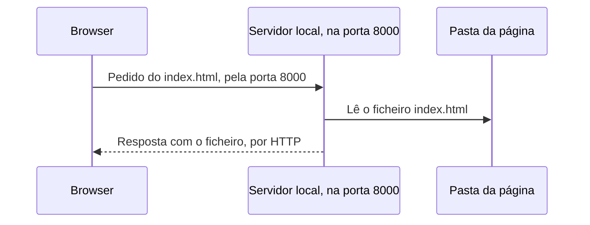
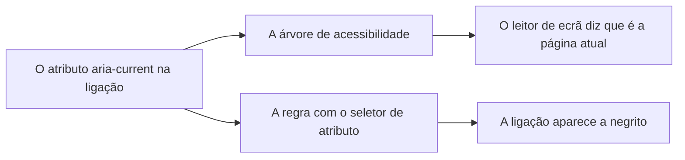
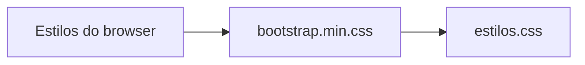

# Acessibilidade e frameworks de CSS

Neste guia aprendes a verificar se qualquer pessoa consegue usar o teu site, também quem usa só o teclado ou um leitor de ecrã. Registas e corrigis o que falha, e usas o ARIA no sítio onde o HTML não chega. No fim, refazes uns cartões com o Bootstrap, um framework de CSS, e comparas o que ganhas e o que perdes.

Usa o que já fizeste para quem não vê a página e para quem usa o teclado, e a cascata do tema 03. Rever: [O texto alternativo](02-html-e-semantica.md#o-texto-alternativo), [A árvore de acessibilidade](02-html-e-semantica.md#a-árvore-de-acessibilidade), [O foco tem de se ver](03-css-e-flexbox.md#o-foco-tem-de-se-ver) e [A ordem no ficheiro: a última regra ganha](03-css-e-flexbox.md#a-ordem-no-ficheiro-a-última-regra-ganha). Para praticar: [laboratório](laboratorios/05-acessibilidade-e-frameworks-de-css-laboratorio.md) e [ficha de exercícios](exercicios/05-acessibilidade-e-frameworks-de-css-exercicios.md).

## Neste guia

1. [Parte 1: Uma página que todos conseguem usar](#parte-1-uma-página-que-todos-conseguem-usar)
2. [Parte 2: Os nomes e o ARIA](#parte-2-os-nomes-e-o-aria)
3. [Parte 3: Um framework de CSS](#parte-3-um-framework-de-css)
4. [Exemplo guiado: a Estante Digital auditada e comparada](#exemplo-guiado-a-estante-digital-auditada-e-comparada)

## Parte 1: Uma página que todos conseguem usar

### A acessibilidade é para todas as pessoas

A Rita partiu o braço direito e passa um mês a usar o computador só com a mão esquerda, sem rato. O avô do Tiago vê mal e aumenta a letra do browser. Uma aluna cega da escola ouve as páginas com um leitor de ecrã. E, no recreio, ao sol, ninguém lê um texto cinzento-claro no telemóvel. Uma página que só funciona com rato, boa vista e boa luz deixa estas pessoas de fora.

A **acessibilidade** é a qualidade de uma página que todas as pessoas conseguem usar, com as suas formas de ver, ouvir, mexer e perceber. Ajuda quem tem uma deficiência, e ajuda também quem está numa situação difícil, como o braço partido ou o sol no ecrã.

As regras de acessibilidade para a web estão num documento internacional, as **WCAG**. O nome vem do inglês *Web Content Accessibility Guidelines*, as orientações de acessibilidade para o conteúdo da web. Organizam-se em quatro princípios. Já cumpriste uma parte de cada um nos temas anteriores:

| Princípio | A pergunta | O que já fizeste |
| --- | --- | --- |
| Percetível | Consegue-se ver ou ouvir o conteúdo? | O texto alternativo das imagens e o contraste |
| Operável | Consegue-se usar a página e andar nela? | O teste do teclado, o foco visível, os títulos e as ligações que dizem para onde levam |
| Compreensível | Percebe-se o conteúdo e o site? | O idioma da página e o mesmo menu, no mesmo sítio, em todas as páginas |
| Robusto | Os programas, como o leitor de ecrã, percebem a página? | O HTML pela sua função, que dá os papéis na árvore de acessibilidade |

Cada regra das WCAG tem um nível: A, AA ou AAA. O A é o mínimo, e o AA é o que os sites procuram cumprir. O contraste mínimo de 4,5, do tema 03, é uma regra do nível AA.

### A auditoria faz-se à mão, com uma lista

A Estante Digital parece bem feita. Mas uma barreira só aparece quando se usa a página de outra forma: sem rato, com a letra maior, ou a ouvir.

Uma **auditoria de acessibilidade** é percorrer cada página com uma lista de verificações, à mão, para encontrar o que impede alguém de a usar. A lista tem oito verificações:

1. Teclado: com Tab, Shift+Tab e Enter, chegas a todas as ligações, pela ordem do HTML, e segues cada uma. Rever: [Verificar uma página](02-html-e-semantica.md#verificar-uma-página).
2. Foco: a moldura vê-se sempre, em todas as ligações e em todos os fundos. Rever: [O foco tem de se ver](03-css-e-flexbox.md#o-foco-tem-de-se-ver).
3. Nomes: cada imagem tem `alt`, com texto ou vazio, e cada ligação diz para onde leva, mesmo lida sozinha. Rever: [O texto alternativo](02-html-e-semantica.md#o-texto-alternativo).
4. Títulos: um só `h1`, e os outros títulos sem saltos a descer. Rever: [Títulos: de h1 a h6](02-html-e-semantica.md#títulos-de-h1-a-h6).
5. Contraste: o texto normal tem pelo menos 4,5 de contraste com o fundo. Rever: [O contraste entre o texto e o fundo](03-css-e-flexbox.md#o-contraste-entre-o-texto-e-o-fundo).
6. Cor: nenhuma informação depende só da cor, e as ligações do texto estão sublinhadas. Rever: [As ligações continuam a parecer ligações](03-css-e-flexbox.md#as-ligações-continuam-a-parecer-ligações).
7. Idioma e localização: o `html` tem `lang="pt-PT"`, cada página tem um `title` diferente, e o menu diz em que página estás.
8. Zoom: com o zoom a 200%, a página continua a ler-se e nada fica cortado. Rever: [A página testa-se em várias larguras, com o zoom e com o teclado](04-responsividade-e-grid.md#a-página-testa-se-em-várias-larguras-com-o-zoom-e-com-o-teclado).

A auditoria faz-se em todas as páginas do site, porque cada uma tem o seu conteúdo. Uma verificação que falha numa página é um problema, mesmo que passe nas outras.

O menu dizer a página atual é uma regra do nível AAA, e não é obrigatório no AA. Está na lista porque ajuda quem usa o site a saber onde está.

### As ferramentas automáticas só ajudam

Medir o contraste de cada texto, um a um, demora. Há ferramentas que fazem uma parte da auditoria sozinhas. O Chrome e o Edge trazem uma, o Lighthouse, num separador das ferramentas do programador com o mesmo nome. Na categoria Accessibility, analisa a página e dá uma pontuação de 0 a 100, com a lista dos problemas que encontrou.

O Lighthouse encontra o que se pode medir, como o contraste das cores, as imagens sem `alt` e as ligações sem nome. Encontra também os saltos nos títulos e o `html` sem `lang`. Não encontra o que precisa de uma pessoa a julgar. Não sabe se um `alt` descreve bem a imagem, nem se "clica aqui" quer dizer alguma coisa. E não vê se a moldura do foco aparece. Por isso, uma pontuação de 100 não prova que a página é acessível: diz só que a ferramenta não encontrou nada do que procura.

O Lighthouse só analisa páginas que chegam por HTTP, como as de um servidor. Uma página aberta com duplo clique tem um endereço `file://`, que o browser lê do disco. Rever: [Uma página do teu disco não vem de um servidor](01-web-e-planeamento.md#uma-página-do-teu-disco-não-vem-de-um-servidor).

### Um servidor local serve uma pasta por HTTP

Para o Lighthouse analisar uma página do teu computador, ela tem de chegar ao browser por HTTP. Usa-se um **servidor local**: um pequeno programa que corre no teu computador e envia, por HTTP, os ficheiros de uma pasta. O Python, que usas em Fundamentos de Programação, traz um. No terminal, na pasta da página, este comando liga-o:

```bash
python -m http.server 8000 --bind 127.0.0.1
```

No Windows, se o terminal não conhecer o `python`, o comando começa por `py`; no macOS, por `python3`. O endereço 127.0.0.1 quer dizer "este computador". Com o `--bind 127.0.0.1`, só o teu computador consegue abrir as páginas, e os outros da rede da escola não.

O 8000 é a **porta**: um número que separa os vários programas que esperam pedidos no mesmo computador. No endereço, a porta vem a seguir ao domínio, depois de dois pontos. A página abre-se em `http://127.0.0.1:8000`, e o servidor fica a correr até carregares em Ctrl+C no terminal.



O browser pede a página ao servidor local, como pediria a um servidor da Internet. O servidor lê o ficheiro da pasta e envia-o na resposta. Com duplo clique, não há pedido nenhum: o browser lê o ficheiro diretamente do disco.

### Um problema regista-se pelo efeito em quem usa a página

"O contraste está mal" não diz a ninguém onde está o problema, nem porque vale a pena corrigi-lo. Quem lê o registo, e tu daqui a um mês, precisa de saber o que falhou, quem fica prejudicado e como se confirmou a correção.

Cada problema da auditoria regista-se com quatro coisas. São parecidas com as dos defeitos do tema 04, mas, no lugar da largura, vem quem fica prejudicado:

```text
O que falha e onde: na página dos torneios, a data das inscrições está em cinzento-claro, no fundo branco.
Quem fica sem conseguir o quê: quem vê mal, ou lê ao sol, não consegue ler até quando se pode inscrever.
A causa: a cor #aaaaaa tem 2,32 de contraste com o branco, e o mínimo é 4,5.
A correção e como se confirmou: a cor passou a #595959, e a janela de escolher cores mostra 7,00.
```

A segunda linha é a mais importante. Diz o que a pessoa não consegue fazer, e não só a regra que falhou. É por ela que se percebe porque a correção vale a pena.

## Parte 2: Os nomes e o ARIA

### Cada ligação e cada imagem têm um nome

Quem usa um leitor de ecrã não lê a página de cima a baixo de cada vez. Pede-lhe a lista das ligações e escolhe uma, como quem passa os olhos pelo menu. Por isso, cada ligação tem de dizer para onde leva, mesmo lida sozinha, fora da frase.

No tema 02, viste que cada coisa da árvore de acessibilidade tem um nome. É a esse nome que se chama nome acessível. Numa ligação, é o texto que está entre as etiquetas, e numa imagem é o `alt`. Numa ligação que só tem uma imagem, é o `alt` dessa imagem. Rever: [O texto alternativo](02-html-e-semantica.md#o-texto-alternativo).

Esta ligação, com o ícone de um mapa, não tem nome nenhum, porque a imagem não tem `alt`:

```html
<a href="como-chegar.html"></a>
```

O leitor de ecrã diz só "ligação", ou lê o nome do ficheiro. Com `alt="Como chegar"`, o nome passa a dizer para onde a ligação leva. E uma ligação "clica aqui" tem nome, mas o nome não diz nada. Corrige-se reescrevendo a frase, para o texto da ligação ser o destino: `Vê <a href="horario.html">o horário dos treinos</a>.`.

O que é novo neste tema é ver o nome nas ferramentas do programador. No separador Elements, seleciona o elemento. Depois abre o separador Accessibility, ao lado do Styles, que pode estar escondido atrás do botão `»`. Na secção Computed Properties, a linha Name mostra o nome acessível. Se estiver vazia, o elemento não tem nome.

### O ARIA só entra quando o HTML não chega

No menu da Estante Digital, a ligação "Início" é igual na página inicial e na página "Sobre". Quem vê a página não tem nenhum sinal de onde está, e o leitor de ecrã diz só "Início, ligação". O HTML tem elementos para o menu, para as ligações e para as listas, mas nenhum para dizer "esta é a página atual".

O **ARIA** é um conjunto de atributos que acrescentam informação à árvore de acessibilidade, quando o HTML não tem forma de a dizer. O nome vem do inglês *Accessible Rich Internet Applications*. Quase todos os atributos começam por `aria-`; o `role`, que dá o papel do tema 02, é a exceção. Para a página atual, usa-se o `aria-current="page"` na ligação da página onde se está:

```html
<li><a href="index.html" aria-current="page">Início</a></li>
```

O leitor de ecrã passa a dizer algo como "Início, ligação, página atual". O atributo não muda nada no ecrã: para quem vê, é preciso uma regra de CSS, na secção seguinte.

O ARIA usa-se com três cuidados:

1. Se um elemento do HTML já diz o que queres, usa o elemento. O `alt` dá o nome a uma imagem, e o `nav` já tem o papel de navegação: não precisam de ARIA. Rever: [Os pontos de referência](02-html-e-semantica.md#os-pontos-de-referência).
2. O ARIA só muda o que o leitor de ecrã diz. Um `div` com `role="button"` é anunciado como botão, mas não recebe o foco nem responde ao Enter, como um `button` verdadeiro.
3. Nunca escondas do leitor de ecrã, com `aria-hidden="true"`, um elemento onde o teclado chega. A pessoa ficava com o foco num sítio que o leitor de ecrã não diz.

Um ARIA mal posto é pior do que nenhum, porque o leitor de ecrã diz uma coisa e a página faz outra. Por isso, no teu site, o ARIA aparece pouco, e só onde o HTML não chega.

### O seletor de atributo escolhe pelo valor de um atributo

Com o `aria-current`, o leitor de ecrã já sabe qual é a página atual. Quem vê a página precisa do mesmo sinal no menu, e o mais seguro é que ele venha do mesmo atributo.

Um **seletor de atributo**, entre parênteses retos, escolhe os elementos que têm um atributo com um certo valor. Esta regra escolhe só as ligações do menu com `aria-current="page"` e põe-nas a negrito:

```css
nav a[aria-current="page"] {
  font-weight: bold;
}
```



O desenho mostra o mesmo atributo a dar dois sinais. Um é para quem ouve, pela árvore de acessibilidade, e o outro para quem vê, pela regra de CSS. Se a página atual mudar, mudam os dois, e nunca ficam diferentes.

## Parte 3: Um framework de CSS

### Um framework de CSS traz regras já escritas

No tema 04, escreveste à mão as regras dos cartões e da grelha. Em quase todos os sites há cartões, grelhas, botões e menus. Muitas equipas não os escrevem de raiz em cada site: usam regras que outras pessoas já escreveram e testaram.

Um **framework de CSS** é uma folha de estilos grande, escrita por outras pessoas, com classes prontas que se põem no HTML. O mais usado é o Bootstrap. Nesta disciplina usamos a versão 5.3.9, só a parte do CSS.

O ficheiro do Bootstrap não fica na pasta do site. O browser vai buscá-lo a outro servidor, o jsDelivr, que guarda ficheiros prontos para os sites usarem. A linha copia-se da documentação oficial, na página Introduction, e vai no `head`:

```html
<link href="https://cdn.jsdelivr.net/npm/bootstrap@5.3.9/dist/css/bootstrap.min.css" rel="stylesheet" integrity="sha384-yEPZ7jP9S0QKiUQ0m3jjsO4ProIW7wvR9gXkI7JOGa2XVsw53Yke2bsdkBbjmmiX" crossorigin="anonymous">
```

O `href` tem o endereço do ficheiro, com o número da versão. O `integrity` é a impressão digital do ficheiro. Se o que chegar do jsDelivr for diferente, o browser recusa-o, e a página fica sem o CSS do Bootstrap. O `crossorigin` faz o pedido de forma a que o browser possa verificar um ficheiro que vem de outro servidor. A linha copia-se inteira, sem mudar nada.

### As classes do framework vêm da documentação

Com o Bootstrap ligado, as classes escolhem-se na documentação. Para um cartão, a página Cards dá a classe `card`, para a caixa, e `card-body`, para o espaço por dentro. Para a grelha, a página Grid system dá a `row`, para a linha, e as classes das colunas:

```html
<ul class="row g-3 list-unstyled">
  <li class="col-sm-6 col-lg-4">
    <div class="card h-100">
      <div class="card-body">Rei: anda uma casa, em qualquer direção.</div>
    </div>
  </li>
  <!-- Mais um li igual para cada cartão. -->
</ul>
```

Na grelha do Bootstrap, cada linha divide-se em 12 partes. O número no fim da classe diz quantas partes a coluna ocupa: com 6, metade da linha, e com 4, um terço. A palavra do meio, como `sm` ou `lg`, diz a partir de que largura da janela a classe vale. Por baixo dessa largura, a coluna ocupa a linha toda.

| Classe | O que faz |
| --- | --- |
| `row` | Uma linha da grelha do Bootstrap, onde as colunas se arrumam lado a lado |
| `g-3` | O espaço entre os cartões, de 1rem, ao lado e por baixo |
| `list-unstyled` | Tira as bolinhas e o recuo da lista |
| `col-sm-6` | 6 das 12 partes, metade da linha, a partir de 576 píxeis de largura da janela |
| `col-lg-4` | 4 das 12 partes, um terço da linha, a partir de 992 píxeis |
| `card` e `card-body` | A caixa do cartão, com borda e cantos redondos, e o espaço por dentro |
| `h-100` | O cartão ocupa a altura toda da coluna, e os cartões da mesma linha ficam iguais |

Os pontos de mudança do Bootstrap, como os 576 e os 992 píxeis, são media queries que já estão escritas no ficheiro dele. Rever: [Uma media query muda a arrumação a partir de uma largura](04-responsividade-e-grid.md#uma-media-query-muda-a-arrumação-a-partir-de-uma-largura).

Os exemplos da documentação usam `div` para a linha e para as colunas. Aqui fica um `ul`, com um `li` por cartão, porque os cartões continuam a ser uma lista. O framework dá o aspeto, mas quem escolhe o elemento pela sua função és tu.

### A ordem das folhas de estilos decide os conflitos

Numa página do site, com o `estilos.css` no `head`, juntas a linha do Bootstrap a seguir. Os cartões do Bootstrap aparecem, mas o resto da página também muda. O fundo fica branco, e os títulos perdem a cor do site e ficam menos grossos.

O Bootstrap começa por dar regras aos próprios elementos do HTML, como o `body`, os títulos e as ligações. O browser junta as folhas pela ordem dos `link`, como se fossem um só ficheiro. As regras do Bootstrap contam como as tuas, e não como os estilos do browser. A regra `body` do Bootstrap e a tua têm a mesma especificidade, e por isso ganha a que vem depois. Rever: [A especificidade: o seletor mais preciso ganha](03-css-e-flexbox.md#a-especificidade-o-seletor-mais-preciso-ganha).



As regras do browser perdem para as das folhas da página. Entre as folhas, com seletores igualmente específicos, ganha a que está mais à direita no desenho, a última a ser lida.

No separador Styles, carrega no `body`. A tua `background-color` aparece riscada, e por cima está a regra que ganhou. O nome de um ficheiro do Bootstrap, como `_reboot.scss` ou `bootstrap.min.css`, aparece à direita dela. É assim que se encontra qualquer conflito com um framework. Rever: [O inspetor mostra a regra que ganhou](03-css-e-flexbox.md#o-inspetor-mostra-a-regra-que-ganhou).

Por isso, o framework vem primeiro, e a tua folha de estilos depois:

```html
<link href="https://cdn.jsdelivr.net/npm/bootstrap@5.3.9/dist/css/bootstrap.min.css" rel="stylesheet" integrity="sha384-yEPZ7jP9S0QKiUQ0m3jjsO4ProIW7wvR9gXkI7JOGa2XVsw53Yke2bsdkBbjmmiX" crossorigin="anonymous">
<link rel="stylesheet" href="estilos.css">
```

Nos conflitos com seletores igualmente específicos, ganham as tuas regras. Uma regra do Bootstrap com um seletor mais específico continua a ganhar, venha antes ou depois. E ficam as regras do Bootstrap para o que tu não estilizaste. Os títulos ficam menos grossos, e o `h1` muda de tamanho: num ecrã largo, passa de 32 para 40 píxeis. Um framework muda a página toda, e não só os elementos com as classes dele.

### Um framework tem vantagens e custos

Na Estante Digital, o cartão do Bootstrap fica quase igual ao cartão feito com o CSS da Estante. A diferença está no que cada um custa:

| | O teu CSS | O Bootstrap |
| --- | --- | --- |
| Dependência | Vai com o site, na mesma pasta | Vem do jsDelivr. Sem Internet, os cartões ficam uma lista simples |
| Tamanho | O `estilos.css` da Estante tem menos de 6 kB, com os comentários | Cerca de 230 kB, ou uns 23 kB comprimidos pela rede, para usar meia dúzia de classes |
| Personalização | Mudas a tua regra | Mudas as variáveis do Bootstrap, com os nomes que estão na documentação |
| Arrumação | O ponto de mudança vem do teu conteúdo, em `rem` | Os pontos de mudança são os do Bootstrap, como 576 e 992 píxeis |
| HTML | Uma classe por lista | Várias classes em cada elemento |
| Trabalho | Escreves e testas cada regra | As regras já estão escritas, testadas em muitos browsers e documentadas |

As três primeiras linhas veem-se no browser. O tamanho de cada ficheiro está no separador Network, na coluna Size. O jsDelivr envia o ficheiro comprimido, como um `.zip`, e o browser volta a pô-lo como era. A coluna Size mostra o que veio pela rede, e a barra de baixo soma todos os pedidos da página. Rever: [O pedido diz o que o browser quer](01-web-e-planeamento.md#o-pedido-diz-o-que-o-browser-quer).

O browser guarda uma cópia dos ficheiros que já pediu, a **cache**, para não os voltar a pedir. Para ver o tamanho e a dependência, marca-se a caixa Disable cache do separador Network. Sem a cache, o browser pede outra vez todos os ficheiros.

Para personalizar, o Bootstrap guarda os valores de cada componente em variáveis de CSS, com nomes que começam por `--bs-`. A borda do cartão é a `--bs-card-border-color`. Uma regra na tua folha, que vem depois, dá-lhe outro valor. Rever: [As variáveis de CSS](03-css-e-flexbox.md#as-variáveis-de-css).

```css
.card {
  --bs-card-border-color: var(--cor-borda);
}
```

Um framework compensa num site grande, feito por uma equipa, com muitos componentes e pouco tempo, e quando todos precisam do mesmo aspeto. Num site pequeno, ou quando se está a aprender, o CSS próprio é mais leve, funciona sem Internet e percebe-se de ponta a ponta. E os sites feitos com o mesmo framework ficam parecidos uns com os outros.

## Exemplo guiado: a Estante Digital auditada e comparada

Neste exemplo, a Estante Digital do tema 04 passa pela auditoria de acessibilidade, e o problema encontrado é corrigido. Depois, os cartões dos livros são refeitos com o Bootstrap, numa página de comparação. Os ficheiros completos estão na pasta [estante-digital-acessivel](../exemplos/frontend/estante-digital-acessivel/README.md) dos exemplos, com o relatório da auditoria no `auditoria.md`.

### Passo 1: A auditoria das três páginas

Faz-se a lista da Parte 1 nas três páginas da [Estante Digital responsiva](../exemplos/frontend/estante-digital-responsiva/README.md), à mão, com o Chrome e as ferramentas do programador:

| Verificação | Resultado |
| --- | --- |
| Teclado | Passou: o foco chega a todas as ligações, pela ordem do HTML |
| Foco | Passou: a moldura vê-se, branca no cabeçalho e azul no resto |
| Nomes | Passou: o logótipo tem `alt=""`, porque o nome do site está ao lado, e a capa tem um `alt` que a descreve |
| Títulos | Passou: um `h1` por página, e as secções com `h2` |
| Contraste | Passou: o mais baixo são os títulos azuis no fundo claro, com 7,63 |
| Cor | Passou: as ligações do texto estão sublinhadas |
| Idioma e localização | Falhou uma parte: o menu não diz em que página se está |
| Zoom | Passou: a 200%, os grupos ficam uns por baixo dos outros |

Uma ferramenta automática não dava por este problema. Não tem forma de saber qual das ligações do menu é a da página atual.

### Passo 2: O registo do problema

O problema regista-se com as quatro coisas da Parte 1:

```text
O que falha e onde: no menu das páginas "Início" e "Sobre", a ligação da página onde se está é igual às outras.
Quem fica sem conseguir o quê: quem usa um leitor de ecrã ouve "Início, ligação" e não sabe se já está nessa página.
A causa: o HTML não tem nenhum elemento para dizer "esta é a página atual".
A correção e como se confirmou: aria-current="page" na ligação da página atual, com uma regra que a põe a negrito. No separador Accessibility aparece aria-current: page.
```

### Passo 3: A correção

Em `index.html`, a ligação "Início" do menu ganha o atributo:

```html
<li><a href="index.html" aria-current="page">Início</a></li>
```

Em `sobre.html`, é a ligação "Sobre" que o ganha. A página do livro não está no menu, e por isso nenhuma ligação do menu dela tem o atributo. No `estilos.css`, a seguir à regra `header a`, entra a regra do seletor de atributo, da Parte 2.

Para confirmar, seleciona-se a ligação "Início" no separador Elements e abre-se o separador Accessibility. Na secção ARIA Attributes aparece `aria-current: page`. No ecrã, "Início" fica a negrito na página inicial, e "Sobre" na página "Sobre".

### Passo 4: A página de comparação

A página `comparacao-bootstrap.html` tem o mesmo cabeçalho e o mesmo rodapé das outras páginas, e não está no menu. O `head` tem um `title` próprio e a linha do Bootstrap antes da do `estilos.css`, como na Parte 3. No `main`, tem o título, um parágrafo que diz para que serve a página e duas secções.

A primeira secção, "Com o CSS da Estante", tem os dois cartões dos livros, iguais aos da página inicial, com a classe `cartoes`. A segunda, "Com o Bootstrap", tem os mesmos dois livros, com as classes do Bootstrap:

```html
<section>
  <h2>Com o Bootstrap</h2>
  <ul class="row g-3 list-unstyled">
    <li class="col-sm-6 col-lg-4">
      <div class="card h-100">
        <div class="card-body">
          <a href="primeiros-passos-na-web.html">Primeiros passos na Web</a>:
          livro para quem nunca escreveu uma página, disponível na biblioteca da escola.
        </div>
      </div>
    </li>
    <li class="col-sm-6 col-lg-4">
      <div class="card h-100">
        <div class="card-body">
          Pequeno dicionário de HTML: consulta rápida das etiquetas mais usadas,
          com um exemplo curto para cada uma.
        </div>
      </div>
    </li>
  </ul>
</section>
```

A 1280 píxeis, os quatro cartões têm todos 299 píxeis de largura. A 320, ficam todos um por linha, com 288.

### Passo 5: A ordem das folhas

Com a linha do Bootstrap depois da do `estilos.css`, a página de comparação fica com o fundo branco. Os títulos perdem o azul da Estante. Com a ordem certa, voltam o fundo claro e os títulos azuis.

Os títulos continuam menos grossos do que nas outras páginas, e o `h1` passa de 32 para 40 píxeis, a 1280. A folha da Estante não diz nada sobre a grossura nem sobre o tamanho dos títulos, e valem as regras do Bootstrap.

### Passo 6: A comparação

A comparação faz-se nas três primeiras linhas da tabela da Parte 3, as que se veem no browser. A página abre-se com duplo clique, como as outras:

1. Dependência: no separador Network, com o Disable cache marcado, escolhe-se Offline no menu que diz No throttling, e recarrega-se a página. O pedido do Bootstrap falha, e os cartões dele ficam uma lista simples, com bolinhas. A caixa dos cartões da Estante não muda.
2. Tamanho: sem o Offline, na coluna Size do separador Network, o `bootstrap.min.css` tem cerca de 23 kB, o que veio pela rede. Descomprimido, tem 232 kB. O `estilos.css` tem menos de 6 kB.
3. Personalização: no `estilos.css`, antes da media query, a regra `.card` dá às variáveis do Bootstrap a borda e o canto dos cartões da Estante:

   ```css
   .card {
     --bs-card-border-color: var(--cor-borda);
     --bs-card-border-radius: 0.5rem;
   }
   ```

   Os cartões do Bootstrap ficam com a borda da mesma cor e os cantos de 8 píxeis, iguais aos da Estante.

Nas larguras pelo meio, as duas grelhas não se comportam da mesma maneira. A 900 píxeis, a grelha da Estante já tem três colunas de 279 píxeis, e, com dois livros, a terceira fica vazia. A do Bootstrap tem duas, de 426, porque só passa a três aos 992 píxeis. Para a Estante, um site pequeno, o CSS próprio chega, e o Bootstrap fica só nesta página de comparação.

## Erros frequentes

### Os cartões do Bootstrap aparecem como uma lista simples

O que se vê: as classes estão no HTML, mas a lista tem bolinhas e os cartões não têm borda.

Porque acontece: o CSS do Bootstrap não chegou à página, ou o browser recusou-o. Ou a linha do `link` não foi copiada inteira, ou o computador não tem Internet.

Como se corrige: abre a consola. Se aparecer uma mensagem que começa por `Failed to find a valid digest in the 'integrity' attribute`, o `integrity` não bate certo: copia outra vez a linha da documentação oficial, inteira. Se a linha do `bootstrap.min.css` estiver a vermelho no separador Network, o ficheiro não chegou: confirma a ligação à Internet e o endereço.

### O Lighthouse não analisa a página

O que se vê: o separador Lighthouse não deixa começar a análise da página.

Porque acontece: a página foi aberta com duplo clique, e o endereço começa por `file://`.

Como se corrige: liga o servidor local na pasta da página e abre o endereço `http://127.0.0.1:8000`.

## Palavras novas deste guia

- Acessibilidade: a qualidade de uma página que todas as pessoas conseguem usar, com as suas formas de ver, ouvir, mexer e perceber.
- WCAG: o documento internacional com as regras de acessibilidade para a web, organizadas em quatro princípios e três níveis.
- Auditoria de acessibilidade: percorrer cada página com uma lista de verificações, à mão, para encontrar o que impede alguém de a usar.
- Servidor local: um pequeno programa que corre no teu computador e envia, por HTTP, os ficheiros de uma pasta.
- Porta: um número que separa os vários programas que esperam pedidos no mesmo computador, como o 8000 de `http://127.0.0.1:8000`.
- ARIA: os atributos que acrescentam informação à árvore de acessibilidade quando o HTML não tem forma de a dizer.
- Seletor de atributo: um seletor entre parênteses retos que escolhe os elementos com um atributo com um certo valor.
- Framework de CSS: uma folha de estilos grande, escrita por outras pessoas, com classes prontas que se põem no HTML.
- Cache: a cópia que o browser guarda dos ficheiros que já pediu, para não os voltar a pedir.

Os atributos e as classes novas, e o que cada um faz:

- `aria-current="page"`: diz ao leitor de ecrã que a ligação é a da página atual.
- `integrity` e `crossorigin`: a impressão digital de um ficheiro de outro servidor, e o pedido feito de forma a que o browser a possa verificar.
- `row`, `col-sm-6` e `col-lg-4`: a linha da grelha do Bootstrap e duas larguras de coluna. Ocupam 6 e 4 das 12 partes, a partir de 576 e de 992 píxeis.
- `card` e `card-body`: a caixa de um cartão do Bootstrap e o espaço por dentro.

## O que vem a seguir

No tema 06, o teu site ganha JavaScript, que corre no browser e muda a página enquanto ela está aberta.

## Para saber mais

- W3C, [Easy Checks: A First Review of Web Accessibility](https://www.w3.org/WAI/test-evaluate/easy-checks/), em inglês: verificações rápidas de acessibilidade que se fazem à mão, com o que procurar em cada uma.
- Bootstrap, [Introduction](https://getbootstrap.com/docs/5.3/getting-started/introduction/), em inglês: a linha do CSS para copiar, com a versão e o `integrity`.
- Bootstrap, [Cards](https://getbootstrap.com/docs/5.3/components/card/) e [Grid system](https://getbootstrap.com/docs/5.3/layout/grid/), em inglês: as classes dos cartões e da grelha, com exemplos.
- Chrome for Developers, [Accessibility features reference](https://developer.chrome.com/docs/devtools/accessibility/reference), em inglês: o separador Accessibility das ferramentas do programador, com imagens.


