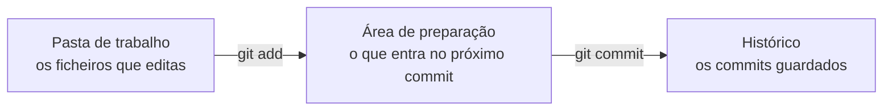
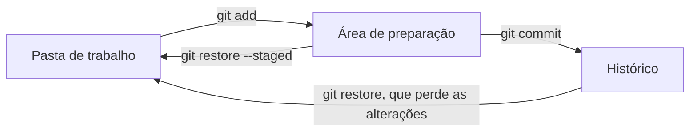

# Guardar versões com o Git

Neste guia aprendes a guardar versões do teu site com o Git. Cada versão tem a data, o autor e uma frase que diz o que mudou. Vês por onde passa uma alteração até ficar guardada e como desfazer um engano antes de a guardar. No fim, fazes o mesmo com os botões do VS Code. O exemplo é a Estante Digital.

Usa a pasta do teu site e os caminhos entre pastas. Rever: [Caminhos relativos](../01-frontend/02-html-e-semantica.md#caminhos-relativos) e [Passo 2: A pasta e os nomes dos ficheiros](../01-frontend/02-html-e-semantica.md#passo-2-a-pasta-e-os-nomes-dos-ficheiros). Para praticar: [laboratório](laboratorios/01-guardar-versoes-com-o-git-laboratorio.md) e [ficha de exercícios](exercicios/01-guardar-versoes-com-o-git-exercicios.md).

## Neste guia

1. [Parte 1: O controlo de versões](#parte-1-o-controlo-de-versões)
2. [Parte 2: O Git no teu computador](#parte-2-o-git-no-teu-computador)
3. [Parte 3: As três zonas](#parte-3-as-três-zonas)
4. [Parte 4: O primeiro commit](#parte-4-o-primeiro-commit)
5. [Parte 5: Depois do primeiro commit](#parte-5-depois-do-primeiro-commit)
6. [Parte 6: O Git no VS Code](#parte-6-o-git-no-vs-code)
7. [Exemplo guiado: a Estante Digital no Git](#exemplo-guiado-a-estante-digital-no-git)

## Parte 1: O controlo de versões

### Guardar cópias não chega

Esta é a pasta de um trabalho de grupo ao fim de uma semana:

```text
trabalho/
├── site.html
├── site-final.html
├── site-final-a-serio.html
└── site-final-2-corrigido-pelo-joao.html
```

Qual é a versão boa? O que mudou entre a segunda e a terceira? Quem apagou o horário, e porquê? Os nomes não respondem a nada disto. E se o João corrigiu uma cópia antiga, as correções dos colegas perderam-se.

Para isto existe o **controlo de versões**: um programa que guarda as versões de uma pasta. Sempre que lhe pedes, guarda os ficheiros como estão nesse momento, com a data, o autor e uma frase que diz o que mudou. Cada versão guardada chama-se um **commit**, uma palavra inglesa que se usa como está: "fazer um commit".

Com o controlo de versões, cada ficheiro tem um só nome, `site.html`. As versões antigas ficam todas guardadas, e podes sempre ver o que mudou, quando, quem o mudou e porquê.

Uma cópia de segurança serve para outra coisa. Guarda a pasta noutro sítio, como uma pen, para o caso de o computador avariar, mas não diz o que mudou. O controlo de versões não a substitui. As versões ficam dentro da pasta, e se o disco avariar perdem-se com ela.

### O Git e o GitHub não são a mesma coisa

O **Git** é o programa de controlo de versões que usamos. Instala-se no computador e trabalha na tua pasta, sem precisar de Internet.

O **GitHub** é um site onde se guardam cópias de pastas com Git, para as partilhar e trabalhar em equipa. Já lá estiveste: os materiais da disciplina, de onde descarregaste a Estante Digital, estão no GitHub.

Pensa numa máquina fotográfica e num álbum partilhado na Internet. O Git é a máquina: guarda as fotografias no teu computador. O GitHub é o álbum: recebe as fotografias que lhe envias, para outras pessoas as verem. Neste tema só usas o Git, e o GitHub fica para o tema seguinte do Git.

## Parte 2: O Git no teu computador

### O terminal recebe comandos

Já usaste o terminal em Fundamentos de Programação, para correr os programas de Python. O Git usa-se da mesma maneira: escreves um comando, carregas em Enter e lês a resposta.

O terminal do VS Code abre-se no menu Terminal, com New Terminal, já dentro da pasta que tens aberta. No Windows, a linha onde escreves começa por `PS`, de PowerShell, o terminal do Windows, e pelo caminho da pasta, como `PS C:\Users\aluno\Documents\estante-digital>`. No Mac, acaba num sinal `%`.

Um comando do Git começa sempre pela palavra `git`, seguida do que queres que ele faça. Este pergunta-lhe a versão:

```bash
git --version
```

A resposta é uma linha como `git version 2.51.0.windows.1`, com os números da versão instalada. As palavras que começam por hífens, como `--version`, são opções, que dizem ao comando como trabalhar. Os comandos escrevem-se exatamente assim, em minúsculas e com os espaços no sítio. As respostas do Git vêm em inglês.

Nos portáteis da escola, o professor já instalou o Git, e confirmas que ele lá está com este comando.

<details>
<summary>Para ires mais longe: instalar o Git no teu computador</summary>

No Windows, abre `https://git-scm.com/downloads/win`, descarrega a versão mais recente e abre o instalador. As respostas que já vêm escolhidas servem, e por isso basta carregar em Next em todos os ecrãs. Há uma que ajuda mudar: no ecrã "Choosing the default editor used by Git", escolhe "Use Visual Studio Code as Git's default editor".

No Mac, abre o Terminal e escreve `git --version`. Se o Git não estiver instalado, o macOS oferece-se para instalar as ferramentas de linha de comandos, que o trazem. Carrega em Instalar e espera que acabe.

Nos dois, confirmas que ficou instalado com `git --version`.

</details>

### Um repositório é uma pasta com memória

Para o Git guardar as versões de uma pasta, tens de lhe dizer qual. Abres a pasta no VS Code, abres o terminal e escreves:

```bash
git init -b main
```

A resposta é uma linha como esta, com o caminho da tua pasta:

```text
Initialized empty Git repository in C:/Users/aluno/Documents/estante-digital/.git/
```

Quer dizer "criei um repositório vazio". Um **repositório** é uma pasta com memória. É a pasta de sempre, com uma pasta escondida lá dentro, chamada `.git`, onde o Git guarda todas as versões:

```text
estante-digital/
├── .git/                 a memória do Git, escondida
├── imagens/
├── index.html
├── primeiros-passos-na-web.html
└── sobre.html
```

O `init` (de *initialize*, iniciar) cria a pasta `.git`. O `-b main` dá o nome `main` ao histórico desta pasta, o mesmo nome que o GitHub usa.

Três regras evitam os problemas mais comuns:

- faz o `git init` uma só vez em cada pasta, no início;
- fá-lo com a pasta do site aberta no VS Code, e nunca com outra pasta aberta, como a dos materiais da disciplina, ou com nenhuma;
- não mexas na pasta `.git` nem a apagues, porque apagá-la apaga todas as versões. O Windows e o VS Code escondem-na para não lhe tocares por engano.

## Parte 3: As três zonas

### A pasta de trabalho, a área de preparação e o histórico

Imagina que corrigiste um erro na página Sobre e começaste a mudar o rodapé da página inicial, que ainda não acabaste. Queres guardar a correção, mas não o rodapé a meio. Se o Git guardasse tudo o que mudou, guardava as duas coisas juntas.

Por isso, o Git funciona como uma fotografia de grupo: primeiro escolhes quem entra no enquadramento e só depois carregas no botão. Cada alteração passa por três zonas:

- A **pasta de trabalho** é a pasta que vês e editas no VS Code, onde mudas os ficheiros.
- A **área de preparação** é a lista do que vai entrar no próximo commit. É o enquadramento da fotografia.
- O **histórico** é a sequência dos commits guardados, dentro da pasta `.git`.



O diagrama mostra o caminho de uma alteração. O comando `git add` copia-a da pasta de trabalho para a área de preparação. O comando `git commit` guarda no histórico o que está na área de preparação.

No caso do início, pões só a página Sobre na área de preparação e guardas. O rodapé fica na pasta de trabalho, à espera de estar pronto.

### O comando git status diz em que zona está cada ficheiro

Para saberes em que zona está cada ficheiro, pergunta ao Git com `git status`. É o comando que mais vais usar: antes de cada comando, para saberes de onde partes, e depois, para confirmares o que mudou.

Logo a seguir ao `git init` na pasta da Estante Digital, a resposta é esta:

```text
On branch main

No commits yet

Untracked files:
  (use "git add <file>..." to include in what will be committed)
	README.md
	imagens/
	index.html
	primeiros-passos-na-web.html
	sobre.html

nothing added to commit but untracked files present (use "git add" to track)
```

`On branch main` quer dizer que estás no histórico chamado `main`. `No commits yet` quer dizer que ainda não há commits. Depois vem a lista dos ficheiros que o Git ainda não segue. A última linha diz que ainda não puseste nada na área de preparação. As linhas entre parênteses são sugestões do Git, com o comando que muda os ficheiros de grupo.

Um ficheiro passa a ser **seguido** pelo Git quando o juntas pela primeira vez com `git add`. Daí em diante, o Git compara-o sempre com o último commit, e diz-te quando ele muda.

A resposta do `git status` arruma os ficheiros em grupos, cada um com um título em inglês:

| O que o Git escreve | O que quer dizer | Em que zona está a alteração |
| --- | --- | --- |
| `Untracked files` | Ficheiros novos, que o Git ainda não segue | Só na pasta de trabalho |
| `Changes to be committed` | O que vai entrar no próximo commit | Na área de preparação |
| `Changes not staged for commit` | Ficheiros seguidos, mudados depois do último commit e ainda não preparados | Só na pasta de trabalho |
| `nothing to commit, working tree clean` | Nada mudou desde o último commit | A pasta de trabalho é igual ao último commit |

Dentro dos grupos, `new file` é um ficheiro novo, e `modified` é um ficheiro mudado.

## Parte 4: O primeiro commit

### A identidade do autor

Cada commit guarda quem o fez, com um nome e um email. Antes do primeiro commit numa pasta, dizes ao Git quem és, com dois comandos:

```bash
git config user.name "Ana Exemplo"
git config user.email "ana.exemplo@example.com"
```

O `config` muda uma configuração do Git, e o valor vai entre aspas, por causa do espaço. Para confirmares, `git config user.name`, sem valor, mostra o nome guardado. Se não mostrar nada, ainda não há nome.

Escritos assim, os comandos guardam a identidade só nesta pasta. Os portáteis da escola são partilhados, e uma identidade guardada para o portátil inteiro ia parar aos commits do colega que o usasse a seguir. Por isso, configuras a identidade em cada repositório novo.

A identidade que usas depende da pasta:

- num repositório de treino, uma cópia de uma pasta só para experimentar, que podes estragar à vontade, usa uma identidade inventada, como a do exemplo;
- no repositório do teu site, usa o teu nome e apelido e o email `nome.apelido@example.com`. No lugar de `nome.apelido`, escreve o teu nome e apelido, sem acentos.

O domínio `example.com` existe só para exemplos e não recebe emails. Assim, o teu email verdadeiro não fica no histórico, que mais tarde vai ser público no GitHub. No tema do GitHub, trocas este email pelo que o GitHub te der.

<details>
<summary>Para ires mais longe: a identidade para o computador todo</summary>

Na documentação vais encontrar `git config --global user.name "..."`. Com a opção `--global`, a identidade fica guardada para todos os repositórios do computador, e não precisas de a repetir em cada pasta. Num computador só teu, em casa, é prático. Num portátil partilhado, como os da escola, não se usa.

</details>

### O .gitignore diz o que fica de fora

O sistema operativo cria às vezes ficheiros nas pastas que não são teus: o Windows cria `Thumbs.db` e `desktop.ini`, e o Mac cria `.DS_Store`. Não fazem parte do site e não devem entrar no histórico.

O ficheiro `.gitignore`, na pasta do repositório, diz ao Git que ficheiros deve ignorar, um nome por linha. Um ficheiro ignorado não aparece no `git status` e não entra nos commits, mesmo que exista na pasta. As linhas que começam por `#` são comentários:

```text
# Ficheiros que o sistema operativo cria sozinho e que não fazem parte do site.
.DS_Store
Thumbs.db
desktop.ini
```

O `.gitignore` faz-se antes do primeiro commit, porque só vale para os ficheiros que o Git ainda não segue. Um ficheiro que já entrou num commit fica no histórico, e o Git continua a segui-lo, mesmo que depois o escrevas no `.gitignore`.

O nome começa por um ponto e não tem extensão. Cria-o no VS Code, porque o Windows esconde às vezes as extensões, e um `.gitignore.txt` não serve.

### O comando git add escolhe o que entra no commit

O comando `git add` põe ficheiros na área de preparação. Escreves a seguir os nomes dos ficheiros, separados por espaços. O nome de uma pasta junta todos os ficheiros que ela tem:

```bash
git add .gitignore index.html primeiros-passos-na-web.html sobre.html imagens
```

A pasta tem também o `README.md`, o ficheiro que diz o que está na pasta. Antes de leres a resposta, prevê: depois deste comando, em que grupo do `git status` aparece o `index.html`, e em que grupo fica o `README.md`?

O `index.html` passa para `Changes to be committed`, com `new file` à frente. O `README.md` fica em `Untracked files`, porque não estava no comando. Nada foi guardado ainda: escolheste quem entra na fotografia, mas ainda não carregaste no botão.

O `git add` copia o ficheiro como está nesse momento. Se o mudares depois do `git add`, a mudança nova fica só na pasta de trabalho, e tens de o juntar outra vez.

Junta os ficheiros pelo nome e confirma com o `git status`. Assim escolhes o que entra, em vez de levares tudo o que estiver na pasta.

<details>
<summary>Para ires mais longe: o git add com um ponto</summary>

O comando `git add .`, com um ponto, junta de uma vez todos os ficheiros novos e mudados da pasta onde estás. É rápido, mas leva também o que não querias, como um ficheiro de testes esquecido. Quem o usa vê sempre o `git status` antes. Nas aulas, juntamos os ficheiros pelo nome.

</details>

### Um commit guarda uma alteração com sentido

Com a área de preparação pronta, o commit guarda-a no histórico:

```bash
git commit -m "Guarda a primeira versão da Estante Digital"
```

O `-m` (de *message*, mensagem) dá a mensagem do commit, entre aspas. A resposta diz o que ficou guardado:

```text
[main (root-commit) 96b4445] Guarda a primeira versão da Estante Digital
 6 files changed, 332 insertions(+)
 create mode 100644 .gitignore
 create mode 100644 imagens/capa-primeiros-passos-na-web.svg
 create mode 100644 imagens/logotipo.svg
 create mode 100644 index.html
 create mode 100644 primeiros-passos-na-web.html
 create mode 100644 sobre.html
```

O `main` é o histórico onde o commit entrou, e `root-commit` diz que é o primeiro. O `96b4445` é o início do código que identifica o commit, e o teu vai ser outro. A segunda linha diz que mudaram 6 ficheiros, com 332 linhas acrescentadas. Cada `create mode` é um ficheiro que entrou no histórico pela primeira vez.

A mensagem diz o que a alteração faz, para quem ler o histórico daqui a um mês, que podes ser tu. Segue três regras:

- começa por um verbo, como "Acrescenta", "Corrige", "Muda" ou "Tira";
- diz o quê e onde: "Corrige o título da página Sobre", e não "Correções";
- nunca é "update", "alterações", "teste" ou "asdf", que não dizem nada.

Cada commit leva uma só alteração com sentido. Uma correção na página Sobre e um rodapé novo na página inicial são duas alterações, e por isso dois commits. O número de commits não mede o trabalho. Um commit por cada linha é tão difícil de ler como um só commit no fim do ano.

## Parte 5: Depois do primeiro commit

### O comando git diff mostra o que mudou

Depois do primeiro commit, acrescentas um critério à lista da página Sobre. O `git status` diz que o `sobre.html` foi mudado, mas não diz o quê. Para ver exatamente o que mudou, usa `git diff` (de *difference*, diferença):

```text
diff --git a/sobre.html b/sobre.html
index 644825b..941aa9c 100644
--- a/sobre.html
+++ b/sobre.html
@@ -40,6 +40,7 @@
           <li>Estão escritos ou falados em português.</li>
           <li>Explicam as coisas desde o início, sem saltar passos.</li>
           <li>Foram usados por pelo menos um aluno da turma, que os recomenda.</li>
+          <li>São gratuitos, ou estão na biblioteca da escola.</li>
         </ul>
       </section>
 
```

Para ler, começa pelas linhas `---` e `+++`, que dizem o ficheiro. A linha com `@@` diz onde está a mudança, perto da linha 40. As linhas sem sinal à frente não mudaram e estão lá para dar contexto. Uma linha com `+` à frente foi acrescentada, e uma linha com `-` foi apagada. Uma linha alterada aparece duas vezes: a antiga, com `-`, e a nova, com `+`.

O `git diff` tem duas formas, uma para cada zona:

- `git diff` compara a pasta de trabalho com a área de preparação: mostra o que mudaste e ainda não preparaste;
- `git diff --staged` compara a área de preparação com o último commit: mostra o que vai entrar no próximo commit.

Depois de um `git add sobre.html`, o `git diff` fica vazio, porque já não há nada por preparar, e o `git diff --staged` mostra a alteração. Vê sempre o `git diff --staged` antes de um commit, porque é a última vez que confirmas o que vai ficar guardado.

Um ficheiro novo, que o Git ainda não segue, não aparece no `git diff`, porque o Git só compara ficheiros que já conhece. Para esses, o `git status` é que diz que existem.

### O comando git log mostra o histórico

O `git log` mostra os commits do histórico, do mais recente para o mais antigo:

```text
commit 43cdb51ffd5f7bc46bca279082f671980beecd8a (HEAD -> main)
Author: Ana Exemplo <ana.exemplo@example.com>
Date:   Thu Nov 12 13:14:20 2026 +0000

    Acrescenta o README da pasta

commit 96b44454c52c58b4e27d0b08bfa793f75d299266
Author: Ana Exemplo <ana.exemplo@example.com>
Date:   Thu Nov 12 13:14:20 2026 +0000

    Guarda a primeira versão da Estante Digital
```

Cada commit tem um **identificador**, o código de 40 letras e números que vem depois de `commit`. Não há dois commits com o mesmo identificador. A seguir vêm o autor, com o email, a data e, numa linha à parte, mais abaixo, a mensagem. O `(HEAD -> main)` marca o commit mais recente, aquele onde estás.

Para ver uma linha por commit, junta a opção `--oneline`:

```bash
git log --oneline
```

```text
43cdb51 (HEAD -> main) Acrescenta o README da pasta
96b4445 Guarda a primeira versão da Estante Digital
```

Na versão curta, o identificador tem só os primeiros 7 caracteres, que chegam para o distinguir dos outros. É esta versão que copias quando te pedirem o histórico, porque mostra as mensagens sem o email.

### Desfazer antes do commit

Há dois enganos que se desfazem antes do commit, com o comando `git restore`. O próprio `git status` sugere-o, nas linhas entre parênteses.

O primeiro engano é juntar à área de preparação um ficheiro que não querias:

```bash
git restore --staged index.html
```

Este comando tira o `index.html` da área de preparação, e o ficheiro volta ao grupo onde estava antes do `git add`. O conteúdo do ficheiro não muda: só deixa de estar preparado.

O segundo engano é estragar um ficheiro sem querer, como apagar o rodapé, e querer que ele volte ao que estava:

```bash
git restore index.html
```

Este comando deita fora as alterações do ficheiro que não estão na área de preparação. O ficheiro volta à versão da área de preparação ou, se não preparaste nada dele, à do último commit. O Git não guarda as alterações que deitou fora.



O diagrama junta as setas de ida e as de volta. O `git restore --staged` tira o ficheiro da área de preparação, sem lhe mexer. O `git restore` põe na pasta de trabalho a versão guardada, por cima das tuas alterações.

Por isso, antes de um `git restore` sem `--staged`, vê com o `git diff` o que vais perder. E experimenta-o primeiro num repositório de treino, e nunca no teu site.

## Parte 6: O Git no VS Code

### O painel Source Control

Tudo o que fizeste no terminal também se faz no VS Code, com o rato. Na barra da esquerda, o ícone Source Control, com três círculos ligados por linhas, abre o painel do Git. Também se abre com Ctrl+Shift+G, no Windows e no Mac.

O painel mostra as mesmas zonas, com outros nomes:

| No terminal | No painel Source Control |
| --- | --- |
| `Untracked files` e `Changes not staged for commit` | O grupo Changes |
| `Changes to be committed` | O grupo Staged Changes |
| `git add` | O botão `+`, Stage Changes, ao lado do ficheiro |
| `git restore --staged` | O botão `-`, Unstage Changes, ao lado do ficheiro |
| `git commit -m` | A caixa Message, para a mensagem, e o botão Commit |
| `git restore` | O botão da seta curva, Discard Changes |

Ao lado de cada ficheiro há uma letra:

- `U` (de *untracked*): um ficheiro que o Git ainda não segue;
- `A` (de *added*): um ficheiro novo, já preparado;
- `M` (de *modified*): um ficheiro mudado.

Carregar no nome de um ficheiro mudado mostra as duas versões lado a lado, como o `git diff`. O terminal e o painel mexem no mesmo repositório: o que fazes num aparece logo no outro, e podes misturá-los.

Há três cuidados a ter:

- Num ficheiro com `M`, o Discard Changes faz o mesmo que o `git restore`. O VS Code pergunta "Are you sure you want to discard changes", e, se carregares em Discard File, as alterações perdem-se.
- Num ficheiro com `U`, o Discard Changes apaga o ficheiro. O VS Code pergunta se o queres apagar e, se carregares em Move to Recycle Bin, manda-o para a Reciclagem. É assim que se perde uma página que ainda não tem nenhum commit.
- Se carregares em Commit sem nada em Staged Changes, o VS Code pergunta se queres preparar todas as alterações e fazer o commit. Os botões são Yes, Always e Never. Fecha a pergunta e prepara os ficheiros um a um. Nunca carregues em Always, porque o VS Code passa a fazê-lo sempre, para todos os alunos que usam o portátil.

## Exemplo guiado: a Estante Digital no Git

Neste exemplo, a Estante Digital entra no Git, com três commits e um engano desfeito. Faz-se numa cópia da pasta, que serve de repositório de treino, e a pasta original, nos materiais da disciplina, fica como está.

### Passo 1: Uma cópia para treinar

Nos materiais da disciplina descarregados no laboratório do tema 01 de frontend, a Estante Digital está em `exemplos/frontend/estante-digital`. Copia-se a pasta `estante-digital` inteira para a pasta Documentos, no Explorador de Ficheiros. Depois abre-se a cópia no VS Code, com Open Folder, no menu File, e abre-se o terminal, com New Terminal, no menu Terminal. O primeiro comando, `git --version`, confirma que o Git está instalado.

### Passo 2: Criar o repositório

```bash
git init -b main
git status
```

O `git init` responde `Initialized empty Git repository in` e o caminho da pasta. O `git status` dá a resposta da secção do `git status`: `No commits yet` e cinco ficheiros e pastas em `Untracked files`. A pasta de trabalho tem tudo, e a área de preparação e o histórico estão vazios.

### Passo 3: A identidade

É um repositório de treino, e por isso a identidade é inventada:

```bash
git config user.name "Ana Exemplo"
git config user.email "ana.exemplo@example.com"
git config user.name
```

O último comando responde `Ana Exemplo`, e a identidade está guardada nesta pasta.

### Passo 4: O .gitignore

No painel Explorer do VS Code, cria-se um ficheiro novo, com New File, chamado `.gitignore`. Lá dentro ficam as quatro linhas da secção do `.gitignore`: o comentário, `.DS_Store`, `Thumbs.db` e `desktop.ini`. O `git status` passa a mostrar também o `.gitignore` em `Untracked files`, porque é um ficheiro novo como os outros.

### Passo 5: O primeiro commit

O primeiro commit guarda o site como está: as três páginas, as imagens e o `.gitignore`. O `README.md` não é uma página do site e fica para um commit à parte.

```bash
git add .gitignore index.html primeiros-passos-na-web.html sobre.html imagens
git status
```

```text
On branch main

No commits yet

Changes to be committed:
  (use "git rm --cached <file>..." to unstage)
	new file:   .gitignore
	new file:   imagens/capa-primeiros-passos-na-web.svg
	new file:   imagens/logotipo.svg
	new file:   index.html
	new file:   primeiros-passos-na-web.html
	new file:   sobre.html

Untracked files:
  (use "git add <file>..." to include in what will be committed)
	README.md
```

Os seis ficheiros estão na área de preparação, e a pasta `imagens` deu lugar aos dois ficheiros que tem. O `README.md` ficou de fora, como se queria. Segue-se o commit:

```bash
git commit -m "Guarda a primeira versão da Estante Digital"
```

A resposta é a da secção do commit: `root-commit`, 6 ficheiros e 332 linhas.

### Passo 6: O README num commit à parte

```bash
git add README.md
git commit -m "Acrescenta o README da pasta"
git status
```

O commit responde `1 file changed, 29 insertions(+)`. O `git status` responde `nothing to commit, working tree clean`: a pasta de trabalho é igual ao último commit.

### Passo 7: Uma alteração, do diff ao commit

Na página Sobre, a lista "Como escolhemos os recursos" ganha um quarto critério. Em `sobre.html`, a seguir ao terceiro item da lista, acrescenta-se:

```html
<li>São gratuitos, ou estão na biblioteca da escola.</li>
```

O `git diff` mostra a linha nova com um `+`, como na secção do `git diff`. É só isso que mudou, e por isso prepara-se, confirma-se e guarda-se:

```bash
git add sobre.html
git diff --staged
git commit -m "Acrescenta um critério de escolha dos recursos"
```

A tabela mostra o caminho do `sobre.html` pelas três zonas, comando a comando:

| Depois de | O `git status` mostra o `sobre.html` em | A alteração está |
| --- | --- | --- |
| Editar e guardar o ficheiro | `Changes not staged for commit` | Só na pasta de trabalho |
| `git add sobre.html` | `Changes to be committed` | Na área de preparação |
| `git commit` | Não aparece: `nothing to commit, working tree clean` | No histórico |

### Passo 8: Ler o histórico

```bash
git log --oneline
```

```text
d318864 (HEAD -> main) Acrescenta um critério de escolha dos recursos
43cdb51 Acrescenta o README da pasta
96b4445 Guarda a primeira versão da Estante Digital
```

Três commits, do mais recente para o mais antigo, e cada mensagem diz o que mudou. Os identificadores do teu repositório vão ser outros.

### Passo 9: Um engano desfeito

Em `index.html`, apaga-se por engano o rodapé inteiro, do `<footer>` ao `</footer>`, e guarda-se. O `git status` mostra o `index.html` em `Changes not staged for commit`, e o `git diff` mostra as seis linhas do rodapé com `-` à frente:

```text
diff --git a/index.html b/index.html
index 3750e88..81be7b5 100644
--- a/index.html
+++ b/index.html
@@ -88,11 +88,5 @@
     </main>
 
     <!-- Rodapé do site: também se repete igual em todas as páginas. -->
-    <footer>
-      <p>
-        Estante Digital, site de exemplo dos materiais de Desenvolvimento de
-        Aplicações do 10.º ano. Conteúdo fictício.
-      </p>
-    </footer>
   </body>
 </html>
```

O `git diff` confirma que a única mudança é o rodapé apagado, e por isso pode deitar-se fora sem perder mais nada:

```bash
git restore index.html
git status
```

O `git status` volta a `nothing to commit, working tree clean`, e no VS Code o rodapé reaparece no ficheiro. No painel Source Control, os grupos Changes e Staged Changes estão vazios, pela mesma razão.

## Erros frequentes

### O terminal diz que git não é reconhecido

O que se vê: depois de escreveres um comando do Git, aparece uma mensagem que começa por `git : The term 'git' is not recognized`.

Porque acontece: o Git não está instalado, ou o VS Code já estava aberto quando o Git foi instalado e ainda não o encontra.

Como se corrige: fecha o VS Code e volta a abri-lo. Se continuar, o Git não está instalado: num computador teu, instala-o, e na escola chama o professor.

### fatal: not a git repository

O que se vê: `fatal: not a git repository (or any of the parent directories): .git`.

Porque acontece: o terminal está numa pasta que não é um repositório. Ou abriste outra pasta no VS Code, ou ainda não fizeste o `git init`.

Como se corrige: vê na linha do terminal em que pasta estás. Abre no VS Code a pasta certa, com Open Folder, e abre um terminal novo. Só faz o `git init` se a pasta ainda não for um repositório.

### O commit não guarda nada

O que se vê: o `git commit` responde `nothing added to commit but untracked files present` ou `no changes added to commit`, e o `git log` não mostra o commit novo.

Porque acontece: a área de preparação está vazia, porque esqueceste o `git add`.

Como se corrige: vê o `git status`, faz o `git add` dos ficheiros que queres e repete o commit.

### O commit não leva a última alteração

O que se vê: o commit fez-se, mas, logo a seguir, o `git status` ainda mostra o ficheiro em `Changes not staged for commit`.

Porque acontece: mudaste o ficheiro depois do `git add`. O commit guardou a versão que estava na área de preparação, e a mudança nova ficou na pasta de trabalho.

Como se corrige: vê com o `git diff` o que ficou de fora, faz o `git add` outra vez e um commit novo.

### O commit abre um ecrã estranho

O que se vê: depois do `git commit`, o terminal enche-se de linhas começadas por `~` e deixa de responder como antes. Ou abre-se no VS Code um separador chamado `COMMIT_EDITMSG`.

Porque acontece: escreveste o `git commit` sem o `-m` e a mensagem, ou carregaste no botão Commit do VS Code com a caixa Message vazia. O Git abriu um editor para escreveres a mensagem.

Como se corrige: no terminal com as linhas `~`, carrega em Esc, escreve `:q!` e carrega em Enter. No separador `COMMIT_EDITMSG`, fecha-o sem escrever nada. Nos dois casos, o commit é cancelado. Repete-o com o `-m "mensagem"`, ou com a mensagem escrita na caixa Message.

### Author identity unknown

O que se vê: o commit falha, com `Author identity unknown` e `Please tell me who you are`.

Porque acontece: a identidade não está configurada nesta pasta.

Como se corrige: a mensagem do Git sugere os comandos com `--global`. Não os copies, porque num portátil partilhado a identidade ficava para o colega seguinte. Escreve-os sem `--global`, como diz a linha `Omit --global to set the identity only in this repository`, e repete o commit.

### O terminal mostra : ou (END) e não deixa escrever

O que se vê: depois de um `git diff` ou de um `git log` comprido, a última linha do terminal é `:` ou `(END)`. O que escreves não aparece.

Porque acontece: a resposta não cabia no terminal, e o Git está a mostrá-la aos bocados.

Como se corrige: anda com as setas, ou com a barra de espaços, e sai com a tecla `q`.

### fatal: could not resolve HEAD

O que se vê: o `git restore --staged` responde `fatal: could not resolve HEAD`.

Porque acontece: ainda não há nenhum commit, e o `git restore --staged` não tem um commit para onde voltar.

Como se corrige: antes do primeiro commit, usa o comando que o `git status` sugere nesse momento, `git rm --cached`, seguido do nome do ficheiro. Faz o mesmo: tira o ficheiro da área de preparação, sem o apagar da pasta.

### O git status mostra ficheiros que não são do site

O que se vê: o `git status` mostra pastas que não são do teu site, como `01-frontend/` e `exemplos/`, ou `Desktop/` e `Downloads/`.

Porque acontece: o `git init` foi feito com outra pasta aberta no VS Code, como a dos materiais da disciplina, ou com nenhuma.

Como se corrige: não faças nenhum commit e chama o professor, que tira o repositório criado por engano. Depois abre a pasta do site no VS Code e faz lá o `git init`.

## Palavras novas deste guia

- Controlo de versões: um programa que guarda as versões de uma pasta, com o que mudou, quando, quem e porquê.
- Commit: uma versão guardada, com a data, o autor e uma mensagem que diz o que mudou.
- Git: o programa de controlo de versões que trabalha na tua pasta, no teu computador.
- GitHub: o site onde se guardam cópias de pastas com Git, para as partilhar e trabalhar em equipa.
- Repositório: uma pasta com uma pasta `.git` lá dentro, onde o Git guarda todas as versões.
- Repositório de treino: uma cópia de uma pasta, só para experimentar, que se pode estragar à vontade.
- Pasta de trabalho: a pasta que vês e editas, onde mudas os ficheiros.
- Área de preparação: a lista do que vai entrar no próximo commit.
- Histórico: a sequência dos commits guardados, dentro da pasta `.git`.
- Ficheiro seguido: um ficheiro que já foi juntado com `git add`, e que o Git compara sempre com o último commit.
- Ficheiro ignorado: um ficheiro escrito no `.gitignore`, que o Git não segue nem guarda.
- Identificador: o código de letras e números que identifica um commit, como `96b4445`.

Os comandos deste guia, e o que cada um faz:

- `git --version`: mostra a versão do Git instalada.
- `git init -b main`: cria um repositório na pasta onde estás, com o histórico chamado `main`.
- `git status`: diz em que zona está cada ficheiro.
- `git config user.name` e `git config user.email`: guardam o nome e o email do autor nesta pasta.
- `git add`: copia ficheiros para a área de preparação.
- `git commit -m "mensagem"`: guarda no histórico o que está na área de preparação.
- `git diff`: mostra o que mudou e ainda não está preparado. `git diff --staged`: mostra o que está preparado.
- `git log`: mostra o histórico. `git log --oneline`: mostra-o com uma linha por commit.
- `git restore --staged`: tira um ficheiro da área de preparação, sem o mudar.
- `git restore`: deita fora as alterações de um ficheiro que não estão preparadas.

## O que vem a seguir

No tema 03 de frontend, CSS e Flexbox, dás aspeto ao teu site e guardas cada passo num commit.

## Para saber mais

- Git, [página de transferências para Windows](https://git-scm.com/downloads/win), em inglês: o instalador do Git para o teu computador.
- Scott Chacon e Ben Straub, [Pro Git](https://git-scm.com/book/pt-br/v2), em português do Brasil: o livro oficial do Git, gratuito. O capítulo 2 trata do que viste neste guia.
- Visual Studio Code, [Source Control](https://code.visualstudio.com/docs/sourcecontrol/overview), em inglês: o painel do Git no VS Code, com imagens de cada botão.


