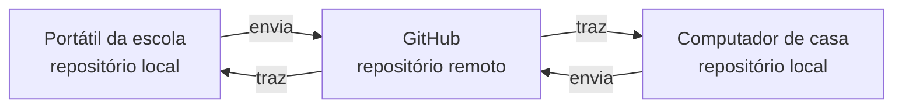
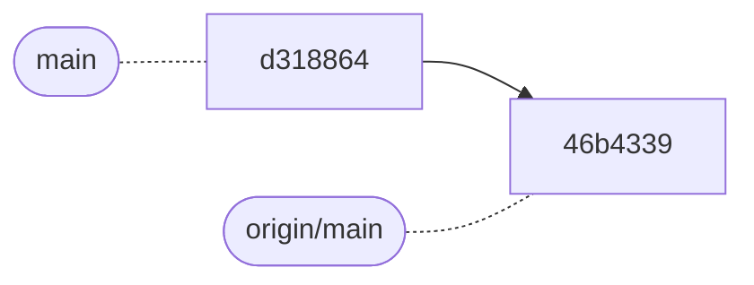
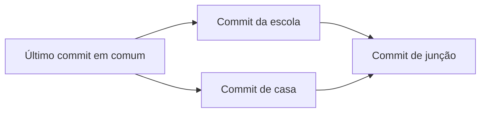

# Partilhar versões com o GitHub

Neste guia aprendes a guardar uma cópia do histórico do teu site no GitHub. Envias para lá os commits novos e recebes os que fizeste noutro computador. Vês também como corrigir o último commit antes de o enviar, e como ligar o portátil ao GitHub com uma chave que só tu desbloqueias. O exemplo é a Estante Digital.

Usa os commits e o histórico do tema 01 do Git. Rever: [Um commit guarda uma alteração com sentido](01-guardar-versoes-com-o-git.md#um-commit-guarda-uma-alteração-com-sentido), [O comando git log mostra o histórico](01-guardar-versoes-com-o-git.md#o-comando-git-log-mostra-o-histórico) e [A identidade do autor](01-guardar-versoes-com-o-git.md#a-identidade-do-autor). Para praticar: [laboratório](laboratorios/02-partilhar-versoes-com-o-github-laboratorio.md) e [ficha de exercícios](exercicios/02-partilhar-versoes-com-o-github-exercicios.md).

## Neste guia

1. [Parte 1: O repositório remoto](#parte-1-o-repositório-remoto)
2. [Parte 2: Enviar e receber commits](#parte-2-enviar-e-receber-commits)
3. [Parte 3: Corrigir o último commit](#parte-3-corrigir-o-último-commit)
4. [Parte 4: O GitHub](#parte-4-o-github)
5. [Parte 5: O GitHub no VS Code](#parte-5-o-github-no-vs-code)
6. [Exemplo guiado: a Estante Digital em dois computadores](#exemplo-guiado-a-estante-digital-em-dois-computadores)

## Parte 1: O repositório remoto

### O histórico fica num só computador

O site da Ana está no portátil da escola, com todos os commits na pasta `.git`. Em casa, ela quer continuar o trabalho. Leva uma cópia da pasta numa pen, muda duas páginas e faz commits em casa. Na aula seguinte, o portátil da escola não tem nenhum desses commits. Agora há duas pastas com histórias diferentes, e o problema dos ficheiros `site-final` voltou. Se o portátil avariar, perde-se tudo o que só lá estava.

Falta um sítio comum, onde fique a cópia do histórico que todos os computadores partilham. É um **repositório remoto**: uma cópia do repositório noutro sítio, quase sempre num servidor na Internet, como o GitHub. O repositório que está no teu computador chama-se **repositório local**.

Cada computador tem o histórico inteiro, e o remoto guarda o histórico comum. Quando acabas um trabalho, envias os commits novos do local para o remoto. Quando começas noutro computador, trazes de lá os commits que ainda não tens.



O diagrama mostra dois repositórios locais e um remoto. Os dois computadores não falam um com o outro: cada um envia para o remoto e traz de lá. O remoto é o ponto de encontro.

### Para treinar, uma pasta faz de GitHub

Antes de usares o GitHub, treinas com um remoto que não precisa de Internet nem de conta: uma pasta do teu computador. Assim podes enganar-te à vontade, sem mexer no GitHub.

O comando que cria essa pasta é parecido com o do tema 01, com a opção `--bare` (em inglês, nu):

```bash
git init --bare -b main ../github-de-treino.git
```

Um repositório criado com `--bare` tem só o histórico. Não tem pasta de trabalho, e por isso não tem os ficheiros do site para editar: é como a pasta `.git` sozinha. É assim que o GitHub guarda os repositórios. O `-b main` dá o nome `main` ao histórico, como no tema 01.

Como nos caminhos relativos do HTML, o `../` sobe à pasta de cima. A pasta nova fica ao lado da pasta onde estás, e não dentro dela. O nome acaba em `.git` para lembrar que a pasta só tem o histórico. A resposta é a do `git init`, com o caminho da pasta nova:

```text
Initialized empty Git repository in C:/Users/aluno/Documents/github-de-treino.git/
```

### O remoto tem um nome e um endereço

O repositório local precisa de saber onde está o remoto. Dás-lhe um nome e um endereço com `git remote add`:

```bash
git remote add origin ../github-de-treino.git
```

O nome é `origin`, que quer dizer origem, e é o nome que toda a gente usa para o remoto principal. O endereço, no treino, é o caminho para a pasta. No GitHub vai ser um endereço como `git@github.com:ana-exemplo/estante-digital.git`. Os comandos que vêm a seguir são os mesmos nos dois casos.

Para veres os remotos de um repositório, usa `git remote -v`, com `-v` de *verbose*, que quer dizer com pormenor:

```text
origin	../github-de-treino.git (fetch)
origin	../github-de-treino.git (push)
```

Aparece o mesmo endereço duas vezes: um para trazer commits, `fetch`, e outro para os enviar, `push`. São quase sempre iguais. Se o `git remote -v` não responder nada, o repositório ainda não tem remoto.

### Clonar copia um repositório inteiro

No computador de casa, a Ana não tem nenhuma cópia do site. Precisa de uma pasta com os ficheiros, com o histórico e com o remoto já configurado. Fazer `git init` e copiar os ficheiros não serve, porque o histórico ficava vazio.

**Clonar** é copiar um repositório remoto inteiro para uma pasta nova, com todos os commits. Faz-se com `git clone`, seguido do endereço do remoto e do nome da pasta nova:

```bash
git clone ../github-de-treino.git ../estante-casa
```

```text
Cloning into '../estante-casa'...
done.
```

A pasta `estante-casa` tem os ficheiros na pasta de trabalho e a pasta `.git`, com o histórico inteiro. Tem também o remoto `origin` já configurado, com o endereço de onde veio, escrito por inteiro. Não precisas de `git init` nem de `git remote add`.

O clone não leva a identidade, porque ela está na configuração da pasta de onde vieste. Num clone novo, configuras outra vez o `user.name` e o `user.email`.

Descarregar em ZIP, como fizeste com os materiais da disciplina, é diferente. O ZIP traz só os ficheiros, sem a pasta `.git`: não tem histórico nem remoto.

## Parte 2: Enviar e receber commits

### O git push envia os commits

O comando `git push` envia para o remoto os commits que ele ainda não tem. Da primeira vez, diz-se para onde:

```bash
git push -u origin main
```

O `origin` é o remoto, e o `main` é o histórico que se envia. O `-u` liga o teu `main` ao `main` do remoto, e por isso, das outras vezes, basta `git push`. A resposta acaba assim:

```text
To ../github-de-treino.git
 * [new branch]      main -> main
branch 'main' set up to track 'origin/main'.
```

Antes destas linhas aparecem outras, com contagens, como `Writing objects: 100% (15/15)`, que mostram o Git a enviar. A linha `main -> main` diz que o teu `main` foi para o `main` do remoto. A última diz que os dois ficaram ligados.

O teu computador guarda o que sabe do remoto com o nome **origin/main**. É o estado do `main` do remoto da última vez que o teu computador falou com ele. No `git log --oneline`, aparece ao lado do commit onde está:

```text
d318864 (HEAD -> main, origin/main) Acrescenta um critério de escolha dos recursos
43cdb51 Acrescenta o README da pasta
96b4445 Guarda a primeira versão da Estante Digital
```

No `git log`, o nome `main` está ao lado do commit mais recente do teu histórico, e avança a cada commit novo. O `origin/main` faz o mesmo para o remoto, mas só se mexe quando o teu computador fala com ele. Aqui estão no mesmo commit, e por isso o remoto tem tudo o que tu tens. Num clone, e depois do primeiro `git fetch`, aparece também `origin/HEAD`, que diz qual é o histórico principal do remoto e não precisa de nada teu.

<details>
<summary>Para ires mais longe: o que é o [new branch]</summary>

Os históricos com nome, como o `main`, chamam-se ramos, *branches* em inglês. Um repositório pode ter vários, para experimentar uma ideia sem estragar o principal. O `[new branch]` diz que o ramo `main` ainda não existia no remoto e foi criado. Os ramos são o assunto do tema 03 do Git.

</details>

### O git fetch traz os commits sem mexer nos teus ficheiros

A Ana fez um commit em casa e enviou-o. Na escola, antes de começar, corre o `git status`, que responde `Your branch is up to date with 'origin/main'.`. A resposta está desatualizada: o `git status` não vai ao remoto. Compara com o `origin/main` que o portátil guardou da última vez.

Para atualizar o que o computador sabe do remoto, usa `git fetch`:

```text
From ../github-de-treino
   d318864..46b4339  main       -> origin/main
```

A resposta diz que o `origin/main` avançou do commit `d318864` para o `46b4339`. Antes destas linhas aparecem outras, começadas por `remote:`, com contagens.

O `git fetch` traz os commits novos para dentro da pasta `.git` e muda só o `origin/main`. Os teus ficheiros e o teu `main` ficam como estavam. Por isso o `git status` agora diz `Your branch is behind 'origin/main' by 1 commit`, e o `git log --oneline origin/main` mostra o commit que veio:

```text
46b4339 (origin/main, origin/HEAD) Acrescenta a revisão do professor aos critérios
d318864 (HEAD -> main) Acrescenta um critério de escolha dos recursos
43cdb51 Acrescenta o README da pasta
96b4445 Guarda a primeira versão da Estante Digital
```

O `origin/main` está um commit à frente do teu `main`:



O diagrama mostra os dois commits, do mais antigo para o mais recente, e onde está cada nome depois do `git fetch`. O `main` ficou no `d318864`, e o `origin/main` avançou para o `46b4339`. Para veres o que esse commit muda, antes de o juntares aos teus ficheiros, usa `git diff main origin/main`. Mostra as diferenças como o `git diff` do tema 01: as linhas com `+` são as que vais receber.

### O git pull junta os commits do remoto aos teus

Depois de veres o que vem, juntas os commits ao teu `main` e aos teus ficheiros com `git pull`:

```text
Updating d318864..46b4339
Fast-forward
 sobre.html | 1 +
 1 file changed, 1 insertion(+)
```

O `git pull` faz duas coisas seguidas: um `git fetch`, e depois junta o `origin/main` ao teu `main`. A pasta de trabalho muda, e o VS Code mostra logo o `sobre.html` com a linha nova.

`Fast-forward` quer dizer avançar: como não tinhas commits diferentes, o teu `main` só avançou até ao commit novo, o `46b4339`, onde está o `origin/main`. As outras linhas dizem que ficheiros mudaram, como a resposta de um commit. Se não houver nada novo no remoto, o `git pull` responde `Already up to date.`.

O `git fetch` é olhar antes de mexer: traz os commits e deixa-te ver o que vem. O `git pull` traz e mexe nos teus ficheiros. Quando não tens a certeza do que vem, começa pelo `git fetch`.

### Antes de começar, pull; no fim, push

Para o histórico ser um só, há uma rotina para cada sessão de trabalho, em qualquer computador:

1. Antes de começar, `git pull`, para trazeres o que fizeste noutro sítio.
2. Trabalhas e fazes os commits, como no tema 01.
3. No fim, `git push`, para o remoto ficar com tudo.

O que acontece se te esqueceres? A Ana fez um commit na escola e não o enviou. Em casa, sem o `pull` da escola, fez outro commit, noutro ficheiro, e enviou-o. De volta à escola, o `git push` responde isto:

```text
To ../github-de-treino.git
 ! [rejected]        main -> main (fetch first)
error: failed to push some refs to '../github-de-treino.git'
hint: Updates were rejected because the remote contains work that you do not
hint: have locally. This is usually caused by another repository pushing to
hint: the same ref. If you want to integrate the remote changes, use
hint: 'git pull' before pushing again.
hint: See the 'Note about fast-forwards' in 'git push --help' for details.
```

O envio foi recusado, `rejected`. O remoto tem um commit que tu não tens, o de casa. Se o Git aceitasse o envio, o commit de casa desaparecia do remoto. O `(fetch first)` e as linhas `hint` dizem o que fazer: trazer primeiro o que lá está. Se já tivesses feito `git fetch`, a recusa dizia `(non-fast-forward)`, e resolvia-se da mesma maneira.

Para resolver, juntas as duas histórias e envias outra vez:

```bash
git pull --no-rebase --no-edit
git push
```

O `--no-rebase` diz ao `git pull` que junte as duas histórias com um commit novo, o **commit de junção**. Esse commit tem dois commits antes dele: o teu e o que veio do remoto. O `--no-edit` aceita a mensagem que o Git escreve, `Merge branch 'main' of`, seguida do endereço do remoto, sem abrir o editor. Depois disso, o teu `main` tem tudo o que o remoto tinha, e o `git push` já é aceite.



O diagrama mostra as duas histórias. Separam-se depois do último commit que tinham em comum, uma com o commit da escola e outra com o de casa. O commit de junção volta a juntá-las.

Na Internet vais encontrar o `git push --force`, que envia na mesma e apaga do remoto os commits que não tens. Nunca o uses para resolver um envio recusado.

Com um remoto, o `git status` ganha uma linha que compara o teu `main` com o `origin/main`:

| O que o `git status` diz | O que quer dizer | O que fazes |
| --- | --- | --- |
| `Your branch is up to date with 'origin/main'.` | Tens o mesmo que o remoto, da última vez que falaste com ele | Nada |
| `Your branch is ahead of 'origin/main' by 1 commit.` | Tens 1 commit que o remoto não tem | `git push` |
| `Your branch is behind 'origin/main' by 1 commit, and can be fast-forwarded.` | O remoto tem 1 commit que tu não tens | `git pull` |
| `Your branch and 'origin/main' have diverged,` | Os dois têm commits que o outro não tem | `git pull --no-rebase --no-edit`, e depois `git push` |

<details>
<summary>Para ires mais longe: o desenho do commit de junção</summary>

O `git log --oneline --graph` desenha o histórico com linhas, como o diagrama. Depois da junção do exemplo guiado, mais abaixo, as primeiras linhas são estas:

```text
*   e3d841f (HEAD -> main) Merge branch 'main' of ../github-de-treino
|\  
| * 04cc6fe (origin/main, origin/HEAD) Diz no README quando se revê a lista
* | c35ee08 Muda o título da página inicial
|/  
* 46b4339 Acrescenta a revisão do professor aos critérios
```

As duas linhas separam-se depois do `46b4339`, uma com o commit da escola e outra com o de casa. Voltam a juntar-se no commit de junção. O tema 03 do Git explica as junções.

</details>

## Parte 3: Corrigir o último commit

### O git commit --amend substitui o último commit

Acabaste de fazer um commit e reparas que a mensagem tem um erro, como "Acrescenta uma frase a pagina Sobre", sem acentos. Ou esqueceste-te de juntar um ficheiro que fazia parte da mesma alteração. Um commit novo só para isso deixava o histórico com dois commits para uma só alteração.

O comando `git commit --amend` substitui o último commit por um novo, corrigido. Para mudar a mensagem:

```bash
git commit --amend -m "Acrescenta à página Sobre como se sugere um recurso"
```

```text
[main 6c7a028] Acrescenta à página Sobre como se sugere um recurso
 Date: Thu Dec 10 10:20:00 2026 +0000
 1 file changed, 1 insertion(+), 1 deletion(-)
```

O commit corrigido tem a mensagem nova e um identificador novo, `6c7a028`. A linha `Date` mostra a data do commit original, que se mantém. Para juntar um ficheiro esquecido, faz o `git add` dele antes do `git commit --amend`, e ele entra no commit corrigido.

O `--amend` só se usa num commit que ainda não enviaste. Antes do `git push`, o commit só existe no teu computador, e ninguém dá pela troca. Depois do `git push`, o remoto tem o commit antigo, e o teu repositório passa a ter outro no lugar dele. O envio seguinte é recusado, com `(non-fast-forward)`, porque as duas histórias deixaram de bater certo.

Por isso, antes de um `--amend`, vê o `git status`. Se disser `Your branch is ahead of 'origin/main' by 1 commit`, o último commit ainda não foi enviado, e podes corrigi-lo. Se disser `up to date`, já foi enviado, e não se corrige com o `--amend`. Um erro nos ficheiros corrige-se num commit novo. Um erro só na mensagem fica como está.

## Parte 4: O GitHub

### A conta e o email privado

O GitHub é o remoto que vais usar a sério. Cada aluno tem a sua conta, que cria na aula em `github.com`, com o email da escola, se o tiver, ou com um email seu.

O GitHub pede um email, uma palavra-passe e um **nome de utilizador**, o nome que aparece em todos os endereços da tua conta, como `github.com/ana-exemplo`. É público, e por isso escolhe um que não te importes de ver num endereço, sem a data de nascimento nem a morada. A palavra-passe é só tua: não a dês a ninguém, nem a escrevas num ficheiro.

Na escola, abre o GitHub numa janela privada do browser, com Ctrl+Shift+N no Chrome e no Edge. Quando a fechas, o browser esquece o início de sessão. Assim, o colega que usar o portátil a seguir não fica com a tua conta aberta.

Os commits que envias são públicos, com o nome e o email do autor. Para o teu email verdadeiro não ficar no histórico, o GitHub dá-te um **email privado**, que não recebe mensagens e só serve para os commits. Tem esta forma, com um número teu e o teu nome de utilizador:

```text
12345678+ana-exemplo@users.noreply.github.com
```

No repositório do teu site, trocas o email `example.com` do tema 01 por este, com o mesmo comando, sem `--global`:

```bash
git config user.email "12345678+ana-exemplo@users.noreply.github.com"
```

Os commits antigos ficam com o email `example.com`, porque um commit não muda depois de feito. Os novos levam o email privado, e o GitHub liga-os à tua conta.

### A página pessoal

A tua conta tem uma **página pessoal**, no endereço `github.com/` seguido do teu nome de utilizador. Mostra os teus repositórios públicos e os dias em que fizeste commits.

Um repositório com o mesmo nome que o teu nome de utilizador, como `ana-exemplo/ana-exemplo`, é especial: o README dele aparece no topo da página pessoal. É aí que te apresentas, com o que estás a aprender e os sites que fizeste.

A página pessoal é pública. Os commits do site já dizem o teu nome e apelido, como autor do trabalho. Na página, não acrescentas mais nada sobre ti: nem o nome completo, nem a escola, a localidade, a idade, uma fotografia tua ou contactos. Escreve sobre o teu trabalho.

### Um repositório no GitHub

No GitHub, cada projeto tem o seu repositório, criado no botão `+`, no canto de cima, com New repository. O GitHub pede o nome do repositório, que deve ser o da pasta do site, como `estante-digital`.

O repositório é público, Public: qualquer pessoa pode ver o código e o histórico, mas só tu podes enviar commits. O teu site vai ser publicado a partir dele no tema 09 de frontend.

O GitHub oferece-se para criar um README, um `.gitignore` e uma licença. Deixa estas três opções desligadas, porque o teu site já tem o README e o `.gitignore`. Com elas, o GitHub fazia um primeiro commit que o teu repositório local não tem, e o teu primeiro `git push` era recusado.

Depois de criado, o repositório vazio mostra a página Quick setup, com o endereço dele. Carrega em SSH, ao lado de HTTPS, e o endereço passa a ter esta forma:

```text
git@github.com:ana-exemplo/estante-digital.git
```

### A chave SSH prova que és tu

Quando envias commits, o GitHub tem de saber que és mesmo tu. Num computador só teu, o Git podia guardar o início de sessão no GitHub. Nos portáteis da escola, todos os alunos usam a mesma conta do Windows. Um início de sessão guardado ficava para o colega seguinte, que podia enviar commits para o teu repositório.

Por isso, na escola, ligas-te ao GitHub pelo SSH, uma forma segura de ligar dois computadores, com uma chave SSH. A chave SSH são dois ficheiros que se criam juntos. A **chave pública** vai para o GitHub, na tua conta. A **chave privada** fica no portátil e nunca sai de lá.

Pensa num cadeado e na sua chave. A chave pública é o cadeado que deixas no GitHub, e só a tua chave privada o abre. Quando envias commits, o GitHub confirma que a chave do portátil abre o cadeado da tua conta.

### A chave cria-se uma vez, com uma frase-passe

A chave privada fica guardada fechada com uma **frase-passe**, uma frase que só tu sabes, e o Git pede-ta em cada ligação ao GitHub. Assim, mesmo que outro aluno use o portátil, não envia nada para o teu repositório sem a tua frase-passe.

A frase-passe deve ser comprida, com quatro palavras ou mais, como "cavalo azul salta tabuleiro". Não a escrevas em nenhum ficheiro, não a digas a ninguém e não a esqueças. Uma frase-passe esquecida não se recupera: cria-se uma chave nova.

A chave cria-se uma vez em cada computador. Na escola, cria-se no portátil onde trabalhas sempre. No terminal do VS Code, no Windows, os comandos são estes. No lugar de `UTILIZADOR`, escreve o teu nome de utilizador do GitHub:

```powershell
New-Item -ItemType Directory -Force $HOME\.ssh
ssh-keygen -t ed25519 -f $HOME\.ssh\gh-UTILIZADOR -C "UTILIZADOR"
Get-Content $HOME\.ssh\gh-UTILIZADOR.pub
```

O primeiro comando cria a pasta `.ssh`, onde ficam as chaves, na tua pasta de utilizador. O segundo cria as duas chaves. O `-t ed25519` é o tipo de chave, o `-f` é o nome do ficheiro, e o `-C` é um comentário que fica na chave pública. A chave privada chama-se `gh-UTILIZADOR`, e a pública tem o mesmo nome com `.pub` no fim. Cada aluno tem o seu nome, e por isso as chaves de colegas no mesmo portátil não se misturam.

O `ssh-keygen` pede a frase-passe duas vezes, com `Enter passphrase` e `Enter same passphrase again`. Enquanto a escreves, não aparece nada no ecrã, nem asteriscos. Escreve-a e carrega em Enter, e não a deixes vazia. No fim, diz onde guardou as duas chaves e desenha um quadrado de símbolos, que não precisas de ler.

O terceiro comando mostra a chave pública, uma só linha como esta:

```text
ssh-ed25519 AAAAC3NzaC1lZDI1NTE5AAAAIJduWhb/xfYpf/hdRf1acXgfcj96rKa67l+Te56n9iBP ana-exemplo
```

Essa linha copia-se para o GitHub, nas definições da conta, em Settings, SSH and GPG keys e New SSH key. A chave pública pode ser vista por quem quiser, porque só serve de cadeado. O ficheiro sem `.pub`, a chave privada, nunca se copia, nunca se envia e nunca entra num commit.

No Mac, os comandos são `mkdir -p ~/.ssh`, o mesmo `ssh-keygen` com `~/.ssh/gh-UTILIZADOR` no lugar de `$HOME\.ssh\gh-UTILIZADOR`, e `cat ~/.ssh/gh-UTILIZADOR.pub`.

### O repositório escolhe a chave

No portátil pode haver chaves de vários alunos, na mesma pasta `.ssh`. Por isso, em cada repositório, dizes ao Git que chave usar, só nessa pasta, como a identidade:

```bash
git config core.sshCommand "ssh -i ~/.ssh/gh-UTILIZADOR -o IdentitiesOnly=yes"
```

O `-i` diz o ficheiro da chave privada. O `-o IdentitiesOnly=yes` obriga o SSH a usar só esta chave, e não outras que estejam no portátil. Depois, ligas o repositório ao GitHub, com o endereço SSH que copiaste da página Quick setup, e envias, como no treino:

```bash
git remote add origin git@github.com:UTILIZADOR/REPOSITORIO.git
git push -u origin main
```

### A primeira ligação ao GitHub

Na primeira ligação, o SSH ainda não conhece o GitHub e pergunta se confias nele:

```text
The authenticity of host 'github.com (4.163.8.144)' can't be established.
ED25519 key fingerprint is: SHA256:+DiY3wvvV6TuJJhbpZisF/zLDA0zPMSvHdkr4UvCOqU
This key is not known by any other names.
Are you sure you want to continue connecting (yes/no/[fingerprint])?
```

A impressão digital, `fingerprint`, identifica o servidor do GitHub. Se for `SHA256:+DiY3wvvV6TuJJhbpZisF/zLDA0zPMSvHdkr4UvCOqU`, a que o GitHub publica, escreve `yes` e carrega em Enter. O número entre parênteses, depois de `github.com`, pode ser outro. O SSH guarda o GitHub na lista dos servidores conhecidos e não volta a perguntar.

A seguir, o Git pede a frase-passe da tua chave, com uma linha que começa por `Enter passphrase for key`. Escreve-a, sem ver nada no ecrã. O envio continua como no treino e acaba com `main -> main`. No GitHub, ao recarregar a página do repositório, aparecem os teus ficheiros e os teus commits.

Das outras vezes, basta `git push`, e o Git pede a frase-passe em cada ligação ao GitHub: no `git push`, no `git pull` e no `git fetch`.

## Parte 5: O GitHub no VS Code

### O painel Source Control com um remoto

Num repositório com remoto, o painel Source Control do VS Code também envia e traz commits, com o rato.

Na barra do fundo da janela, à esquerda, aparece o nome do histórico, `main`, e ao lado um ícone com duas setas em círculo. É o botão de sincronizar, Synchronize Changes. Quando há commits por enviar ou por receber, mostra quantos são. A seta para cima conta os que vais enviar, e a seta para baixo os que vais receber. Depois de um commit no painel, aparece também um botão azul, Sync Changes, com o número de commits por enviar.

Sincronizar faz um `git pull` e depois um `git push`. Na primeira vez, o VS Code pergunta `This action will pull and push commits from and to "origin/main".`, com os botões OK e OK, Don't Show Again. Carrega em OK. O outro botão grava a escolha no VS Code da conta dos alunos, para todos os colegas que usam o portátil.

Com o GitHub, o VS Code pede a frase-passe numa caixa no topo da janela, com a palavra `Passphrase` e o nome da chave.

O VS Code pode perguntar também `Would you like Visual Studio Code to periodically run "git fetch"?`. Carrega em No. Com o GitHub, o VS Code pedia-te a frase-passe de poucos em poucos minutos.

A secção Graph, no painel Source Control, mostra o histórico desenhado, com etiquetas como `main` e `origin/main` ao lado dos commits, como o `git log --oneline`.

Num repositório sem remoto, o painel mostra um botão Publish Branch, que começa o início de sessão no GitHub dentro do VS Code. Não carregues nele. Na escola, a ligação ao GitHub faz-se pela chave SSH, e um início de sessão no VS Code ficava guardado para o colega seguinte.

## Exemplo guiado: a Estante Digital em dois computadores

Neste exemplo, a Ana continua a cópia de treino da Estante Digital do guia 01, com três commits. Treina com uma pasta que faz de GitHub e um clone, como se trabalhasse na escola e em casa. As duas pastas estão no mesmo computador, cada uma aberta numa janela do VS Code.

### Passo 1: A pasta que faz de GitHub

A cópia de treino está na pasta Documentos, aberta no VS Code, com o terminal na pasta dela. O primeiro comando cria o remoto de treino, ao lado:

```bash
git init --bare -b main ../github-de-treino.git
```

A resposta é `Initialized empty Git repository in`, com o caminho de `github-de-treino.git`. A pasta Documentos passa a ter, lado a lado, a cópia de treino, com a pasta de trabalho, e o remoto, só com o histórico.

### Passo 2: Ligar e enviar

```bash
git remote add origin ../github-de-treino.git
git remote -v
git push -u origin main
git status
```

O `git remote -v` mostra o `origin`, com `../github-de-treino.git` duas vezes. O `git push` acaba em `main -> main` e `branch 'main' set up to track 'origin/main'.`. O `git status` responde `Your branch is up to date with 'origin/main'.`, e o `git log --oneline` mostra `(HEAD -> main, origin/main)` no commit `d318864`, o mais recente.

### Passo 3: O computador de casa

```bash
git clone ../github-de-treino.git ../estante-casa
```

A Ana abre uma janela nova do VS Code, com New Window, no menu File, e abre lá a pasta `estante-casa`. Esta janela faz de computador de casa. No terminal dela, configura a identidade, porque o clone não a leva:

```bash
git config user.name "Ana Exemplo"
git config user.email "ana.exemplo@example.com"
git log --oneline
```

O `git log --oneline` mostra os mesmos três commits, com `(HEAD -> main, origin/main, origin/HEAD)` no mais recente. O clone tem o histórico inteiro.

### Passo 4: Uma alteração em casa

Em casa, em `sobre.html`, a Ana acrescenta um quinto critério à lista "Como escolhemos os recursos":

```html
<li>Foram vistos pelo professor antes de entrarem na estante.</li>
```

Depois faz o commit, vê o estado e envia:

```bash
git add sobre.html
git commit -m "Acrescenta a revisão do professor aos critérios"
git status
git push
```

O commit responde `[main 46b4339]` e `1 file changed, 1 insertion(+)`. Antes do envio, o `git status` diz `Your branch is ahead of 'origin/main' by 1 commit.`. O `git push` acaba em `d318864..46b4339  main -> main`: o `main` do remoto avançou de um commit para o outro.

### Passo 5: De volta à escola

Na janela da escola, a da pasta `estante-digital`, a Ana vê o estado, traz o que há no remoto e vê outra vez:

```bash
git status
git fetch
git status
```

O primeiro `git status` diz `up to date`, porque ainda não falou com o remoto. O `git fetch` responde `d318864..46b4339  main       -> origin/main`. O segundo `git status` diz `Your branch is behind 'origin/main' by 1 commit, and can be fast-forwarded.`.

Antes de juntar, a Ana vê o que vem:

```bash
git diff main origin/main
```

O `git diff` mostra a linha do quinto critério, com `+` à frente, no `sobre.html`. É o que ela fez em casa, e por isso junta-o:

```bash
git pull
```

A resposta é a da secção do `git pull`: `Fast-forward` e `sobre.html | 1 +`. No VS Code, o `sobre.html` da escola já tem o quinto critério, e o `git log --oneline` mostra `(HEAD -> main, origin/main, origin/HEAD)` no `46b4339`.

### Passo 6: Um envio recusado

Na escola, a Ana muda o `h1` do `index.html`, de "Recursos de estudo recomendados pela turma" para "Recursos de estudo escolhidos pela turma". Faz o commit, sem enviar:

```bash
git add index.html
git commit -m "Muda o título da página inicial"
```

Em casa, o `git pull` responde `Already up to date.`, porque o commit da escola não foi enviado. A Ana acrescenta ao `README.md`, num parágrafo novo, a frase "A lista dos recursos é revista no início de cada período." Faz o commit e envia:

```bash
git add README.md
git commit -m "Diz no README quando se revê a lista"
git push
```

De volta à escola, o `git push` é recusado, com `! [rejected]        main -> main (fetch first)`, como na secção da rotina. A Ana junta as duas histórias e envia:

```bash
git pull --no-rebase --no-edit
git push
git status
```

O `git pull` traz o commit de casa e responde `Merge made by the 'ort' strategy.` e `README.md | 2 ++`. O commit de junção chama-se `Merge branch 'main' of ../github-de-treino`. O `git push` acaba em `04cc6fe..e3d841f  main -> main`, e o `git status` volta a `up to date`. A escola tem agora o título novo e a frase do README, e o remoto também.

### Passo 7: Um commit corrigido

Na escola, a Ana acrescenta a frase "Qualquer aluno pode sugerir um recurso novo." no fim do parágrafo da secção "Porque existe", na página Sobre. Faz o commit e repara no erro da mensagem:

```bash
git add sobre.html
git commit -m "Acrescenta uma frase a pagina Sobre"
git status
```

O `git status` diz `Your branch is ahead of 'origin/main' by 1 commit.`. O commit ainda não foi enviado, e por isso pode ser corrigido:

```bash
git commit --amend -m "Acrescenta à página Sobre como se sugere um recurso"
git log --oneline -2
git push
```

O `git log --oneline -2` mostra só os dois últimos commits:

```text
6c7a028 (HEAD -> main) Acrescenta à página Sobre como se sugere um recurso
e3d841f (origin/main, origin/HEAD) Merge branch 'main' of ../github-de-treino
```

O commit com a mensagem errada desapareceu e deu lugar ao `6c7a028`. O `git push` envia-o, e o remoto nunca teve o commit errado.

## Erros frequentes

### error: remote origin already exists.

O que se vê: o `git remote add origin` responde `error: remote origin already exists.`.

Porque acontece: o repositório já tem um remoto com o nome `origin`. Correste o comando duas vezes, ou o repositório veio de um clone.

Como se corrige: vê o endereço com `git remote -v`. Se estiver errado, troca-o com `git remote set-url origin`, seguido do endereço certo.

### Permission denied (publickey)

O que se vê: o `git push` responde `git@github.com: Permission denied (publickey).`, seguido de `fatal: Could not read from remote repository.`, sem pedir a frase-passe.

Porque acontece: o GitHub não conhece a chave que o Git usou. Ou a chave pública não foi copiada para a tua conta, ou o `core.sshCommand` deste repositório tem outro nome de chave, ou não existe.

Como se corrige: confirma com `git config core.sshCommand` que o nome da chave é o teu. No GitHub, em Settings, SSH and GPG keys, confirma que a tua chave está lá. Se não estiver, mostra outra vez a chave pública com `Get-Content` e acrescenta-a.

### Repository not found

O que se vê: o `git push` responde com uma linha que diz `Repository not found`, seguida de `fatal: Could not read from remote repository.`.

Porque acontece: o endereço do remoto tem um erro no nome de utilizador ou no do repositório. Ou o repositório ainda não foi criado no GitHub.

Como se corrige: compara o endereço do `git remote -v` com o da página Quick setup do repositório, letra a letra, e corrige-o com `git remote set-url origin`.

### O envio é recusado com (fetch first)

O que se vê: o `git push` responde `! [rejected]` e `(fetch first)`.

Porque acontece: o remoto tem commits que tu não tens, enviados de outro computador ou feitos no GitHub.

Como se corrige: `git pull --no-rebase --no-edit` e depois `git push`, como na secção da rotina.

### fatal: Need to specify how to reconcile divergent branches.

O que se vê: o `git pull` responde com várias linhas `hint` e acaba em `fatal: Need to specify how to reconcile divergent branches.`.

Porque acontece: o teu `main` e o do remoto têm commits diferentes, e o `git pull` sem opções não sabe como os juntar.

Como se corrige: repete com `git pull --no-rebase --no-edit`. As linhas `hint` sugerem comandos `git config`, e dizem que podem levar `--global`. Não corras nenhum: basta o `--no-rebase` no próprio comando.

### O envio é recusado com (non-fast-forward)

O que se vê: o `git push` responde `! [rejected]` e `(non-fast-forward)`.

Porque acontece: o remoto tem commits que o teu `main` não tem, e o teu computador já os conhece, porque fizeste `git fetch`. Acontece também depois de um `git commit --amend` num commit que já tinhas enviado: o remoto tem o antigo, e tu tens o corrigido no lugar dele.

Como se corrige: junta as duas histórias, como num envio recusado, com `git pull --no-rebase --no-edit` e `git push`. Depois de um `--amend`, o histórico fica com os dois commits, o antigo e o corrigido, e não se perde nada.

### O git pull diz CONFLICT

O que se vê: o `git pull` responde com uma linha que começa por `CONFLICT`, e a última começa por `Automatic merge failed`.

Porque acontece: a tua alteração e a que veio do remoto mudaram as mesmas linhas do mesmo ficheiro. O Git não sabe qual escolher. Os conflitos são o assunto do tema 04 do Git.

Como se corrige: desfaz a junção com `git merge --abort`, que põe tudo como estava antes do `git pull`, e chama o professor.

### Esqueceste a frase-passe

O que se vê: o Git pede a frase-passe, e nenhuma das que escreves serve. O SSH volta a perguntar e acaba em `Permission denied`.

Porque acontece: a frase-passe não se recupera. Nem o GitHub nem o professor a sabem.

Como se corrige: cria uma chave nova, com o mesmo `ssh-keygen`. Ele avisa que o ficheiro já existe e pergunta `Overwrite (y/n)?`: escreve `y`. Depois, no GitHub, apaga a chave antiga, em Settings, SSH and GPG keys, e acrescenta a nova.

## Palavras novas deste guia

- Repositório remoto: uma cópia do repositório noutro sítio, como o GitHub, com o histórico que os vários computadores partilham.
- Repositório local: o repositório que está no teu computador.
- Clonar: copiar um repositório remoto inteiro para uma pasta nova, com todos os commits e o remoto já configurado.
- origin/main: o estado do `main` do remoto da última vez que o teu computador falou com ele.
- Commit de junção: um commit que junta duas histórias, com dois commits antes dele.
- Nome de utilizador: o nome da tua conta do GitHub, que aparece em todos os endereços dela.
- Email privado: o email que o GitHub te dá para os commits, que não recebe mensagens.
- Página pessoal: a página pública da tua conta do GitHub, com os teus repositórios.
- Chave pública: a parte da chave SSH que vai para o GitHub, como um cadeado.
- Chave privada: a parte da chave SSH que fica no portátil e abre o cadeado.
- Frase-passe: a frase que fecha a chave privada, e que o Git te pede em cada ligação ao GitHub.

Os comandos novos e o que fazem:

- `git init --bare -b main`: cria um repositório só com o histórico, sem pasta de trabalho.
- `git remote add origin`: dá ao repositório um remoto chamado `origin`, com o endereço que vem a seguir. `git remote -v`: mostra os remotos. `git remote set-url origin`: troca o endereço.
- `git clone`: copia um repositório remoto inteiro para uma pasta nova.
- `git push -u origin main`: envia os commits e liga o `main` ao do remoto. Depois, basta `git push`.
- `git fetch`: traz os commits do remoto, sem mexer nos teus ficheiros.
- `git diff main origin/main`: mostra o que os commits trazidos mudam.
- `git pull`: traz os commits do remoto e junta-os ao teu `main` e aos teus ficheiros. `git pull --no-rebase --no-edit`: junta duas histórias com um commit de junção.
- `git commit --amend -m "mensagem"`: substitui o último commit, ainda não enviado, por um corrigido.
- `git config core.sshCommand`: escolhe a chave SSH que este repositório usa.
- `ssh-keygen`: cria uma chave SSH, com a frase-passe.

## O que vem a seguir

No tema 04 de frontend, Responsividade e Grid, adaptas o teu site a ecrãs estreitos e largos, e envias cada passo para o GitHub.

## Para saber mais

- Scott Chacon e Ben Straub, [Pro Git](https://git-scm.com/book/pt-br/v2), em português do Brasil: a secção 2.5 do livro oficial do Git, "Trabalhando com Repositórios Remotos".
- GitHub Docs, [Conectando-se ao GitHub com o SSH](https://docs.github.com/pt/authentication/connecting-to-github-with-ssh), em português do Brasil: as chaves SSH, com os passos para cada sistema operativo.
- GitHub Docs, [Impressões digitais da chave SSH do GitHub](https://docs.github.com/pt/authentication/keeping-your-account-and-data-secure/githubs-ssh-key-fingerprints), em português do Brasil: a impressão digital que o SSH mostra na primeira ligação.


